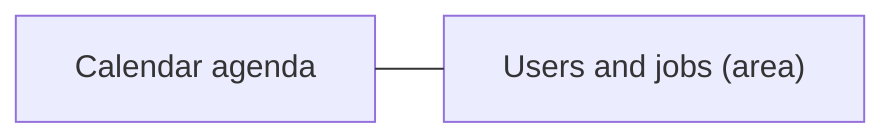
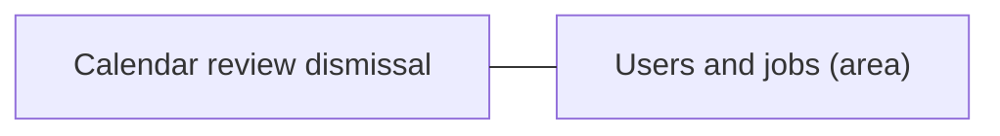
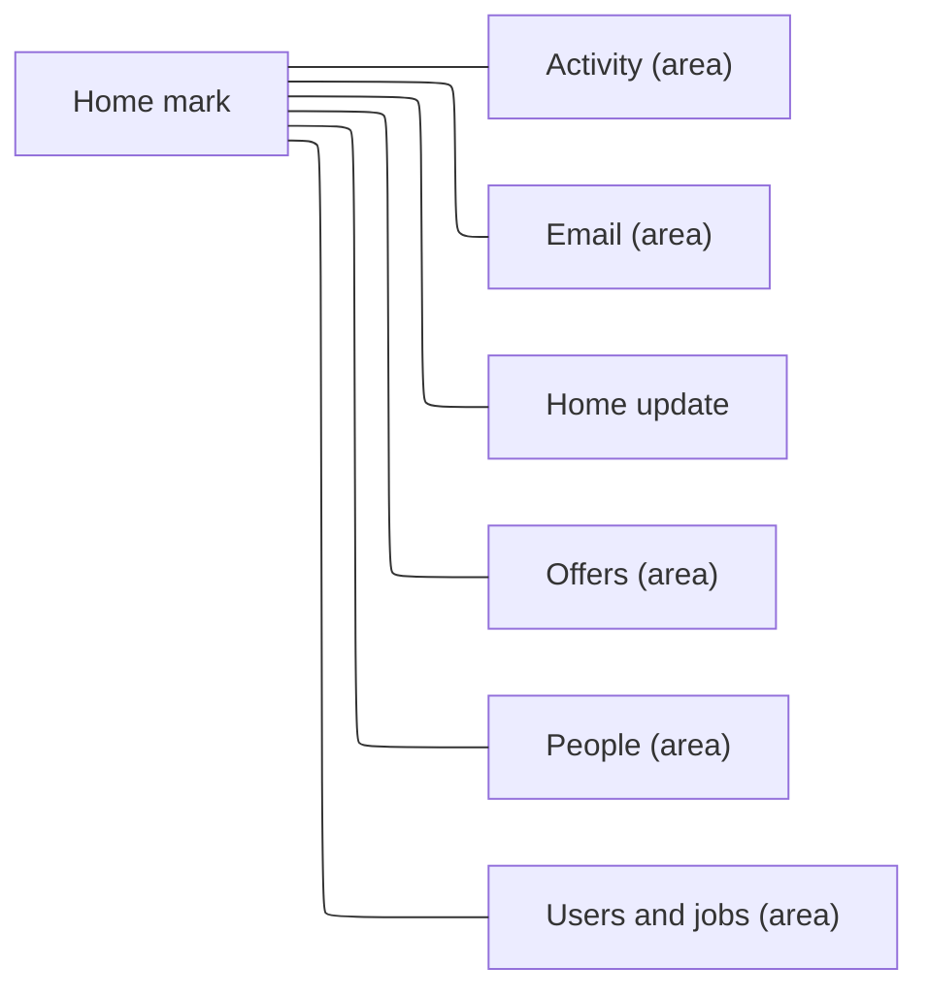
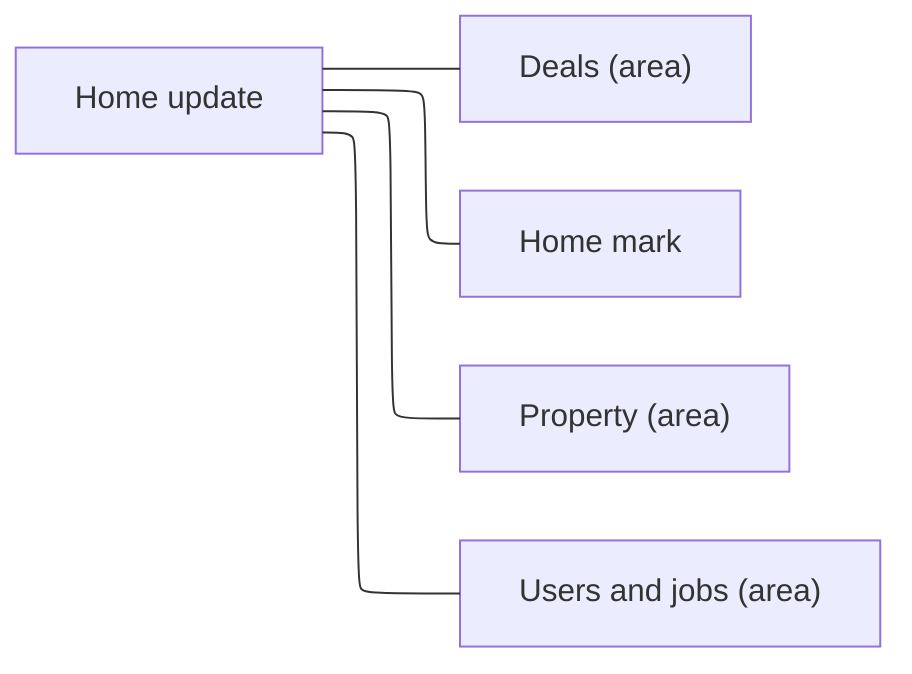
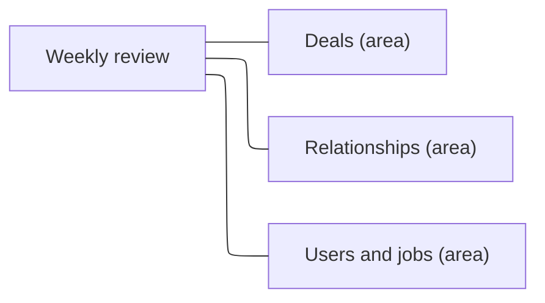

# Home and calendar

Each line shows a connection. The foreign keys below name the exact columns.

### Calendar agenda

### Calendar review dismissal

### Home mark

### Home update

### Weekly review

## Foreign keys

| From table and columns                                                                 | To table and columns                                       |
| -------------------------------------------------------------------------------------- | ---------------------------------------------------------- |
| [calendar_agenda](next.calendar_agenda.md) (`changed_by_user_id`)                      | [app_user](next.app_user.md) (`id`)                        |
| [calendar_agenda](next.calendar_agenda.md) (`changed_for_user_id`)                     | [app_user](next.app_user.md) (`id`)                        |
| [calendar_agenda](next.calendar_agenda.md) (`user_id`)                                 | [app_user](next.app_user.md) (`id`)                        |
| [calendar_agenda](next.calendar_agenda.md) (`changed_by_job`)                          | [job](next.job.md) (`slug`)                                |
| [calendar_review_dismissal](next.calendar_review_dismissal.md) (`changed_by_user_id`)  | [app_user](next.app_user.md) (`id`)                        |
| [calendar_review_dismissal](next.calendar_review_dismissal.md) (`changed_for_user_id`) | [app_user](next.app_user.md) (`id`)                        |
| [calendar_review_dismissal](next.calendar_review_dismissal.md) (`user_id`)             | [app_user](next.app_user.md) (`id`)                        |
| [calendar_review_dismissal](next.calendar_review_dismissal.md) (`changed_by_job`)      | [job](next.job.md) (`slug`)                                |
| [home_mark](next.home_mark.md) (`changed_by_user_id`)                                  | [app_user](next.app_user.md) (`id`)                        |
| [home_mark](next.home_mark.md) (`changed_for_user_id`)                                 | [app_user](next.app_user.md) (`id`)                        |
| [home_mark](next.home_mark.md) (`user_id`)                                             | [app_user](next.app_user.md) (`id`)                        |
| [home_mark](next.home_mark.md) (`home_update_id`, `user_id`)                           | [home_update](next.home_update.md) (`id`, `user_id`)       |
| [home_mark](next.home_mark.md) (`changed_by_job`)                                      | [job](next.job.md) (`slug`)                                |
| [home_mark](next.home_mark.md) (`call_follow_up_id`)                                   | [next_step](next.next_step.md) (`home_call_follow_up_id`)  |
| [home_mark](next.home_mark.md) (`next_step_id`)                                        | [next_step](next.next_step.md) (`home_step_id`)            |
| [home_mark](next.home_mark.md) (`waiting_on_party_id`)                                 | [party](next.party.md) (`id`)                              |
| [home_mark](next.home_mark.md) (`proposal_id`)                                         | [proposal](next.proposal.md) (`id`)                        |
| [home_mark](next.home_mark.md) (`reply_draft_id`, `user_id`)                           | [reply_draft](next.reply_draft.md) (`id`, `owner_user_id`) |
| [home_update](next.home_update.md) (`changed_by_user_id`)                              | [app_user](next.app_user.md) (`id`)                        |
| [home_update](next.home_update.md) (`changed_for_user_id`)                             | [app_user](next.app_user.md) (`id`)                        |
| [home_update](next.home_update.md) (`user_id`)                                         | [app_user](next.app_user.md) (`id`)                        |
| [home_update](next.home_update.md) (`deal_id`)                                         | [deal](next.deal.md) (`id`)                                |
| [home_update](next.home_update.md) (`changed_by_job`)                                  | [job](next.job.md) (`slug`)                                |
| [home_update](next.home_update.md) (`property_id`)                                     | [property](next.property.md) (`id`)                        |
| [weekly_review](next.weekly_review.md) (`changed_by_user_id`)                          | [app_user](next.app_user.md) (`id`)                        |
| [weekly_review](next.weekly_review.md) (`changed_by_user_id`, `reviewer_is_partner`)   | [app_user](next.app_user.md) (`id`, `is_account_partner`)  |
| [weekly_review](next.weekly_review.md) (`changed_for_user_id`)                         | [app_user](next.app_user.md) (`id`)                        |
| [weekly_review](next.weekly_review.md) (`deal_id`)                                     | [deal](next.deal.md) (`id`)                                |
| [weekly_review](next.weekly_review.md) (`changed_by_job`)                              | [job](next.job.md) (`slug`)                                |
| [weekly_review](next.weekly_review.md) (`party_id`, `lead_role`)                       | [party_role](next.party_role.md) (`party_id`, `role`)      |

## Connects to

Numbers count foreign keys between the two areas.

[Activity](viewpoint-activity.md) (2) · [Deals](viewpoint-deals.md) (2) · [Email](viewpoint-email.md) (1) · [Offers](viewpoint-offers.md) (1) · [People](viewpoint-people.md) (1) · [Property](viewpoint-property.md) (1) · [Relationships](viewpoint-relationships.md) (1) · [Users and jobs](viewpoint-users-jobs.md) (20)

## Tables

- [Calendar agenda](next.calendar_agenda.md)
- [Calendar review dismissal](next.calendar_review_dismissal.md)
- [Home mark](next.home_mark.md)
- [Home update](next.home_update.md)
- [Weekly review](next.weekly_review.md)
