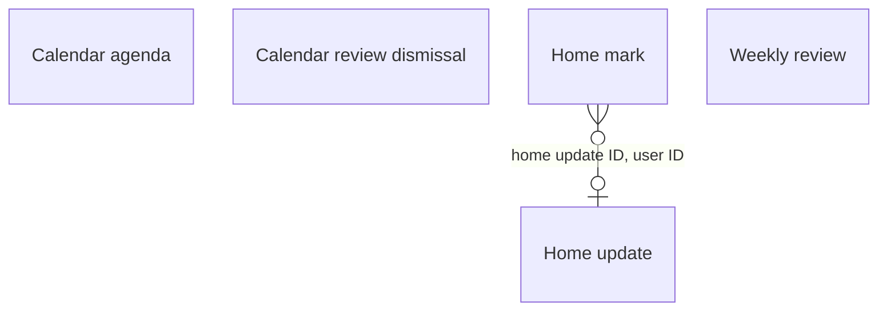

# Home and calendar

## Tables

- [Calendar agenda](next.calendar_agenda.md)
- [Calendar review dismissal](next.calendar_review_dismissal.md)
- [Home mark](next.home_mark.md)
- [Home update](next.home_update.md)
- [Weekly review](next.weekly_review.md)

See each table for its columns and links to other areas.
