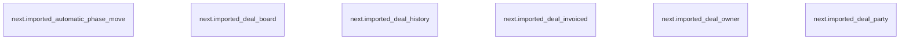

# Imported deals

## Description

Tables in this area and the foreign keys between them.

## Tables

| Name                                                                        | Columns | Comment | Type       |
| --------------------------------------------------------------------------- | ------- | ------- | ---------- |
| [next.imported_automatic_phase_move](next.imported_automatic_phase_move.md) | 5       |         | BASE TABLE |
| [next.imported_deal_board](next.imported_deal_board.md)                     | 11      |         | BASE TABLE |
| [next.imported_deal_history](next.imported_deal_history.md)                 | 26      |         | BASE TABLE |
| [next.imported_deal_invoiced](next.imported_deal_invoiced.md)               | 6       |         | BASE TABLE |
| [next.imported_deal_owner](next.imported_deal_owner.md)                     | 9       |         | BASE TABLE |
| [next.imported_deal_party](next.imported_deal_party.md)                     | 10      |         | BASE TABLE |

## Relations

---

> Generated by [tbls](https://github.com/k1LoW/tbls)
