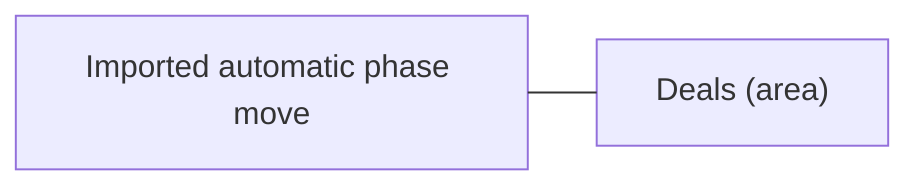
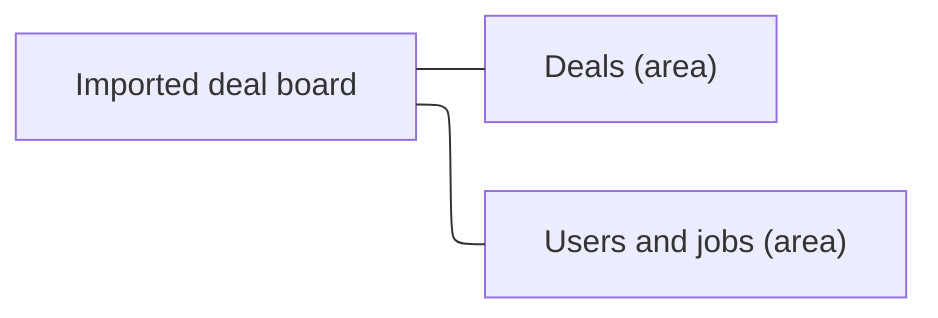
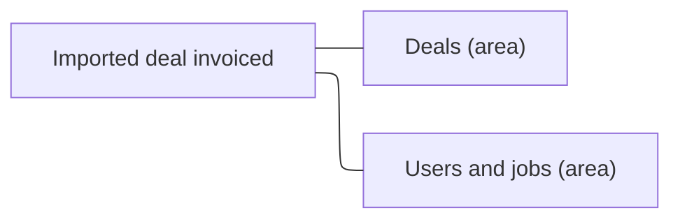
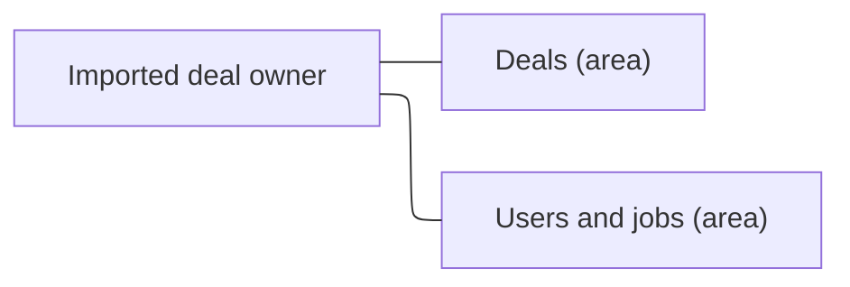
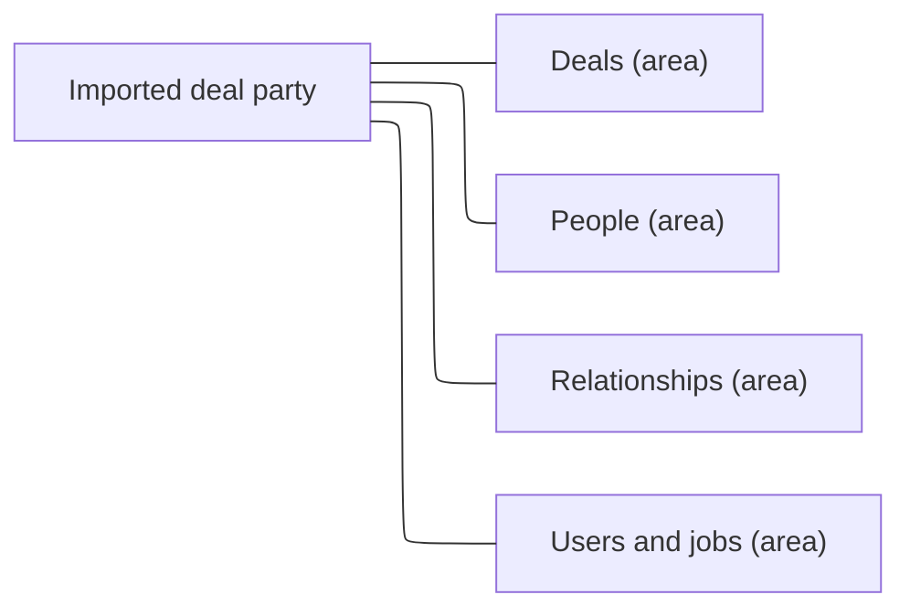

# Imported deals

Each line shows a connection. The foreign keys below name the exact columns.

### Imported automatic phase move

### Imported deal board

### Imported deal history

### Imported deal invoiced

### Imported deal owner

### Imported deal party

## Foreign keys

| From table and columns                                                                            | To table and columns                                                      |
| ------------------------------------------------------------------------------------------------- | ------------------------------------------------------------------------- |
| [imported_automatic_phase_move](next.imported_automatic_phase_move.md) (`deal_id`, `happened_at`) | [deal_phase_change](next.deal_phase_change.md) (`deal_id`, `happened_at`) |
| [imported_automatic_phase_move](next.imported_automatic_phase_move.md) (`prior_phase`)            | [phase](next.phase.md) (`slug`)                                           |
| [imported_deal_board](next.imported_deal_board.md) (`changed_by_user_id`)                         | [app_user](next.app_user.md) (`id`)                                       |
| [imported_deal_board](next.imported_deal_board.md) (`changed_for_user_id`)                        | [app_user](next.app_user.md) (`id`)                                       |
| [imported_deal_board](next.imported_deal_board.md) (`deal_id`)                                    | [deal](next.deal.md) (`id`)                                               |
| [imported_deal_board](next.imported_deal_board.md) (`deal_id`, `phase_at`)                        | [deal_phase_change](next.deal_phase_change.md) (`deal_id`, `happened_at`) |
| [imported_deal_board](next.imported_deal_board.md) (`changed_by_job`)                             | [job](next.job.md) (`slug`)                                               |
| [imported_deal_board](next.imported_deal_board.md) (`phase`)                                      | [phase](next.phase.md) (`slug`)                                           |
| [imported_deal_history](next.imported_deal_history.md) (`changed_by_user_id`)                     | [app_user](next.app_user.md) (`id`)                                       |
| [imported_deal_history](next.imported_deal_history.md) (`deal_id`)                                | [deal](next.deal.md) (`id`)                                               |
| [imported_deal_history](next.imported_deal_history.md) (`changed_by_job`)                         | [job](next.job.md) (`slug`)                                               |
| [imported_deal_invoiced](next.imported_deal_invoiced.md) (`changed_by_user_id`)                   | [app_user](next.app_user.md) (`id`)                                       |
| [imported_deal_invoiced](next.imported_deal_invoiced.md) (`changed_for_user_id`)                  | [app_user](next.app_user.md) (`id`)                                       |
| [imported_deal_invoiced](next.imported_deal_invoiced.md) (`deal_id`)                              | [deal](next.deal.md) (`id`)                                               |
| [imported_deal_invoiced](next.imported_deal_invoiced.md) (`changed_by_job`)                       | [job](next.job.md) (`slug`)                                               |
| [imported_deal_owner](next.imported_deal_owner.md) (`changed_by_user_id`)                         | [app_user](next.app_user.md) (`id`)                                       |
| [imported_deal_owner](next.imported_deal_owner.md) (`changed_for_user_id`)                        | [app_user](next.app_user.md) (`id`)                                       |
| [imported_deal_owner](next.imported_deal_owner.md) (`user_id`)                                    | [app_user](next.app_user.md) (`id`)                                       |
| [imported_deal_owner](next.imported_deal_owner.md) (`deal_id`)                                    | [deal](next.deal.md) (`id`)                                               |
| [imported_deal_owner](next.imported_deal_owner.md) (`changed_by_job`)                             | [job](next.job.md) (`slug`)                                               |
| [imported_deal_party](next.imported_deal_party.md) (`changed_by_user_id`)                         | [app_user](next.app_user.md) (`id`)                                       |
| [imported_deal_party](next.imported_deal_party.md) (`changed_for_user_id`)                        | [app_user](next.app_user.md) (`id`)                                       |
| [imported_deal_party](next.imported_deal_party.md) (`deal_id`)                                    | [deal](next.deal.md) (`id`)                                               |
| [imported_deal_party](next.imported_deal_party.md) (`changed_by_job`)                             | [job](next.job.md) (`slug`)                                               |
| [imported_deal_party](next.imported_deal_party.md) (`party_id`)                                   | [party](next.party.md) (`id`)                                             |
| [imported_deal_party](next.imported_deal_party.md) (`role`)                                       | [role](next.role.md) (`slug`)                                             |

## Connects to

Numbers count foreign keys between the two areas.

[Deals](viewpoint-deals.md) (9) · [People](viewpoint-people.md) (1) · [Relationships](viewpoint-relationships.md) (1) · [Users and jobs](viewpoint-users-jobs.md) (15)

## Tables

- [Imported automatic phase move](next.imported_automatic_phase_move.md)
- [Imported deal board](next.imported_deal_board.md)
- [Imported deal history](next.imported_deal_history.md)
- [Imported deal invoiced](next.imported_deal_invoiced.md)
- [Imported deal owner](next.imported_deal_owner.md)
- [Imported deal party](next.imported_deal_party.md)
