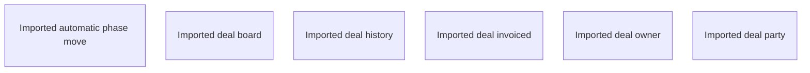

# Imported deals

## Tables

- [Imported automatic phase move](next.imported_automatic_phase_move.md)
- [Imported deal board](next.imported_deal_board.md)
- [Imported deal history](next.imported_deal_history.md)
- [Imported deal invoiced](next.imported_deal_invoiced.md)
- [Imported deal owner](next.imported_deal_owner.md)
- [Imported deal party](next.imported_deal_party.md)

See each table for its columns and links to other areas.
