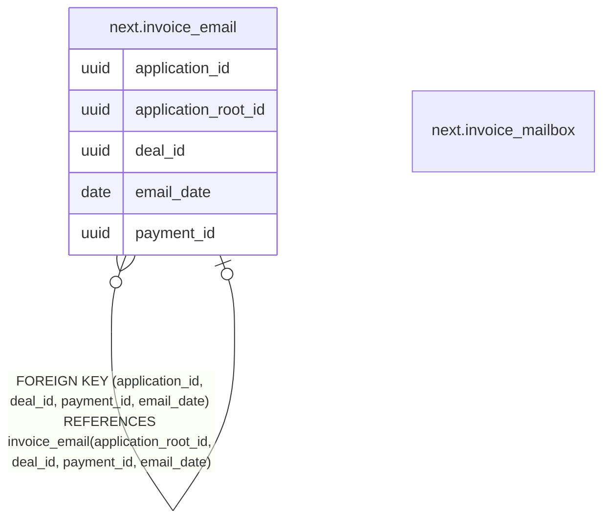

# Invoices

## Description

Tables in this area and the foreign keys between them.

## Tables

| Name                                            | Columns | Comment | Type       |
| ----------------------------------------------- | ------- | ------- | ---------- |
| [next.invoice_email](next.invoice_email.md)     | 22      |         | BASE TABLE |
| [next.invoice_mailbox](next.invoice_mailbox.md) | 5       |         | BASE TABLE |

## Relations

---

> Generated by [tbls](https://github.com/k1LoW/tbls)
