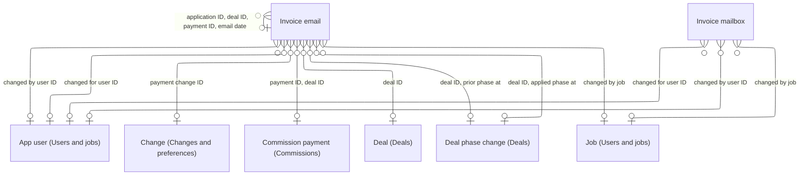

# Invoices

## Connects to

Numbers count foreign keys between the two areas.

[Changes and preferences](viewpoint-changes-preferences.md) (1) · [Commissions](viewpoint-commissions.md) (1) · [Deals](viewpoint-deals.md) (3) · [Users and jobs](viewpoint-users-jobs.md) (6)

## Tables

- [Invoice email](next.invoice_email.md)
- [Invoice mailbox](next.invoice_mailbox.md)

See each table for its columns and links to other areas.
