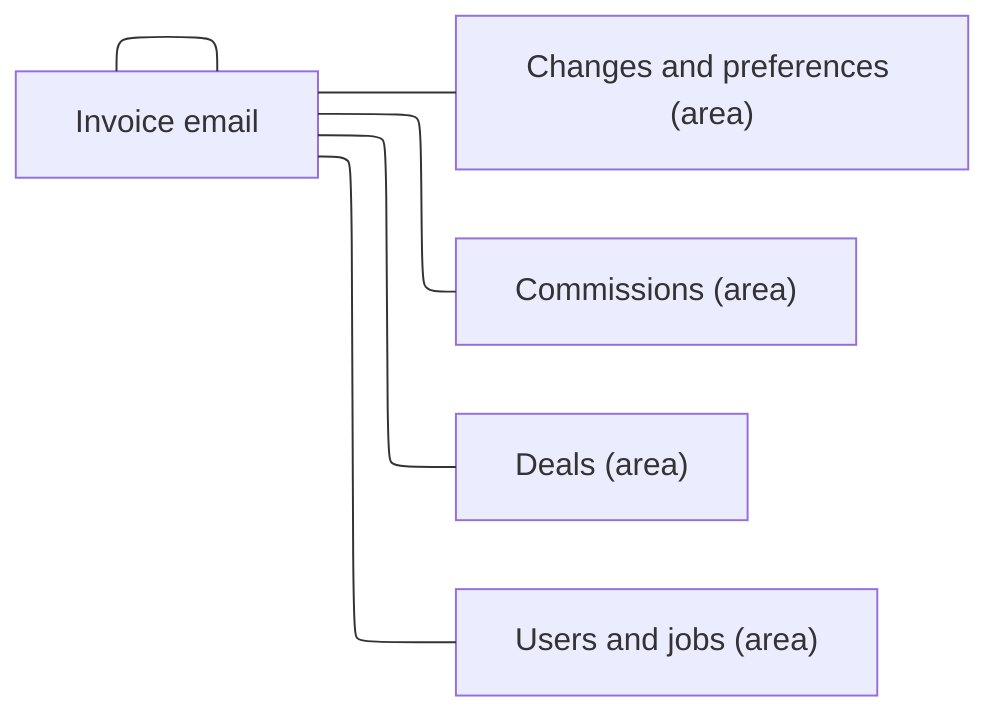

# Invoices

Each line shows a connection. The foreign keys below name the exact columns.

### Invoice email

### Invoice mailbox

## Foreign keys

| From table and columns                                                                           | To table and columns                                                                                  |
| ------------------------------------------------------------------------------------------------ | ----------------------------------------------------------------------------------------------------- |
| [invoice_email](next.invoice_email.md) (`changed_by_user_id`)                                    | [app_user](next.app_user.md) (`id`)                                                                   |
| [invoice_email](next.invoice_email.md) (`changed_for_user_id`)                                   | [app_user](next.app_user.md) (`id`)                                                                   |
| [invoice_email](next.invoice_email.md) (`payment_change_id`)                                     | [change](next.change.md) (`id`)                                                                       |
| [invoice_email](next.invoice_email.md) (`payment_id`, `deal_id`)                                 | [commission_payment](next.commission_payment.md) (`id`, `deal_id`)                                    |
| [invoice_email](next.invoice_email.md) (`deal_id`)                                               | [deal](next.deal.md) (`id`)                                                                           |
| [invoice_email](next.invoice_email.md) (`deal_id`, `applied_phase_at`)                           | [deal_phase_change](next.deal_phase_change.md) (`deal_id`, `happened_at`)                             |
| [invoice_email](next.invoice_email.md) (`deal_id`, `prior_phase_at`)                             | [deal_phase_change](next.deal_phase_change.md) (`deal_id`, `happened_at`)                             |
| [invoice_email](next.invoice_email.md) (`application_id`, `deal_id`, `payment_id`, `email_date`) | [invoice_email](next.invoice_email.md) (`application_root_id`, `deal_id`, `payment_id`, `email_date`) |
| [invoice_email](next.invoice_email.md) (`changed_by_job`)                                        | [job](next.job.md) (`slug`)                                                                           |
| [invoice_mailbox](next.invoice_mailbox.md) (`changed_by_user_id`)                                | [app_user](next.app_user.md) (`id`)                                                                   |
| [invoice_mailbox](next.invoice_mailbox.md) (`changed_for_user_id`)                               | [app_user](next.app_user.md) (`id`)                                                                   |
| [invoice_mailbox](next.invoice_mailbox.md) (`changed_by_job`)                                    | [job](next.job.md) (`slug`)                                                                           |

## Connects to

Numbers count foreign keys between the two areas.

[Changes and preferences](viewpoint-changes-preferences.md) (1) · [Commissions](viewpoint-commissions.md) (1) · [Deals](viewpoint-deals.md) (3) · [Users and jobs](viewpoint-users-jobs.md) (6)

## Tables

- [Invoice email](next.invoice_email.md)
- [Invoice mailbox](next.invoice_mailbox.md)
