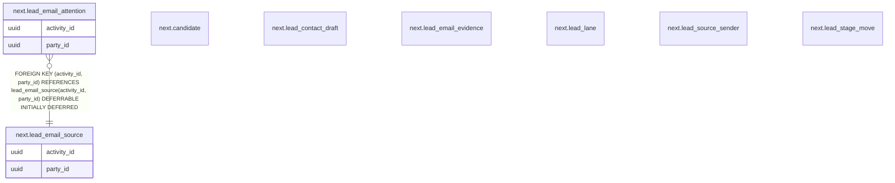

# Leads

## Description

Tables in this area and the foreign keys between them.

## Tables

| Name                                                      | Columns | Comment | Type       |
| --------------------------------------------------------- | ------- | ------- | ---------- |
| [next.candidate](next.candidate.md)                       | 17      |         | BASE TABLE |
| [next.lead_contact_draft](next.lead_contact_draft.md)     | 17      |         | BASE TABLE |
| [next.lead_email_attention](next.lead_email_attention.md) | 6       |         | BASE TABLE |
| [next.lead_email_evidence](next.lead_email_evidence.md)   | 5       |         | BASE TABLE |
| [next.lead_email_source](next.lead_email_source.md)       | 6       |         | BASE TABLE |
| [next.lead_lane](next.lead_lane.md)                       | 6       |         | BASE TABLE |
| [next.lead_source_sender](next.lead_source_sender.md)     | 6       |         | BASE TABLE |
| [next.lead_stage_move](next.lead_stage_move.md)           | 13      |         | BASE TABLE |

## Relations

---

> Generated by [tbls](https://github.com/k1LoW/tbls)
