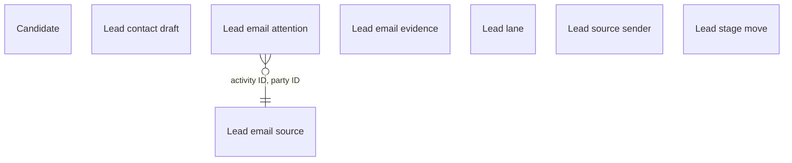

# Leads

## Tables

- [Candidate](next.candidate.md)
- [Lead contact draft](next.lead_contact_draft.md)
- [Lead email attention](next.lead_email_attention.md)
- [Lead email evidence](next.lead_email_evidence.md)
- [Lead email source](next.lead_email_source.md)
- [Lead lane](next.lead_lane.md)
- [Lead source sender](next.lead_source_sender.md)
- [Lead stage move](next.lead_stage_move.md)

See each table for its columns and links to other areas.
