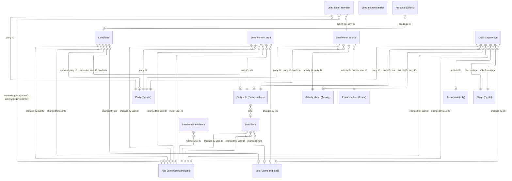

# Leads

## Connects to

Numbers count foreign keys between the two areas.

[Activity](viewpoint-activity.md) (3) · [Deals](viewpoint-deals.md) (2) · [Email](viewpoint-email.md) (1) · [Offers](viewpoint-offers.md) (1) · [People](viewpoint-people.md) (5) · [Relationships](viewpoint-relationships.md) (5) · [Users and jobs](viewpoint-users-jobs.md) (15)

## Tables

- [Candidate](next.candidate.md)
- [Lead contact draft](next.lead_contact_draft.md)
- [Lead email attention](next.lead_email_attention.md)
- [Lead email evidence](next.lead_email_evidence.md)
- [Lead email source](next.lead_email_source.md)
- [Lead lane](next.lead_lane.md)
- [Lead source sender](next.lead_source_sender.md)
- [Lead stage move](next.lead_stage_move.md)

See each table for its columns and links to other areas.

Lead source sender is standalone intake configuration.
