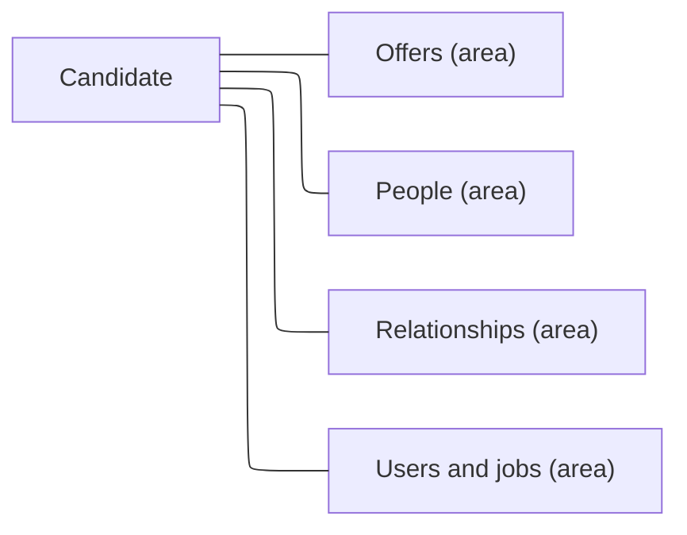
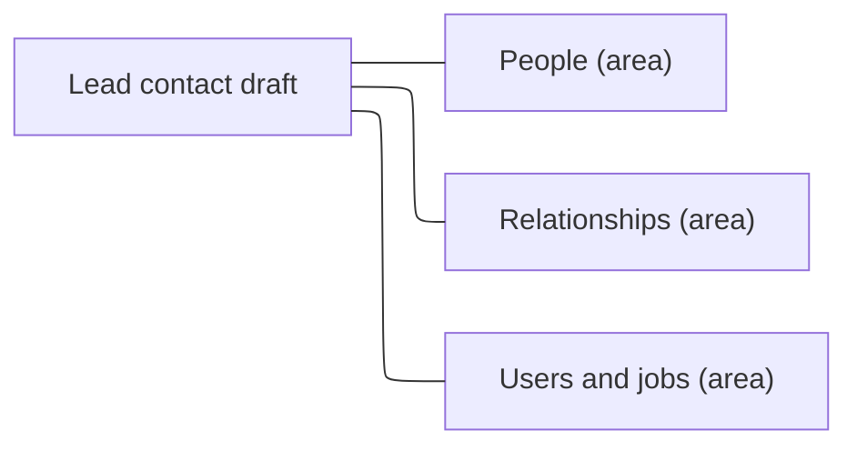
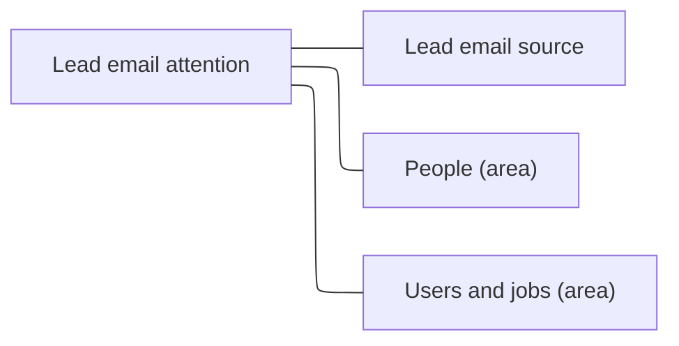
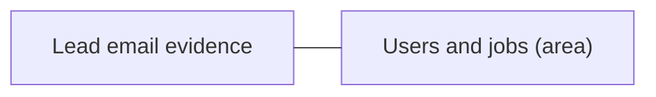
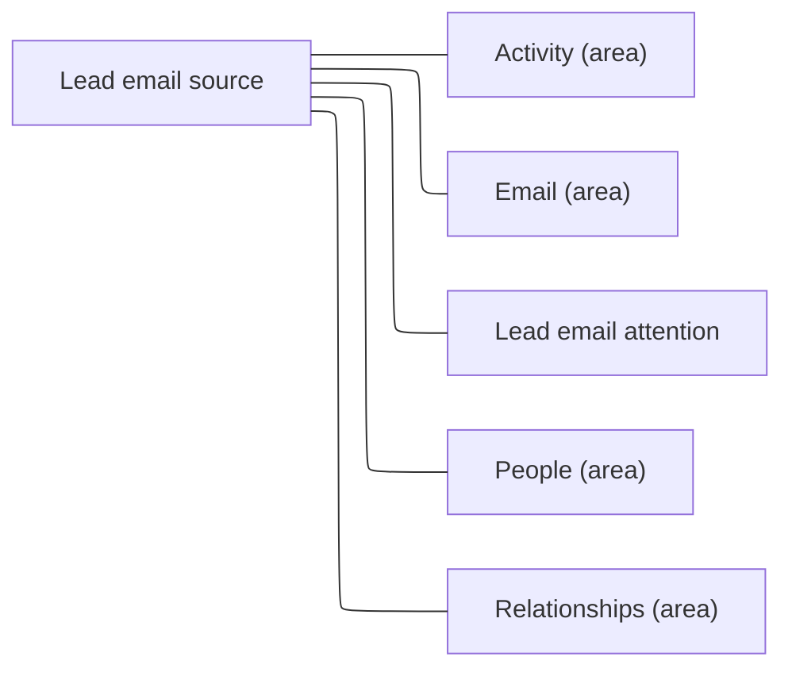
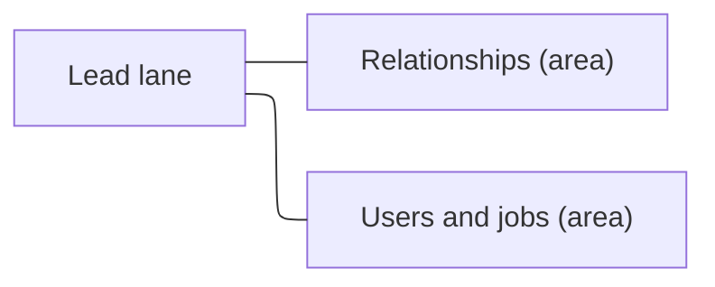
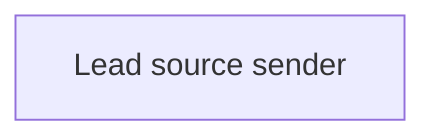
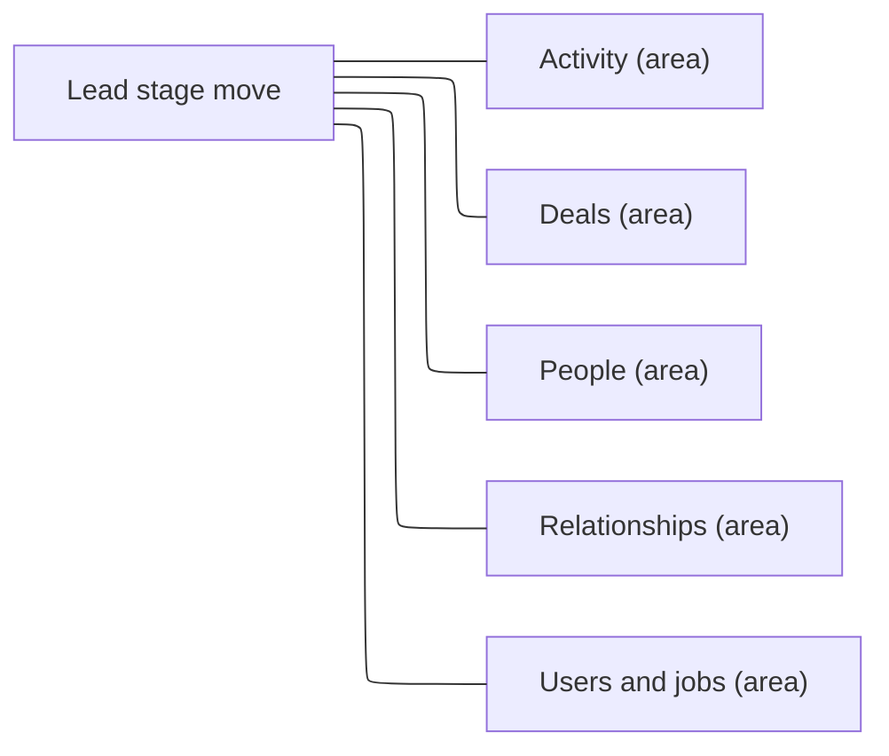

# Leads

Each line shows a connection. The foreign keys below name the exact columns.

### Candidate

### Lead contact draft

### Lead email attention

### Lead email evidence

### Lead email source

### Lead lane

### Lead source sender

### Lead stage move

## Foreign keys

| From table and columns                                                                                      | To table and columns                                                       |
| ----------------------------------------------------------------------------------------------------------- | -------------------------------------------------------------------------- |
| [candidate](next.candidate.md) (`changed_by_user_id`)                                                       | [app_user](next.app_user.md) (`id`)                                        |
| [candidate](next.candidate.md) (`changed_for_user_id`)                                                      | [app_user](next.app_user.md) (`id`)                                        |
| [candidate](next.candidate.md) (`changed_by_job`)                                                           | [job](next.job.md) (`slug`)                                                |
| [candidate](next.candidate.md) (`promoted_party_id`)                                                        | [party](next.party.md) (`id`)                                              |
| [candidate](next.candidate.md) (`promoted_party_id`, `lead_role`)                                           | [party_role](next.party_role.md) (`party_id`, `role`)                      |
| [lead_contact_draft](next.lead_contact_draft.md) (`changed_by_user_id`)                                     | [app_user](next.app_user.md) (`id`)                                        |
| [lead_contact_draft](next.lead_contact_draft.md) (`changed_for_user_id`)                                    | [app_user](next.app_user.md) (`id`)                                        |
| [lead_contact_draft](next.lead_contact_draft.md) (`owner_user_id`)                                          | [app_user](next.app_user.md) (`id`)                                        |
| [lead_contact_draft](next.lead_contact_draft.md) (`changed_by_job`)                                         | [job](next.job.md) (`slug`)                                                |
| [lead_contact_draft](next.lead_contact_draft.md) (`party_id`)                                               | [party](next.party.md) (`id`)                                              |
| [lead_contact_draft](next.lead_contact_draft.md) (`party_id`, `role`)                                       | [party_role](next.party_role.md) (`party_id`, `role`)                      |
| [lead_email_attention](next.lead_email_attention.md) (`acknowledged_by_user_id`, `acknowledger_is_partner`) | [app_user](next.app_user.md) (`id`, `is_account_partner`)                  |
| [lead_email_attention](next.lead_email_attention.md) (`activity_id`, `party_id`)                            | [lead_email_source](next.lead_email_source.md) (`activity_id`, `party_id`) |
| [lead_email_attention](next.lead_email_attention.md) (`party_id`)                                           | [party](next.party.md) (`id`)                                              |
| [lead_email_evidence](next.lead_email_evidence.md) (`mailbox_user_id`)                                      | [app_user](next.app_user.md) (`id`)                                        |
| [lead_email_source](next.lead_email_source.md) (`activity_id`, `party_id`)                                  | [activity_about](next.activity_about.md) (`activity_id`, `party_id`)       |
| [lead_email_source](next.lead_email_source.md) (`activity_id`, `mailbox_user_id`)                           | [email_mailbox](next.email_mailbox.md) (`activity_id`, `user_id`)          |
| [lead_email_source](next.lead_email_source.md) (`party_id`)                                                 | [party](next.party.md) (`id`)                                              |
| [lead_email_source](next.lead_email_source.md) (`party_id`, `lead_role`)                                    | [party_role](next.party_role.md) (`party_id`, `role`)                      |
| [lead_lane](next.lead_lane.md) (`changed_by_user_id`)                                                       | [app_user](next.app_user.md) (`id`)                                        |
| [lead_lane](next.lead_lane.md) (`changed_for_user_id`)                                                      | [app_user](next.app_user.md) (`id`)                                        |
| [lead_lane](next.lead_lane.md) (`changed_by_job`)                                                           | [job](next.job.md) (`slug`)                                                |
| [lead_stage_move](next.lead_stage_move.md) (`activity_id`)                                                  | [activity](next.activity.md) (`id`)                                        |
| [lead_stage_move](next.lead_stage_move.md) (`activity_id`, `party_id`)                                      | [activity_about](next.activity_about.md) (`activity_id`, `party_id`)       |
| [lead_stage_move](next.lead_stage_move.md) (`changed_by_user_id`)                                           | [app_user](next.app_user.md) (`id`)                                        |
| [lead_stage_move](next.lead_stage_move.md) (`changed_for_user_id`)                                          | [app_user](next.app_user.md) (`id`)                                        |
| [lead_stage_move](next.lead_stage_move.md) (`changed_by_job`)                                               | [job](next.job.md) (`slug`)                                                |
| [lead_stage_move](next.lead_stage_move.md) (`party_id`)                                                     | [party](next.party.md) (`id`)                                              |
| [lead_stage_move](next.lead_stage_move.md) (`party_id`, `role`)                                             | [party_role](next.party_role.md) (`party_id`, `role`)                      |
| [lead_stage_move](next.lead_stage_move.md) (`role`, `from_stage`)                                           | [stage](next.stage.md) (`role`, `slug`)                                    |
| [lead_stage_move](next.lead_stage_move.md) (`role`, `to_stage`)                                             | [stage](next.stage.md) (`role`, `slug`)                                    |
| [party_role](next.party_role.md) (`lane`)                                                                   | [lead_lane](next.lead_lane.md) (`slug`)                                    |
| [proposal](next.proposal.md) (`candidate_id`)                                                               | [candidate](next.candidate.md) (`id`)                                      |

## Connects to

Numbers count foreign keys between the two areas.

[Activity](viewpoint-activity.md) (3) · [Deals](viewpoint-deals.md) (2) · [Email](viewpoint-email.md) (1) · [Offers](viewpoint-offers.md) (1) · [People](viewpoint-people.md) (5) · [Relationships](viewpoint-relationships.md) (5) · [Users and jobs](viewpoint-users-jobs.md) (15)

## Tables

- [Candidate](next.candidate.md)
- [Lead contact draft](next.lead_contact_draft.md)
- [Lead email attention](next.lead_email_attention.md)
- [Lead email evidence](next.lead_email_evidence.md)
- [Lead email source](next.lead_email_source.md)
- [Lead lane](next.lead_lane.md)
- [Lead source sender](next.lead_source_sender.md)
- [Lead stage move](next.lead_stage_move.md)

Lead source sender is standalone intake configuration.
