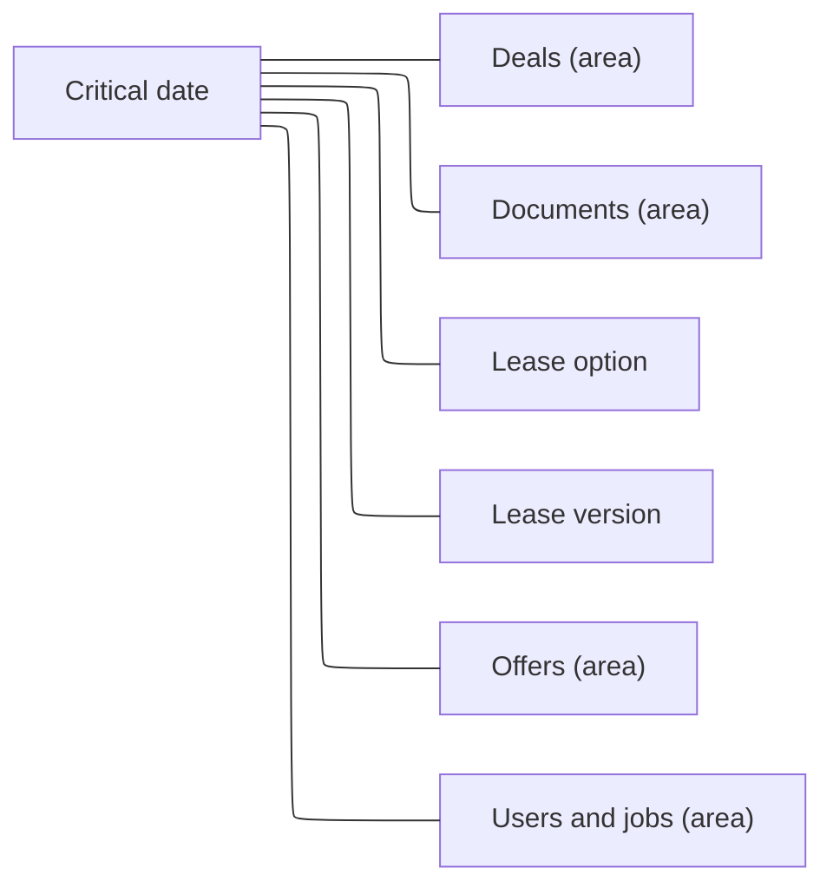
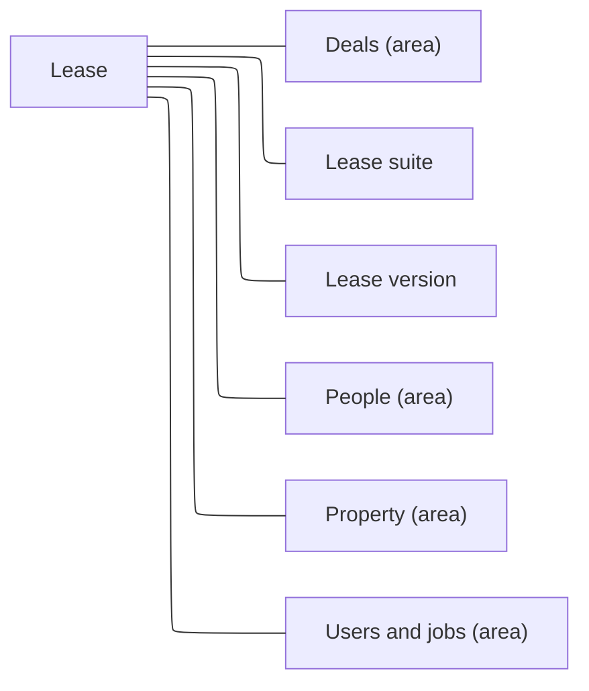
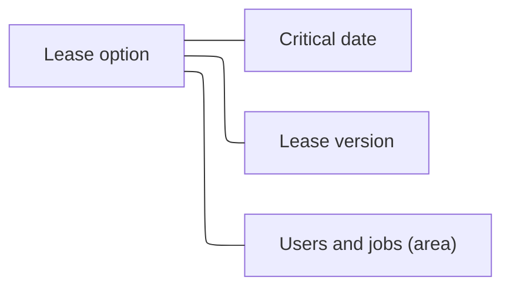
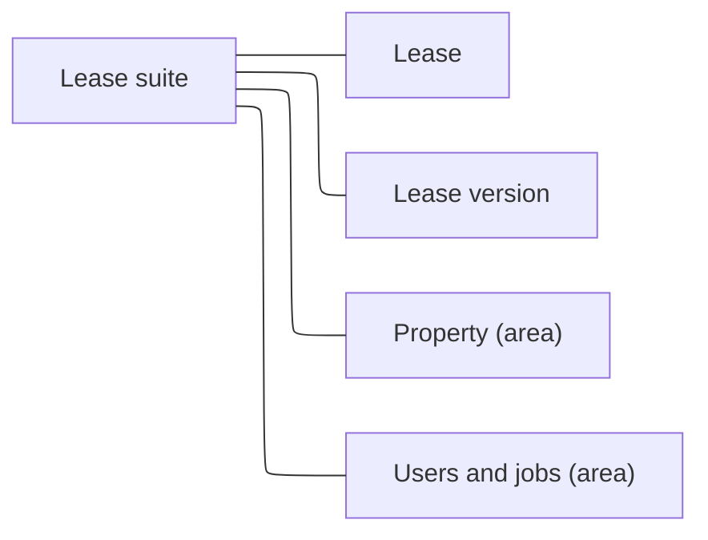
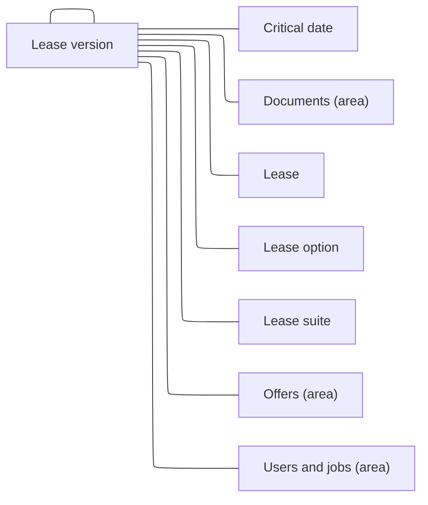

# Leases

Each line shows a connection. The foreign keys below name the exact columns.

### Critical date

### Lease

### Lease option

### Lease suite

### Lease version

## Foreign keys

| From table and columns                                                       | To table and columns                                                |
| ---------------------------------------------------------------------------- | ------------------------------------------------------------------- |
| [critical_date](next.critical_date.md) (`changed_by_user_id`)                | [app_user](next.app_user.md) (`id`)                                 |
| [critical_date](next.critical_date.md) (`changed_for_user_id`)               | [app_user](next.app_user.md) (`id`)                                 |
| [critical_date](next.critical_date.md) (`confirmed_by_user_id`)              | [app_user](next.app_user.md) (`id`)                                 |
| [critical_date](next.critical_date.md) (`resolved_by_user_id`)               | [app_user](next.app_user.md) (`id`)                                 |
| [critical_date](next.critical_date.md) (`deal_id`)                           | [deal](next.deal.md) (`id`)                                         |
| [critical_date](next.critical_date.md) (`document_id`)                       | [document](next.document.md) (`id`)                                 |
| [critical_date](next.critical_date.md) (`changed_by_job`)                    | [job](next.job.md) (`slug`)                                         |
| [critical_date](next.critical_date.md) (`lease_version_id`, `option_number`) | [lease_option](next.lease_option.md) (`lease_version_id`, `number`) |
| [critical_date](next.critical_date.md) (`lease_version_id`)                  | [lease_version](next.lease_version.md) (`id`)                       |
| [critical_date](next.critical_date.md) (`offer_id`, `deal_id`)               | [offer](next.offer.md) (`id`, `deal_id`)                            |
| [deal](next.deal.md) (`renews_lease_id`)                                     | [lease](next.lease.md) (`id`)                                       |
| [lease](next.lease.md) (`changed_by_user_id`)                                | [app_user](next.app_user.md) (`id`)                                 |
| [lease](next.lease.md) (`changed_for_user_id`)                               | [app_user](next.app_user.md) (`id`)                                 |
| [lease](next.lease.md) (`deal_id`)                                           | [deal](next.deal.md) (`id`)                                         |
| [lease](next.lease.md) (`deal_id`, `party_id`, `client_role`)                | [deal_party](next.deal_party.md) (`deal_id`, `party_id`, `role`)    |
| [lease](next.lease.md) (`deal_id`, `property_id`)                            | [deal_property](next.deal_property.md) (`deal_id`, `property_id`)   |
| [lease](next.lease.md) (`changed_by_job`)                                    | [job](next.job.md) (`slug`)                                         |
| [lease](next.lease.md) (`party_id`)                                          | [party](next.party.md) (`id`)                                       |
| [lease](next.lease.md) (`property_id`)                                       | [property](next.property.md) (`id`)                                 |
| [lease_option](next.lease_option.md) (`changed_by_user_id`)                  | [app_user](next.app_user.md) (`id`)                                 |
| [lease_option](next.lease_option.md) (`changed_for_user_id`)                 | [app_user](next.app_user.md) (`id`)                                 |
| [lease_option](next.lease_option.md) (`changed_by_job`)                      | [job](next.job.md) (`slug`)                                         |
| [lease_option](next.lease_option.md) (`lease_version_id`)                    | [lease_version](next.lease_version.md) (`id`)                       |
| [lease_suite](next.lease_suite.md) (`changed_by_user_id`)                    | [app_user](next.app_user.md) (`id`)                                 |
| [lease_suite](next.lease_suite.md) (`changed_for_user_id`)                   | [app_user](next.app_user.md) (`id`)                                 |
| [lease_suite](next.lease_suite.md) (`changed_by_job`)                        | [job](next.job.md) (`slug`)                                         |
| [lease_suite](next.lease_suite.md) (`lease_id`, `property_id`)               | [lease](next.lease.md) (`id`, `property_id`)                        |
| [lease_suite](next.lease_suite.md) (`lease_version_id`, `lease_id`)          | [lease_version](next.lease_version.md) (`id`, `lease_id`)           |
| [lease_suite](next.lease_suite.md) (`suite_id`, `property_id`)               | [suite](next.suite.md) (`id`, `property_id`)                        |
| [lease_version](next.lease_version.md) (`changed_by_user_id`)                | [app_user](next.app_user.md) (`id`)                                 |
| [lease_version](next.lease_version.md) (`changed_for_user_id`)               | [app_user](next.app_user.md) (`id`)                                 |
| [lease_version](next.lease_version.md) (`document_id`)                       | [document](next.document.md) (`id`)                                 |
| [lease_version](next.lease_version.md) (`changed_by_job`)                    | [job](next.job.md) (`slug`)                                         |
| [lease_version](next.lease_version.md) (`lease_id`)                          | [lease](next.lease.md) (`id`)                                       |
| [lease_version](next.lease_version.md) (`lease_id`, `previous_version`)      | [lease_version](next.lease_version.md) (`lease_id`, `version`)      |
| [lease_version](next.lease_version.md) (`offer_id`)                          | [offer](next.offer.md) (`id`)                                       |

## Connects to

Numbers count foreign keys between the two areas.

[Deals](viewpoint-deals.md) (4) · [Documents](viewpoint-documents.md) (2) · [Offers](viewpoint-offers.md) (2) · [People](viewpoint-people.md) (1) · [Property](viewpoint-property.md) (3) · [Users and jobs](viewpoint-users-jobs.md) (17)

## Tables

- [Critical date](next.critical_date.md)
- [Lease](next.lease.md)
- [Lease option](next.lease_option.md)
- [Lease suite](next.lease_suite.md)
- [Lease version](next.lease_version.md)
