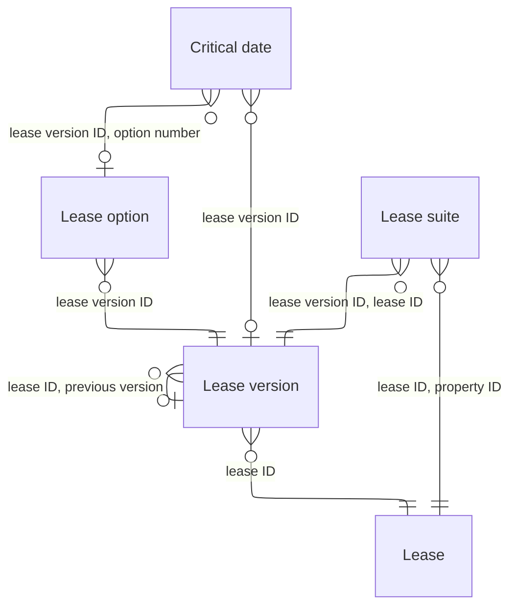

# Leases

## Tables

- [Critical date](next.critical_date.md)
- [Lease](next.lease.md)
- [Lease option](next.lease_option.md)
- [Lease suite](next.lease_suite.md)
- [Lease version](next.lease_version.md)

See each table for its columns and links to other areas.
