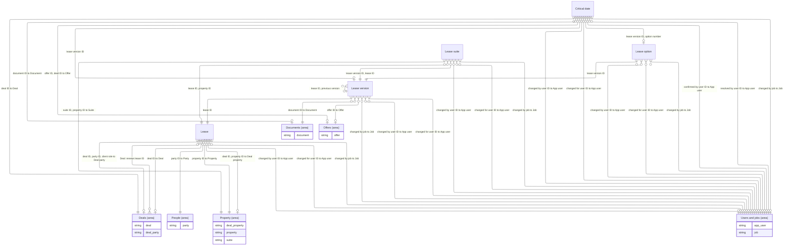

# Leases

## Connects to

Numbers count foreign keys between the two areas.

[Deals](viewpoint-deals.md) (4) · [Documents](viewpoint-documents.md) (2) · [Offers](viewpoint-offers.md) (2) · [People](viewpoint-people.md) (1) · [Property](viewpoint-property.md) (3) · [Users and jobs](viewpoint-users-jobs.md) (17)

## Tables

- [Critical date](next.critical_date.md)
- [Lease](next.lease.md)
- [Lease option](next.lease_option.md)
- [Lease suite](next.lease_suite.md)
- [Lease version](next.lease_version.md)

See each table for its columns and links to other areas.
