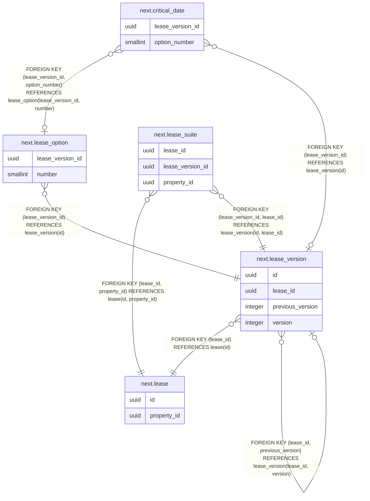

# Leases

## Description

Tables in this area and the foreign keys between them.

## Tables

| Name                                        | Columns | Comment | Type       |
| ------------------------------------------- | ------- | ------- | ---------- |
| [next.critical_date](next.critical_date.md) | 21      |         | BASE TABLE |
| [next.lease](next.lease.md)                 | 10      |         | BASE TABLE |
| [next.lease_option](next.lease_option.md)   | 10      |         | BASE TABLE |
| [next.lease_suite](next.lease_suite.md)     | 9       |         | BASE TABLE |
| [next.lease_version](next.lease_version.md) | 24      |         | BASE TABLE |

## Relations

---

> Generated by [tbls](https://github.com/k1LoW/tbls)
