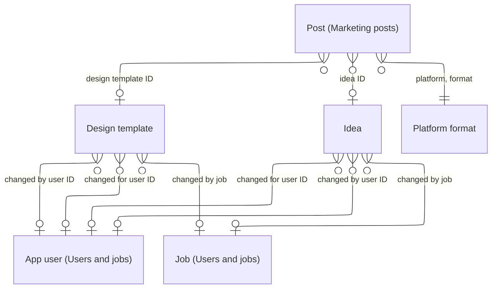

# Marketing categories

## Connects to

Numbers count foreign keys between the two areas.

[Marketing posts](viewpoint-marketing-posts.md) (3) · [Users and jobs](viewpoint-users-jobs.md) (6)

## Tables

- [Design template](next.design_template.md)
- [Idea](next.idea.md)
- [Platform format](next.platform_format.md)

See each table for its columns and links to other areas.
