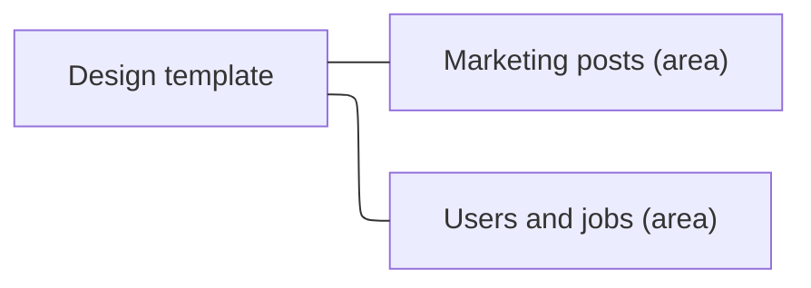
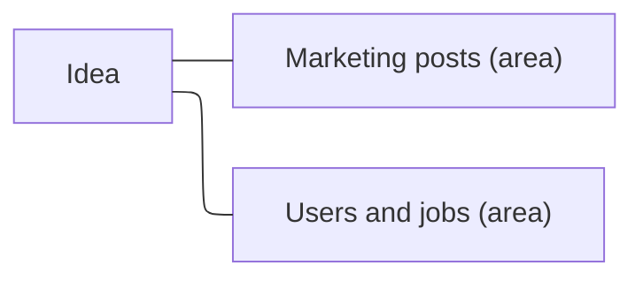
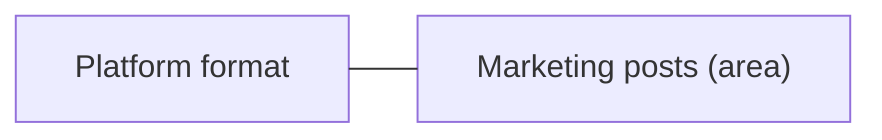

# Marketing categories

Each line shows a connection. The foreign keys below name the exact columns.

### Design template

### Idea

### Platform format

## Foreign keys

| From table and columns                                             | To table and columns                                              |
| ------------------------------------------------------------------ | ----------------------------------------------------------------- |
| [design_template](next.design_template.md) (`changed_by_user_id`)  | [app_user](next.app_user.md) (`id`)                               |
| [design_template](next.design_template.md) (`changed_for_user_id`) | [app_user](next.app_user.md) (`id`)                               |
| [design_template](next.design_template.md) (`changed_by_job`)      | [job](next.job.md) (`slug`)                                       |
| [idea](next.idea.md) (`changed_by_user_id`)                        | [app_user](next.app_user.md) (`id`)                               |
| [idea](next.idea.md) (`changed_for_user_id`)                       | [app_user](next.app_user.md) (`id`)                               |
| [idea](next.idea.md) (`changed_by_job`)                            | [job](next.job.md) (`slug`)                                       |
| [post](next.post.md) (`design_template_id`)                        | [design_template](next.design_template.md) (`id`)                 |
| [post](next.post.md) (`idea_id`)                                   | [idea](next.idea.md) (`id`)                                       |
| [post](next.post.md) (`platform`, `format`)                        | [platform_format](next.platform_format.md) (`platform`, `format`) |

## Connects to

Numbers count foreign keys between the two areas.

[Marketing posts](viewpoint-marketing-posts.md) (3) · [Users and jobs](viewpoint-users-jobs.md) (6)

## Tables

- [Design template](next.design_template.md)
- [Idea](next.idea.md)
- [Platform format](next.platform_format.md)
