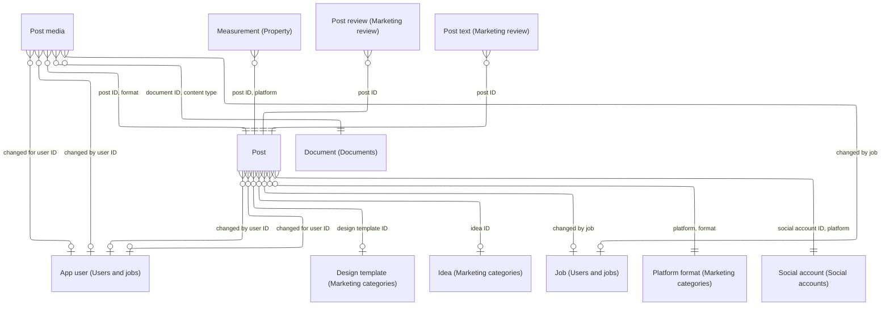

# Marketing posts

## Connects to

Numbers count foreign keys between the two areas.

[Documents](viewpoint-documents.md) (1) · [Marketing categories](viewpoint-marketing-categories.md) (3) · [Marketing review](viewpoint-marketing-review.md) (2) · [Property](viewpoint-property.md) (1) · [Social accounts](viewpoint-social-accounts.md) (1) · [Users and jobs](viewpoint-users-jobs.md) (6)

## Tables

- [Post](next.post.md)
- [Post media](next.post_media.md)

See each table for its columns and links to other areas.
