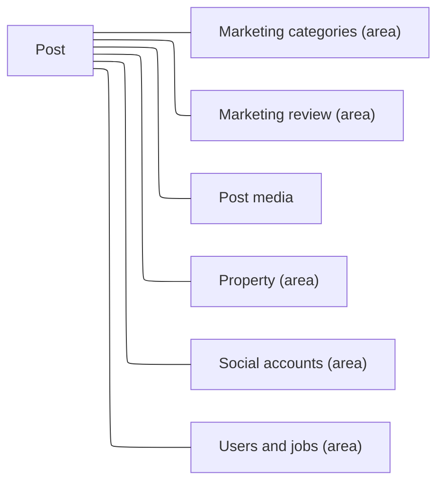
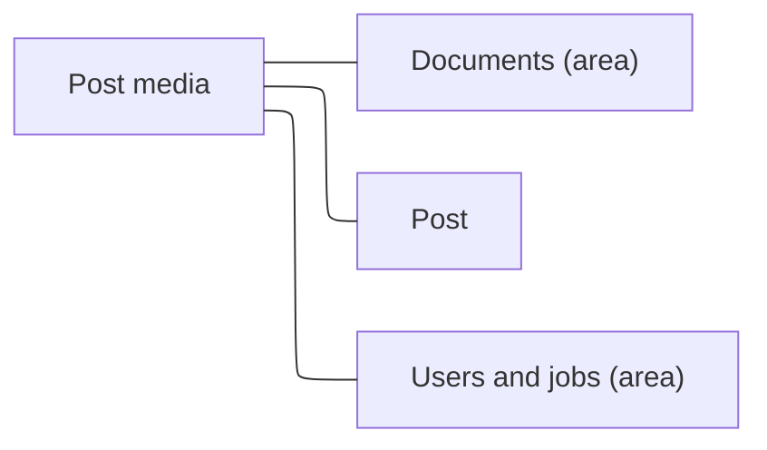

# Marketing posts

Each line shows a connection. The foreign keys below name the exact columns.

### Post

### Post media

## Foreign keys

| From table and columns                                           | To table and columns                                              |
| ---------------------------------------------------------------- | ----------------------------------------------------------------- |
| [measurement](next.measurement.md) (`post_id`, `platform`)       | [post](next.post.md) (`id`, `platform`)                           |
| [post](next.post.md) (`changed_by_user_id`)                      | [app_user](next.app_user.md) (`id`)                               |
| [post](next.post.md) (`changed_for_user_id`)                     | [app_user](next.app_user.md) (`id`)                               |
| [post](next.post.md) (`design_template_id`)                      | [design_template](next.design_template.md) (`id`)                 |
| [post](next.post.md) (`idea_id`)                                 | [idea](next.idea.md) (`id`)                                       |
| [post](next.post.md) (`changed_by_job`)                          | [job](next.job.md) (`slug`)                                       |
| [post](next.post.md) (`platform`, `format`)                      | [platform_format](next.platform_format.md) (`platform`, `format`) |
| [post](next.post.md) (`social_account_id`, `platform`)           | [social_account](next.social_account.md) (`id`, `platform`)       |
| [post_media](next.post_media.md) (`changed_by_user_id`)          | [app_user](next.app_user.md) (`id`)                               |
| [post_media](next.post_media.md) (`changed_for_user_id`)         | [app_user](next.app_user.md) (`id`)                               |
| [post_media](next.post_media.md) (`document_id`, `content_type`) | [document](next.document.md) (`id`, `content_type`)               |
| [post_media](next.post_media.md) (`changed_by_job`)              | [job](next.job.md) (`slug`)                                       |
| [post_media](next.post_media.md) (`post_id`, `format`)           | [post](next.post.md) (`id`, `format`)                             |
| [post_review](next.post_review.md) (`post_id`)                   | [post](next.post.md) (`id`)                                       |
| [post_text](next.post_text.md) (`post_id`)                       | [post](next.post.md) (`id`)                                       |

## Connects to

Numbers count foreign keys between the two areas.

[Documents](viewpoint-documents.md) (1) · [Marketing categories](viewpoint-marketing-categories.md) (3) · [Marketing review](viewpoint-marketing-review.md) (2) · [Property](viewpoint-property.md) (1) · [Social accounts](viewpoint-social-accounts.md) (1) · [Users and jobs](viewpoint-users-jobs.md) (6)

## Tables

- [Post](next.post.md)
- [Post media](next.post_media.md)
