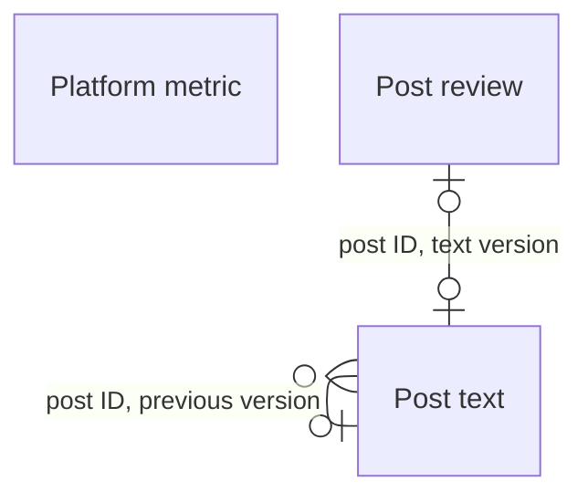

# Marketing review

## Tables

- [Platform metric](next.platform_metric.md)
- [Post review](next.post_review.md)
- [Post text](next.post_text.md)

See each table for its columns and links to other areas.
