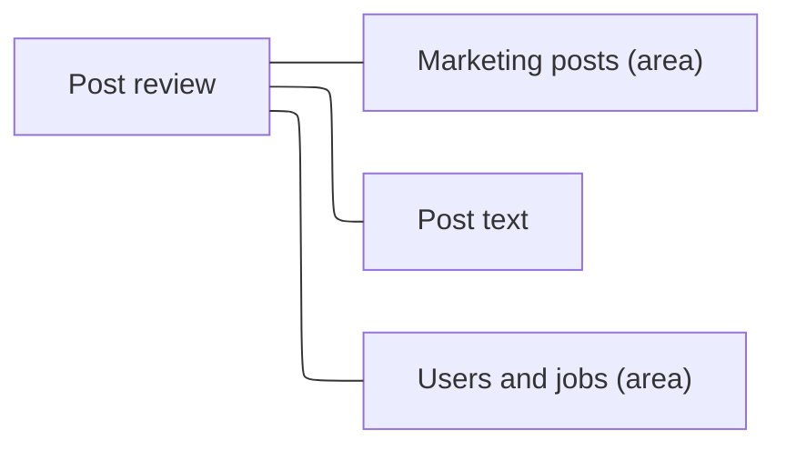
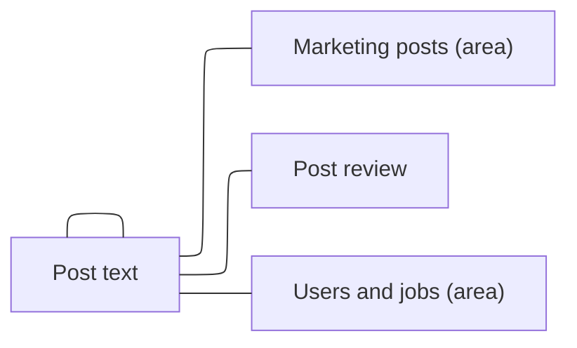

# Marketing review

Each line shows a connection. The foreign keys below name the exact columns.

### Platform metric

### Post review

### Post text

## Foreign keys

| From table and columns                                         | To table and columns                                              |
| -------------------------------------------------------------- | ----------------------------------------------------------------- |
| [measurement](next.measurement.md) (`platform`, `metric`)      | [platform_metric](next.platform_metric.md) (`platform`, `metric`) |
| [post_review](next.post_review.md) (`changed_by_user_id`)      | [app_user](next.app_user.md) (`id`)                               |
| [post_review](next.post_review.md) (`changed_for_user_id`)     | [app_user](next.app_user.md) (`id`)                               |
| [post_review](next.post_review.md) (`changed_by_job`)          | [job](next.job.md) (`slug`)                                       |
| [post_review](next.post_review.md) (`post_id`)                 | [post](next.post.md) (`id`)                                       |
| [post_review](next.post_review.md) (`post_id`, `text_version`) | [post_text](next.post_text.md) (`post_id`, `version`)             |
| [post_text](next.post_text.md) (`changed_by_user_id`)          | [app_user](next.app_user.md) (`id`)                               |
| [post_text](next.post_text.md) (`changed_for_user_id`)         | [app_user](next.app_user.md) (`id`)                               |
| [post_text](next.post_text.md) (`changed_by_job`)              | [job](next.job.md) (`slug`)                                       |
| [post_text](next.post_text.md) (`post_id`)                     | [post](next.post.md) (`id`)                                       |
| [post_text](next.post_text.md) (`post_id`, `previous_version`) | [post_text](next.post_text.md) (`post_id`, `version`)             |

## Connects to

Numbers count foreign keys between the two areas.

[Marketing posts](viewpoint-marketing-posts.md) (2) · [Property](viewpoint-property.md) (1) · [Users and jobs](viewpoint-users-jobs.md) (6)

## Tables

- [Platform metric](next.platform_metric.md)
- [Post review](next.post_review.md)
- [Post text](next.post_text.md)
