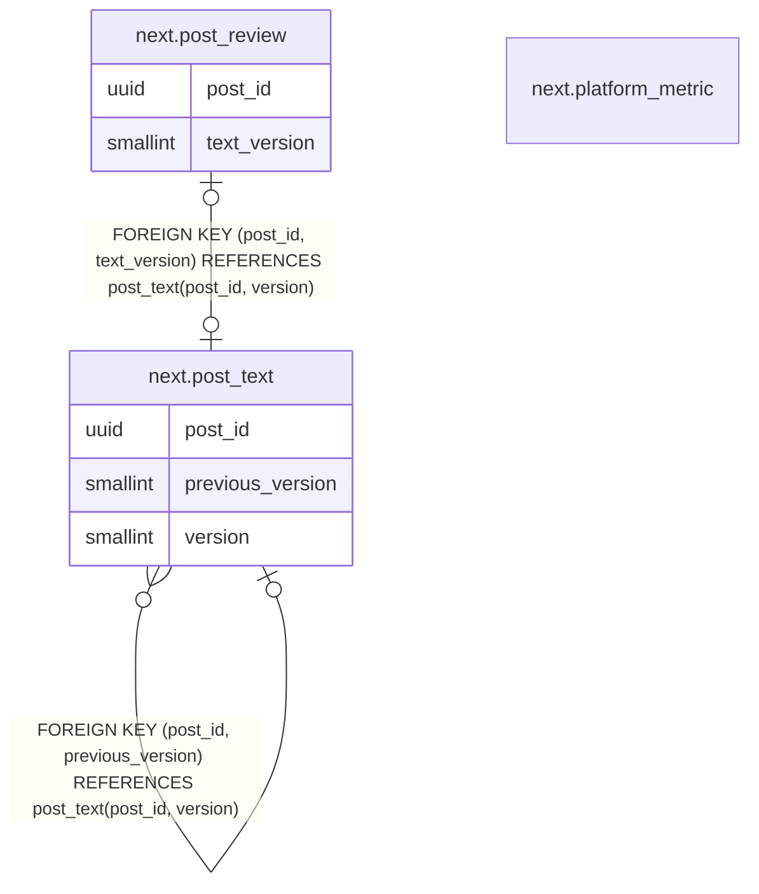

# Marketing review

## Description

Tables in this area and the foreign keys between them.

## Tables

| Name                                            | Columns | Comment | Type       |
| ----------------------------------------------- | ------- | ------- | ---------- |
| [next.platform_metric](next.platform_metric.md) | 3       |         | BASE TABLE |
| [next.post_review](next.post_review.md)         | 7       |         | BASE TABLE |
| [next.post_text](next.post_text.md)             | 8       |         | BASE TABLE |

## Relations

---

> Generated by [tbls](https://github.com/k1LoW/tbls)
