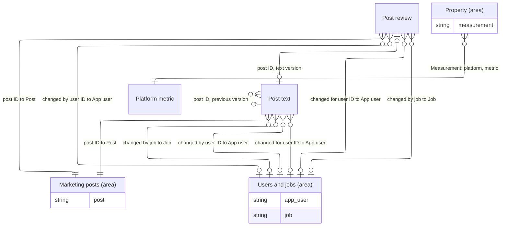

# Marketing review

## Connects to

Numbers count foreign keys between the two areas.

[Marketing posts](viewpoint-marketing-posts.md) (2) · [Property](viewpoint-property.md) (1) · [Users and jobs](viewpoint-users-jobs.md) (6)

## Tables

- [Platform metric](next.platform_metric.md)
- [Post review](next.post_review.md)
- [Post text](next.post_text.md)

See each table for its columns and links to other areas.
