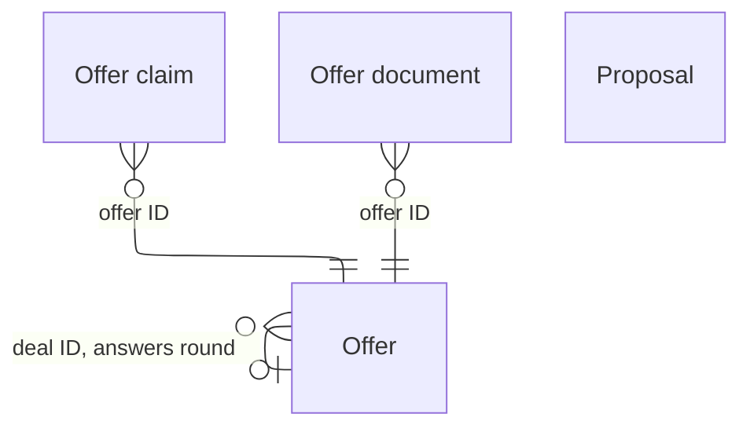

# Offers

## Tables

- [Offer](next.offer.md)
- [Offer claim](next.offer_claim.md)
- [Offer document](next.offer_document.md)
- [Proposal](next.proposal.md)

See each table for its columns and links to other areas.
