# Offers

```mermaid
---
config:
  layout: elk
  er:
    nodeSpacing: 22
    rankSpacing: 44
---
erDiagram
  "Offer"
  "Offer claim"
  "Offer document"
  "Proposal"
  "Activity (area)" {
    string activity
    string activity_about
    string next_step
  }
  "Deals (area)" {
    string deal
    string deal_party
    string phase
    string stage
  }
  "Documents (area)" {
    string document
  }
  "Home and calendar (area)" {
    string home_mark
  }
  "Leads (area)" {
    string candidate
  }
  "Leases (area)" {
    string critical_date
    string lease_version
  }
  "People (area)" {
    string party
  }
  "Property (area)" {
    string deal_property
    string property
  }
  "Relationships (area)" {
    string claim_type
    string how_found
  }
  "Users and jobs (area)" {
    string app_user
    string job
  }
  "Leases (area)" }o--o| "Offer" : "Critical date: offer ID, deal ID"
  "Home and calendar (area)" }o--o| "Proposal" : "Home mark: proposal ID"
  "Leases (area)" }o--o| "Offer" : "Lease version: offer ID"
  "Offer" }o--o| "Users and jobs (area)" : "changed by user ID to App user"
  "Offer" }o--o| "Users and jobs (area)" : "changed for user ID to App user"
  "Offer" }o--|| "Deals (area)" : "deal ID, from party ID, from role to Deal party"
  "Offer" }o--|| "Property (area)" : "deal ID, property ID to Deal property"
  "Offer" }o--o| "Users and jobs (area)" : "changed by job to Job"
  "Offer" }o--o| "Offer" : "deal ID, answers round#160;#160;#160;#160;"
  "Offer claim" }o--o| "Users and jobs (area)" : "changed by user ID to App user"
  "Offer claim" }o--o| "Users and jobs (area)" : "changed for user ID to App user"
  "Offer claim" }o--|| "Relationships (area)" : "claim type to Claim type"
  "Offer claim" }o--o| "Users and jobs (area)" : "changed by job to Job"
  "Offer claim" }o--|| "Offer" : "offer ID"
  "Offer document" }o--o| "Users and jobs (area)" : "changed by user ID to App user"
  "Offer document" }o--o| "Users and jobs (area)" : "changed for user ID to App user"
  "Offer document" }o--|| "Documents (area)" : "document ID to Document"
  "Offer document" }o--o| "Users and jobs (area)" : "changed by job to Job"
  "Offer document" }o--|| "Offer" : "offer ID"
  "Proposal" }o--o| "Activity (area)" : "activity ID, activity kind to Activity"
  "Proposal" }o--o| "Activity (area)" : "activity ID, call deal ID to Activity about"
  "Proposal" }o--o| "Activity (area)" : "activity ID, held deal ID to Activity about"
  "Proposal" }o--o| "Activity (area)" : "activity ID, party ID to Activity about"
  "Proposal" }o--o| "Users and jobs (area)" : "changed by user ID to App user"
  "Proposal" }o--o| "Users and jobs (area)" : "changed for user ID to App user"
  "Proposal" }o--o| "Users and jobs (area)" : "decided by user ID to App user"
  "Proposal" |o--o| "Leads (area)" : "candidate ID to Candidate"
  "Proposal" }o--o| "Deals (area)" : "deal ID to Deal"
  "Proposal" }o--o| "Deals (area)" : "filed deal ID to Deal"
  "Proposal" }o--o| "Relationships (area)" : "how found to How found"
  "Proposal" }o--o| "Users and jobs (area)" : "changed by job to Job"
  "Proposal" }o--|| "Users and jobs (area)" : "proposed by job to Job"
  "Proposal" }o--o| "Activity (area)" : "merged step ID to Next step"
  "Proposal" }o--o| "Activity (area)" : "next step ID, deal ID to Next step"
  "Proposal" }o--o| "People (area)" : "filed vendor ID to Party"
  "Proposal" }o--o| "People (area)" : "owner party ID to Party"
  "Proposal" }o--o| "People (area)" : "party ID to Party"
  "Proposal" }o--o| "Deals (area)" : "from phase to Phase"
  "Proposal" }o--o| "Deals (area)" : "to phase to Phase"
  "Proposal" }o--o| "Property (area)" : "property ID to Property"
  "Proposal" }o--o| "Deals (area)" : "lead role, from stage to Stage"
  "Proposal" }o--o| "Deals (area)" : "lead role, to stage to Stage"
```

## Connects to

Numbers count foreign keys between the two areas.

[Activity](viewpoint-activity.md) (6) · [Deals](viewpoint-deals.md) (7) · [Documents](viewpoint-documents.md) (1) · [Home and calendar](viewpoint-home-calendar.md) (1) · [Leads](viewpoint-leads.md) (1) · [Leases](viewpoint-leases.md) (2) · [People](viewpoint-people.md) (3) · [Property](viewpoint-property.md) (2) · [Relationships](viewpoint-relationships.md) (2) · [Users and jobs](viewpoint-users-jobs.md) (14)

## Tables

- [Offer](next.offer.md)
- [Offer claim](next.offer_claim.md)
- [Offer document](next.offer_document.md)
- [Proposal](next.proposal.md)

See each table for its columns and links to other areas.
