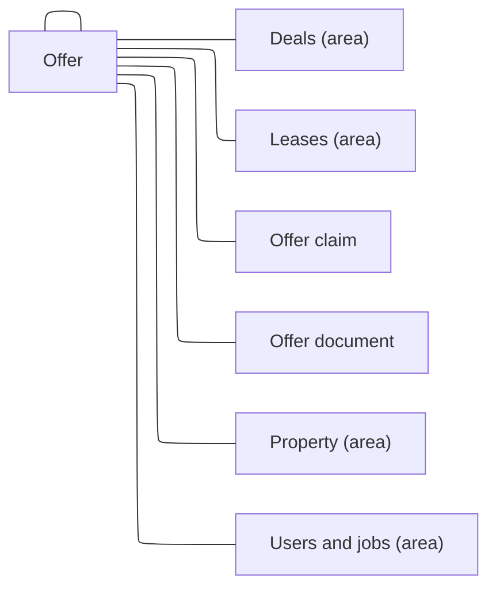
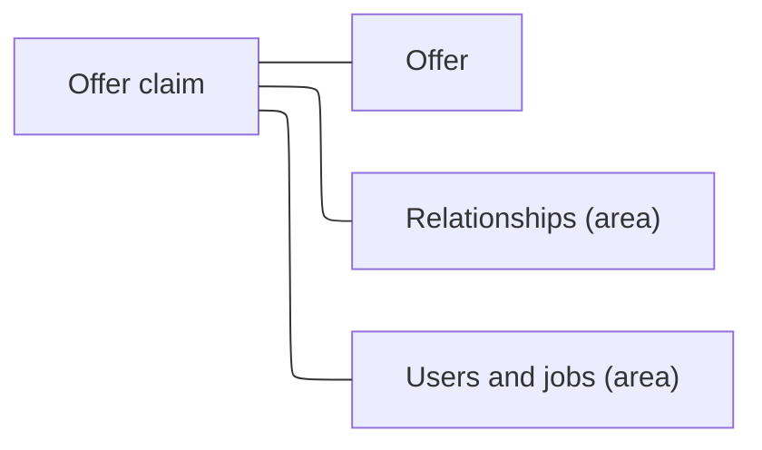
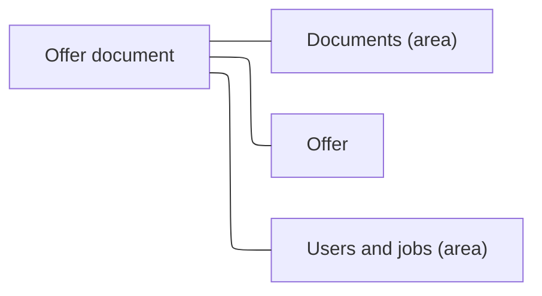
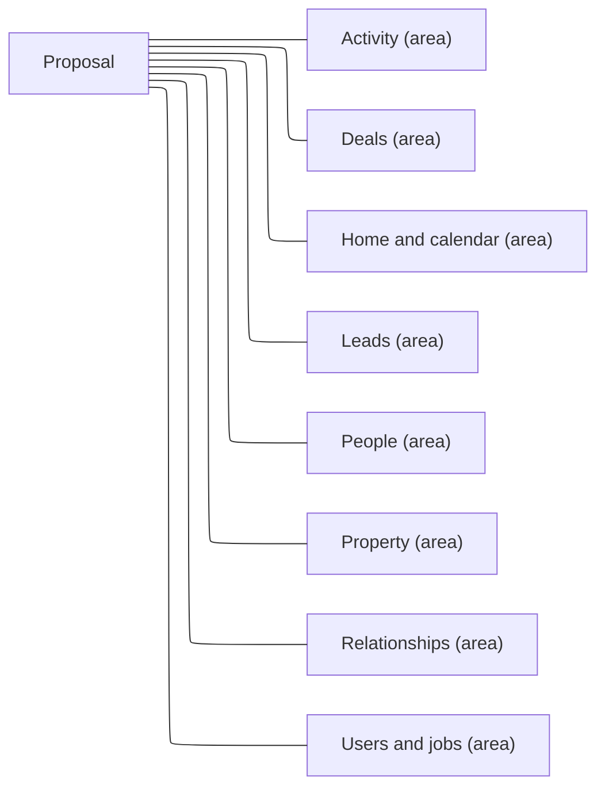

# Offers

Each line shows a connection. The foreign keys below name the exact columns.

### Offer

### Offer claim

### Offer document

### Proposal

## Foreign keys

| From table and columns                                           | To table and columns                                                 |
| ---------------------------------------------------------------- | -------------------------------------------------------------------- |
| [critical_date](next.critical_date.md) (`offer_id`, `deal_id`)   | [offer](next.offer.md) (`id`, `deal_id`)                             |
| [home_mark](next.home_mark.md) (`proposal_id`)                   | [proposal](next.proposal.md) (`id`)                                  |
| [lease_version](next.lease_version.md) (`offer_id`)              | [offer](next.offer.md) (`id`)                                        |
| [offer](next.offer.md) (`changed_by_user_id`)                    | [app_user](next.app_user.md) (`id`)                                  |
| [offer](next.offer.md) (`changed_for_user_id`)                   | [app_user](next.app_user.md) (`id`)                                  |
| [offer](next.offer.md) (`deal_id`, `from_party_id`, `from_role`) | [deal_party](next.deal_party.md) (`deal_id`, `party_id`, `role`)     |
| [offer](next.offer.md) (`deal_id`, `property_id`)                | [deal_property](next.deal_property.md) (`deal_id`, `property_id`)    |
| [offer](next.offer.md) (`changed_by_job`)                        | [job](next.job.md) (`slug`)                                          |
| [offer](next.offer.md) (`deal_id`, `answers_round`)              | [offer](next.offer.md) (`deal_id`, `round`)                          |
| [offer_claim](next.offer_claim.md) (`changed_by_user_id`)        | [app_user](next.app_user.md) (`id`)                                  |
| [offer_claim](next.offer_claim.md) (`changed_for_user_id`)       | [app_user](next.app_user.md) (`id`)                                  |
| [offer_claim](next.offer_claim.md) (`claim_type`)                | [claim_type](next.claim_type.md) (`slug`)                            |
| [offer_claim](next.offer_claim.md) (`changed_by_job`)            | [job](next.job.md) (`slug`)                                          |
| [offer_claim](next.offer_claim.md) (`offer_id`)                  | [offer](next.offer.md) (`id`)                                        |
| [offer_document](next.offer_document.md) (`changed_by_user_id`)  | [app_user](next.app_user.md) (`id`)                                  |
| [offer_document](next.offer_document.md) (`changed_for_user_id`) | [app_user](next.app_user.md) (`id`)                                  |
| [offer_document](next.offer_document.md) (`document_id`)         | [document](next.document.md) (`id`)                                  |
| [offer_document](next.offer_document.md) (`changed_by_job`)      | [job](next.job.md) (`slug`)                                          |
| [offer_document](next.offer_document.md) (`offer_id`)            | [offer](next.offer.md) (`id`)                                        |
| [proposal](next.proposal.md) (`activity_id`, `activity_kind`)    | [activity](next.activity.md) (`id`, `kind`)                          |
| [proposal](next.proposal.md) (`activity_id`, `call_deal_id`)     | [activity_about](next.activity_about.md) (`activity_id`, `deal_id`)  |
| [proposal](next.proposal.md) (`activity_id`, `held_deal_id`)     | [activity_about](next.activity_about.md) (`activity_id`, `deal_id`)  |
| [proposal](next.proposal.md) (`activity_id`, `party_id`)         | [activity_about](next.activity_about.md) (`activity_id`, `party_id`) |
| [proposal](next.proposal.md) (`changed_by_user_id`)              | [app_user](next.app_user.md) (`id`)                                  |
| [proposal](next.proposal.md) (`changed_for_user_id`)             | [app_user](next.app_user.md) (`id`)                                  |
| [proposal](next.proposal.md) (`decided_by_user_id`)              | [app_user](next.app_user.md) (`id`)                                  |
| [proposal](next.proposal.md) (`candidate_id`)                    | [candidate](next.candidate.md) (`id`)                                |
| [proposal](next.proposal.md) (`deal_id`)                         | [deal](next.deal.md) (`id`)                                          |
| [proposal](next.proposal.md) (`filed_deal_id`)                   | [deal](next.deal.md) (`id`)                                          |
| [proposal](next.proposal.md) (`how_found`)                       | [how_found](next.how_found.md) (`slug`)                              |
| [proposal](next.proposal.md) (`changed_by_job`)                  | [job](next.job.md) (`slug`)                                          |
| [proposal](next.proposal.md) (`proposed_by_job`)                 | [job](next.job.md) (`slug`)                                          |
| [proposal](next.proposal.md) (`merged_step_id`)                  | [next_step](next.next_step.md) (`id`)                                |
| [proposal](next.proposal.md) (`next_step_id`, `deal_id`)         | [next_step](next.next_step.md) (`id`, `deal_id`)                     |
| [proposal](next.proposal.md) (`filed_vendor_id`)                 | [party](next.party.md) (`id`)                                        |
| [proposal](next.proposal.md) (`owner_party_id`)                  | [party](next.party.md) (`id`)                                        |
| [proposal](next.proposal.md) (`party_id`)                        | [party](next.party.md) (`id`)                                        |
| [proposal](next.proposal.md) (`from_phase`)                      | [phase](next.phase.md) (`slug`)                                      |
| [proposal](next.proposal.md) (`to_phase`)                        | [phase](next.phase.md) (`slug`)                                      |
| [proposal](next.proposal.md) (`property_id`)                     | [property](next.property.md) (`id`)                                  |
| [proposal](next.proposal.md) (`lead_role`, `from_stage`)         | [stage](next.stage.md) (`role`, `slug`)                              |
| [proposal](next.proposal.md) (`lead_role`, `to_stage`)           | [stage](next.stage.md) (`role`, `slug`)                              |

## Connects to

Numbers count foreign keys between the two areas.

[Activity](viewpoint-activity.md) (6) · [Deals](viewpoint-deals.md) (7) · [Documents](viewpoint-documents.md) (1) · [Home and calendar](viewpoint-home-calendar.md) (1) · [Leads](viewpoint-leads.md) (1) · [Leases](viewpoint-leases.md) (2) · [People](viewpoint-people.md) (3) · [Property](viewpoint-property.md) (2) · [Relationships](viewpoint-relationships.md) (2) · [Users and jobs](viewpoint-users-jobs.md) (14)

## Tables

- [Offer](next.offer.md)
- [Offer claim](next.offer_claim.md)
- [Offer document](next.offer_document.md)
- [Proposal](next.proposal.md)
