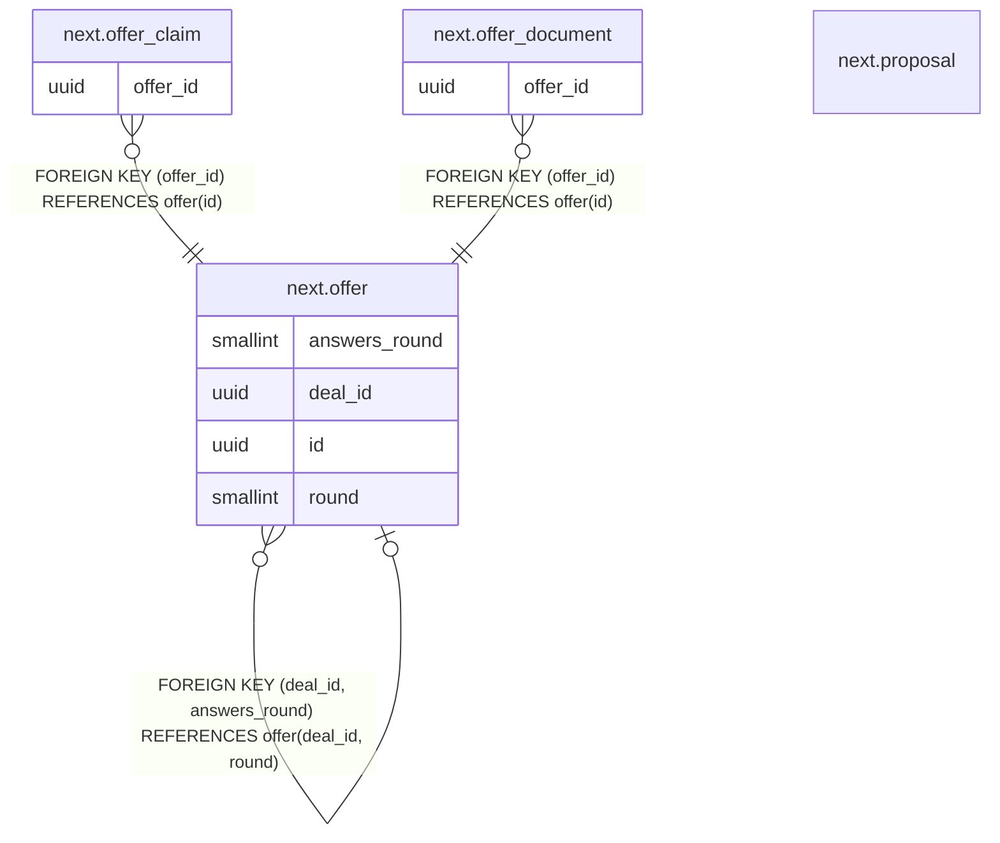

# Offers

## Description

Tables in this area and the foreign keys between them.

## Tables

| Name                                          | Columns | Comment | Type       |
| --------------------------------------------- | ------- | ------- | ---------- |
| [next.offer](next.offer.md)                   | 27      |         | BASE TABLE |
| [next.offer_claim](next.offer_claim.md)       | 10      |         | BASE TABLE |
| [next.offer_document](next.offer_document.md) | 7       |         | BASE TABLE |
| [next.proposal](next.proposal.md)             | 44      |         | BASE TABLE |

## Relations

---

> Generated by [tbls](https://github.com/k1LoW/tbls)
