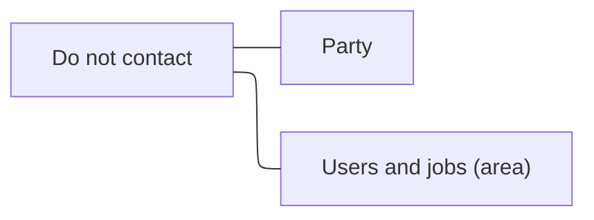
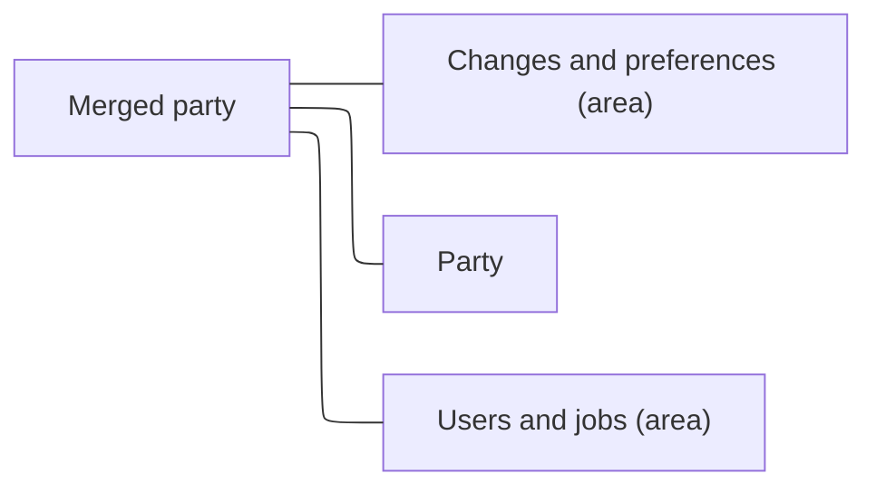
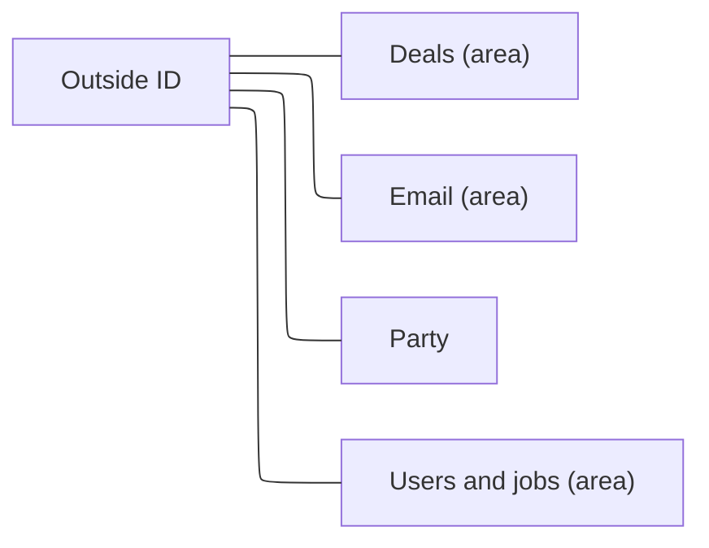
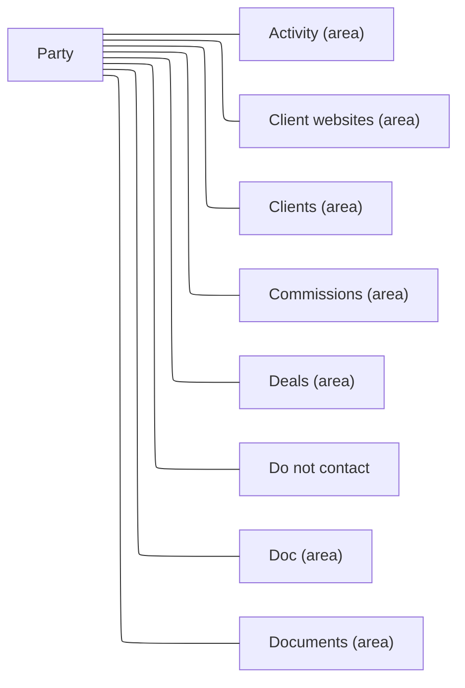
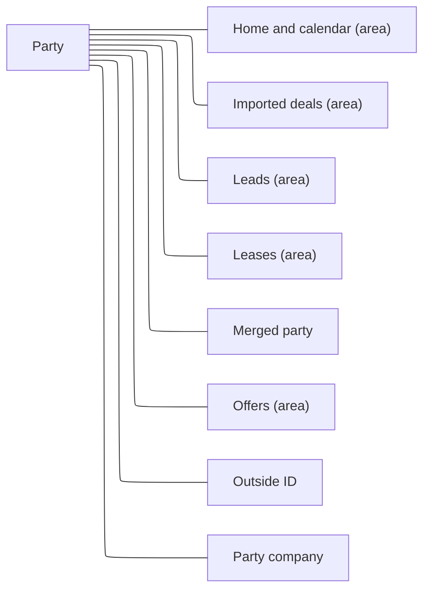
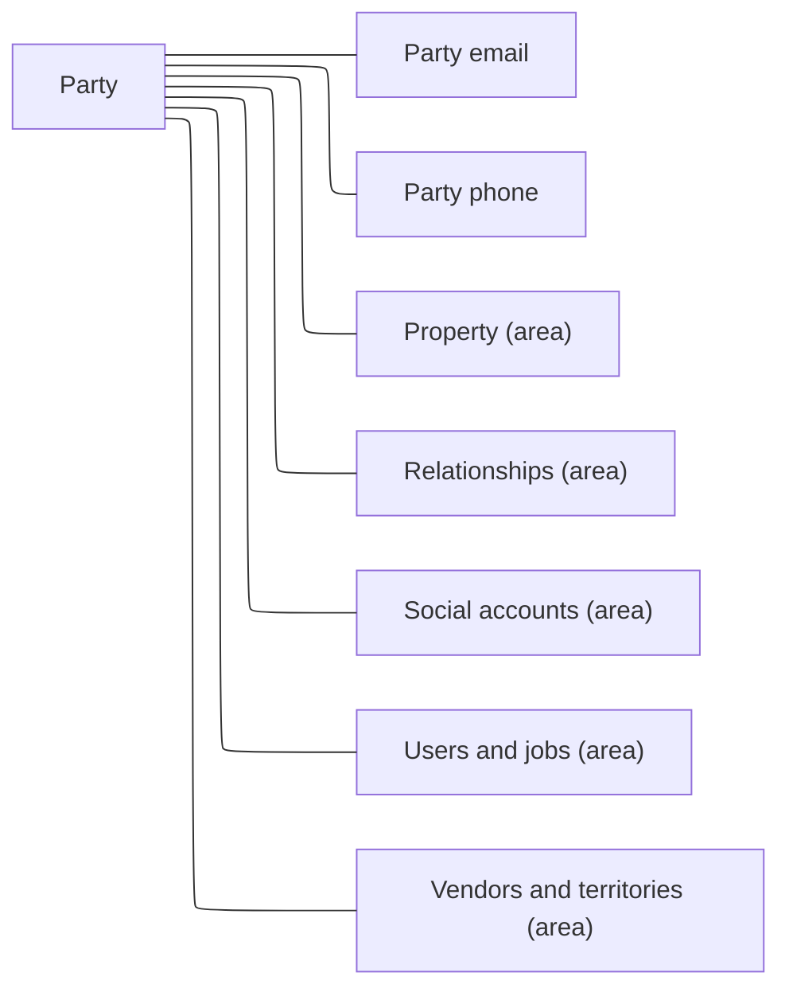
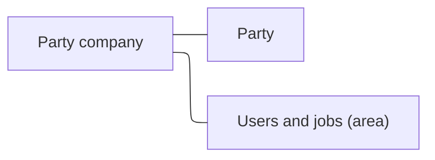
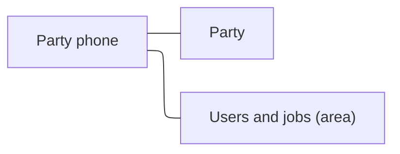

# People

Each line shows a connection. The foreign keys below name the exact columns.

### Do not contact

### Merged party

### Outside ID

### Party

### Party company

### Party email

### Party phone

## Foreign keys

| From table and columns                                                     | To table and columns                        |
| -------------------------------------------------------------------------- | ------------------------------------------- |
| [activity](next.activity.md) (`from_party_id`)                             | [party](next.party.md) (`id`)               |
| [activity_about](next.activity_about.md) (`party_id`)                      | [party](next.party.md) (`id`)               |
| [app_user](next.app_user.md) (`id`, `kind`)                                | [party](next.party.md) (`id`, `kind`)       |
| [building_ownership](next.building_ownership.md) (`party_id`)              | [party](next.party.md) (`id`)               |
| [candidate](next.candidate.md) (`promoted_party_id`)                       | [party](next.party.md) (`id`)               |
| [change](next.change.md) (`merge_of`)                                      | [merged_party](next.merged_party.md) (`id`) |
| [client_brand](next.client_brand.md) (`brand_id`, `brand_kind`)            | [party](next.party.md) (`id`, `kind`)       |
| [commission_share](next.commission_share.md) (`party_id`)                  | [party](next.party.md) (`id`)               |
| [deal_client_website](next.deal_client_website.md) (`client_party_id`)     | [party](next.party.md) (`id`)               |
| [deal_party](next.deal_party.md) (`party_id`)                              | [party](next.party.md) (`id`)               |
| [do_not_contact](next.do_not_contact.md) (`changed_by_user_id`)            | [app_user](next.app_user.md) (`id`)         |
| [do_not_contact](next.do_not_contact.md) (`changed_for_user_id`)           | [app_user](next.app_user.md) (`id`)         |
| [do_not_contact](next.do_not_contact.md) (`changed_by_job`)                | [job](next.job.md) (`slug`)                 |
| [do_not_contact](next.do_not_contact.md) (`party_id`)                      | [party](next.party.md) (`id`)               |
| [doc_judgment_destination](next.doc_judgment_destination.md) (`vendor_id`) | [party](next.party.md) (`id`)               |
| [home_mark](next.home_mark.md) (`waiting_on_party_id`)                     | [party](next.party.md) (`id`)               |
| [imported_deal_party](next.imported_deal_party.md) (`party_id`)            | [party](next.party.md) (`id`)               |
| [introduction](next.introduction.md) (`introduced_party_id`)               | [party](next.party.md) (`id`)               |
| [lead_contact_draft](next.lead_contact_draft.md) (`party_id`)              | [party](next.party.md) (`id`)               |
| [lead_email_attention](next.lead_email_attention.md) (`party_id`)          | [party](next.party.md) (`id`)               |
| [lead_email_source](next.lead_email_source.md) (`party_id`)                | [party](next.party.md) (`id`)               |
| [lead_stage_move](next.lead_stage_move.md) (`party_id`)                    | [party](next.party.md) (`id`)               |
| [lease](next.lease.md) (`party_id`)                                        | [party](next.party.md) (`id`)               |
| [merged_party](next.merged_party.md) (`changed_by_user_id`)                | [app_user](next.app_user.md) (`id`)         |
| [merged_party](next.merged_party.md) (`changed_for_user_id`)               | [app_user](next.app_user.md) (`id`)         |
| [merged_party](next.merged_party.md) (`changed_by_job`)                    | [job](next.job.md) (`slug`)                 |
| [merged_party](next.merged_party.md) (`survivor_id`)                       | [party](next.party.md) (`id`)               |
| [national_account](next.national_account.md) (`party_id`, `kind`)          | [party](next.party.md) (`id`, `kind`)       |
| [next_step](next.next_step.md) (`call_contact_party_id`)                   | [party](next.party.md) (`id`)               |
| [next_step](next.next_step.md) (`owner_party_id`)                          | [party](next.party.md) (`id`)               |
| [next_step](next.next_step.md) (`party_id`)                                | [party](next.party.md) (`id`)               |
| [outside_id](next.outside_id.md) (`changed_by_user_id`)                    | [app_user](next.app_user.md) (`id`)         |
| [outside_id](next.outside_id.md) (`changed_for_user_id`)                   | [app_user](next.app_user.md) (`id`)         |
| [outside_id](next.outside_id.md) (`deal_id`)                               | [deal](next.deal.md) (`id`)                 |
| [outside_id](next.outside_id.md) (`email_activity_id`)                     | [email](next.email.md) (`activity_id`)      |
| [outside_id](next.outside_id.md) (`changed_by_job`)                        | [job](next.job.md) (`slug`)                 |
| [outside_id](next.outside_id.md) (`party_id`)                              | [party](next.party.md) (`id`)               |
| [party](next.party.md) (`changed_by_user_id`)                              | [app_user](next.app_user.md) (`id`)         |
| [party](next.party.md) (`changed_for_user_id`)                             | [app_user](next.app_user.md) (`id`)         |
| [party](next.party.md) (`how_found`)                                       | [how_found](next.how_found.md) (`slug`)     |
| [party](next.party.md) (`changed_by_job`)                                  | [job](next.job.md) (`slug`)                 |
| [party_company](next.party_company.md) (`changed_by_user_id`)              | [app_user](next.app_user.md) (`id`)         |
| [party_company](next.party_company.md) (`changed_for_user_id`)             | [app_user](next.app_user.md) (`id`)         |
| [party_company](next.party_company.md) (`changed_by_job`)                  | [job](next.job.md) (`slug`)                 |
| [party_company](next.party_company.md) (`company_id`, `company_kind`)      | [party](next.party.md) (`id`, `kind`)       |
| [party_company](next.party_company.md) (`person_id`, `person_kind`)        | [party](next.party.md) (`id`, `kind`)       |
| [party_document](next.party_document.md) (`party_id`)                      | [party](next.party.md) (`id`)               |
| [party_email](next.party_email.md) (`changed_by_user_id`)                  | [app_user](next.app_user.md) (`id`)         |
| [party_email](next.party_email.md) (`changed_for_user_id`)                 | [app_user](next.app_user.md) (`id`)         |
| [party_email](next.party_email.md) (`changed_by_job`)                      | [job](next.job.md) (`slug`)                 |
| [party_email](next.party_email.md) (`party_id`)                            | [party](next.party.md) (`id`)               |
| [party_link](next.party_link.md) (`other_party_id`)                        | [party](next.party.md) (`id`)               |
| [party_link](next.party_link.md) (`party_id`)                              | [party](next.party.md) (`id`)               |
| [party_phone](next.party_phone.md) (`changed_by_user_id`)                  | [app_user](next.app_user.md) (`id`)         |
| [party_phone](next.party_phone.md) (`changed_for_user_id`)                 | [app_user](next.app_user.md) (`id`)         |
| [party_phone](next.party_phone.md) (`changed_by_job`)                      | [job](next.job.md) (`slug`)                 |
| [party_phone](next.party_phone.md) (`party_id`)                            | [party](next.party.md) (`id`)               |
| [party_role](next.party_role.md) (`party_id`)                              | [party](next.party.md) (`id`)               |
| [party_specialty](next.party_specialty.md) (`person_id`, `person_kind`)    | [party](next.party.md) (`id`, `kind`)       |
| [party_territory](next.party_territory.md) (`party_id`)                    | [party](next.party.md) (`id`)               |
| [proposal](next.proposal.md) (`filed_vendor_id`)                           | [party](next.party.md) (`id`)               |
| [proposal](next.proposal.md) (`owner_party_id`)                            | [party](next.party.md) (`id`)               |
| [proposal](next.proposal.md) (`party_id`)                                  | [party](next.party.md) (`id`)               |
| [social_account](next.social_account.md) (`owner_party_id`)                | [party](next.party.md) (`id`)               |

## Connects to

Numbers count foreign keys between the two areas.

[Activity](viewpoint-activity.md) (5) · [Changes and preferences](viewpoint-changes-preferences.md) (1) · [Client websites](viewpoint-website.md) (1) · [Clients](viewpoint-clients.md) (2) · [Commissions](viewpoint-commissions.md) (1) · [Deals](viewpoint-deals.md) (2) · [Doc](viewpoint-doc.md) (1) · [Documents](viewpoint-documents.md) (1) · [Email](viewpoint-email.md) (1) · [Home and calendar](viewpoint-home-calendar.md) (1) · [Imported deals](viewpoint-imported-deals.md) (1) · [Leads](viewpoint-leads.md) (5) · [Leases](viewpoint-leases.md) (1) · [Offers](viewpoint-offers.md) (3) · [Property](viewpoint-property.md) (1) · [Relationships](viewpoint-relationships.md) (6) · [Social accounts](viewpoint-social-accounts.md) (1) · [Users and jobs](viewpoint-users-jobs.md) (22) · [Vendors and territories](viewpoint-vendors-territories.md) (1)

## Tables

- [Do not contact](next.do_not_contact.md)
- [Merged party](next.merged_party.md)
- [Outside ID](next.outside_id.md)
- [Party](next.party.md)
- [Party company](next.party_company.md)
- [Party email](next.party_email.md)
- [Party phone](next.party_phone.md)
