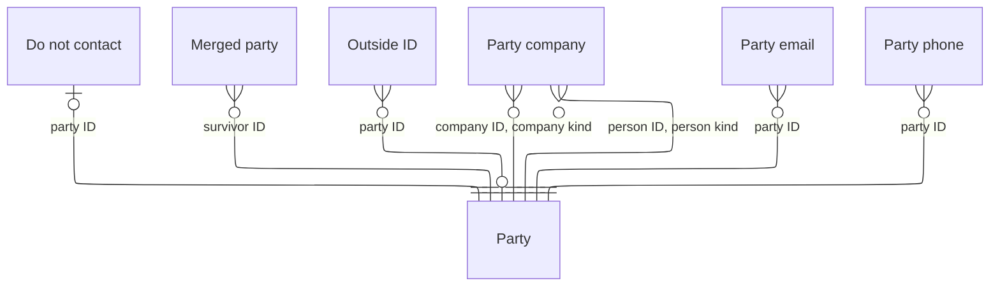

# People

## Tables

- [Do not contact](next.do_not_contact.md)
- [Merged party](next.merged_party.md)
- [Outside ID](next.outside_id.md)
- [Party](next.party.md)
- [Party company](next.party_company.md)
- [Party email](next.party_email.md)
- [Party phone](next.party_phone.md)

See each table for its columns and links to other areas.
