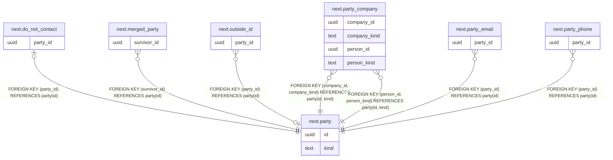

# People

## Description

Tables in this area and the foreign keys between them.

## Tables

| Name                                          | Columns | Comment | Type       |
| --------------------------------------------- | ------- | ------- | ---------- |
| [next.do_not_contact](next.do_not_contact.md) | 8       |         | BASE TABLE |
| [next.merged_party](next.merged_party.md)     | 7       |         | BASE TABLE |
| [next.outside_id](next.outside_id.md)         | 9       |         | BASE TABLE |
| [next.party](next.party.md)                   | 12      |         | BASE TABLE |
| [next.party_company](next.party_company.md)   | 13      |         | BASE TABLE |
| [next.party_email](next.party_email.md)       | 10      |         | BASE TABLE |
| [next.party_phone](next.party_phone.md)       | 11      |         | BASE TABLE |

## Relations

---

> Generated by [tbls](https://github.com/k1LoW/tbls)
