# People

```mermaid
---
title: "\u00a0"
config:
  layout: elk
  er:
    titleTopMargin: 56
    nodeSpacing: 22
    rankSpacing: 44
---
erDiagram
  "Do not contact"
  "Merged party"
  "Outside ID"
  "Party"
  "Party company"
  "Party email"
  "Party phone"
  "Activity (area)" {
    string activity
    string activity_about
    string next_step
  }
  "Changes and preferences (area)" {
    string change
  }
  "Client websites (area)" {
    string deal_client_website
  }
  "Clients (area)" {
    string client_brand
    string national_account
  }
  "Commissions (area)" {
    string commission_share
  }
  "Deals (area)" {
    string deal
    string deal_party
  }
  "Doc (area)" {
    string doc_judgment_destination
  }
  "Documents (area)" {
    string party_document
  }
  "Email (area)" {
    string email
  }
  "Home and calendar (area)" {
    string home_mark
  }
  "Imported deals (area)" {
    string imported_deal_party
  }
  "Leads (area)" {
    string candidate
    string lead_contact_draft
    string lead_email_attention
    string lead_email_source
    string lead_stage_move
  }
  "Leases (area)" {
    string lease
  }
  "Offers (area)" {
    string proposal
  }
  "Property (area)" {
    string building_ownership
  }
  "Relationships (area)" {
    string how_found
    string introduction
    string party_link
    string party_role
    string party_specialty
  }
  "Social accounts (area)" {
    string social_account
  }
  "Users and jobs (area)" {
    string app_user
    string job
  }
  "Vendors and territories (area)" {
    string party_territory
  }
  "Activity (area)" }o--o| "Party" : "Activity: from party ID"
  "Activity (area)" }o--o| "Party" : "Activity about: party ID"
  "Users and jobs (area)" }o--|| "Party" : "App user: ID, kind"
  "Property (area)" }o--|| "Party" : "Building ownership: party ID"
  "Leads (area)" }o--o| "Party" : "Candidate: promoted party ID"
  "Changes and preferences (area)" }o--o| "Merged party" : "Change: merge of"
  "Clients (area)" }o--o| "Party" : "Client brand: brand ID, brand kind"
  "Commissions (area)" }o--|| "Party" : "Commission share: party ID"
  "Client websites (area)" }o--|| "Party" : "Deal client website: client party ID"
  "Deals (area)" }o--|| "Party" : "Deal party: party ID"
  "Do not contact" }o--o| "Users and jobs (area)" : "changed by user ID to App user"
  "Do not contact" }o--o| "Users and jobs (area)" : "changed for user ID to App user"
  "Do not contact" }o--o| "Users and jobs (area)" : "changed by job to Job"
  "Do not contact" |o--|| "Party" : "party ID"
  "Doc (area)" }o--o| "Party" : "Doc judgment destination: vendor ID"
  "Home and calendar (area)" }o--o| "Party" : "Home mark: waiting on party ID"
  "Imported deals (area)" }o--|| "Party" : "Imported deal party: party ID"
  "Relationships (area)" }o--|| "Party" : "Introduction: introduced party ID"
  "Leads (area)" |o--|| "Party" : "Lead contact draft: party ID"
  "Leads (area)" |o--|| "Party" : "Lead email attention: party ID"
  "Leads (area)" }o--|| "Party" : "Lead email source: party ID"
  "Leads (area)" }o--|| "Party" : "Lead stage move: party ID"
  "Leases (area)" }o--|| "Party" : "Lease: party ID"
  "Merged party" }o--o| "Users and jobs (area)" : "changed by user ID to App user"
  "Merged party" }o--o| "Users and jobs (area)" : "changed for user ID to App user"
  "Merged party" }o--o| "Users and jobs (area)" : "changed by job to Job"
  "Merged party" }o--|| "Party" : "survivor ID"
  "Clients (area)" }o--o| "Party" : "National account: party ID, kind"
  "Activity (area)" }o--o| "Party" : "Next step: call contact party ID"
  "Activity (area)" }o--o| "Party" : "Next step: owner party ID"
  "Activity (area)" }o--o| "Party" : "Next step: party ID"
  "Outside ID" }o--o| "Users and jobs (area)" : "changed by user ID to App user"
  "Outside ID" }o--o| "Users and jobs (area)" : "changed for user ID to App user"
  "Outside ID" }o--o| "Deals (area)" : "deal ID to Deal"
  "Outside ID" }o--o| "Email (area)" : "email activity ID to Email"
  "Outside ID" }o--o| "Users and jobs (area)" : "changed by job to Job"
  "Outside ID" }o--o| "Party" : "party ID"
  "Party" }o--o| "Users and jobs (area)" : "changed by user ID to App user"
  "Party" }o--o| "Users and jobs (area)" : "changed for user ID to App user"
  "Party" }o--o| "Relationships (area)" : "how found to How found"
  "Party" }o--o| "Users and jobs (area)" : "changed by job to Job"
  "Party company" }o--o| "Users and jobs (area)" : "changed by user ID to App user"
  "Party company" }o--o| "Users and jobs (area)" : "changed for user ID to App user"
  "Party company" }o--o| "Users and jobs (area)" : "changed by job to Job"
  "Party company" }o--|| "Party" : "company ID, company kind"
  "Party company" }o--|| "Party" : "person ID, person kind"
  "Documents (area)" }o--|| "Party" : "Party document: party ID"
  "Party email" }o--o| "Users and jobs (area)" : "changed by user ID to App user"
  "Party email" }o--o| "Users and jobs (area)" : "changed for user ID to App user"
  "Party email" }o--o| "Users and jobs (area)" : "changed by job to Job"
  "Party email" }o--|| "Party" : "party ID"
  "Relationships (area)" }o--|| "Party" : "Party link: other party ID"
  "Relationships (area)" }o--|| "Party" : "Party link: party ID"
  "Party phone" }o--o| "Users and jobs (area)" : "changed by user ID to App user"
  "Party phone" }o--o| "Users and jobs (area)" : "changed for user ID to App user"
  "Party phone" }o--o| "Users and jobs (area)" : "changed by job to Job"
  "Party phone" }o--|| "Party" : "party ID"
  "Relationships (area)" }o--|| "Party" : "Party role: party ID"
  "Relationships (area)" }o--|| "Party" : "Party specialty: person ID, person kind"
  "Vendors and territories (area)" }o--|| "Party" : "Party territory: party ID"
  "Offers (area)" }o--o| "Party" : "Proposal: filed vendor ID"
  "Offers (area)" }o--o| "Party" : "Proposal: owner party ID"
  "Offers (area)" }o--o| "Party" : "Proposal: party ID"
  "Social accounts (area)" }o--|| "Party" : "Social account: owner party ID"
```

## Connects to

Numbers count foreign keys between the two areas.

[Activity](viewpoint-activity.md) (5) · [Changes and preferences](viewpoint-changes-preferences.md) (1) · [Client websites](viewpoint-website.md) (1) · [Clients](viewpoint-clients.md) (2) · [Commissions](viewpoint-commissions.md) (1) · [Deals](viewpoint-deals.md) (2) · [Doc](viewpoint-doc.md) (1) · [Documents](viewpoint-documents.md) (1) · [Email](viewpoint-email.md) (1) · [Home and calendar](viewpoint-home-calendar.md) (1) · [Imported deals](viewpoint-imported-deals.md) (1) · [Leads](viewpoint-leads.md) (5) · [Leases](viewpoint-leases.md) (1) · [Offers](viewpoint-offers.md) (3) · [Property](viewpoint-property.md) (1) · [Relationships](viewpoint-relationships.md) (6) · [Social accounts](viewpoint-social-accounts.md) (1) · [Users and jobs](viewpoint-users-jobs.md) (22) · [Vendors and territories](viewpoint-vendors-territories.md) (1)

## Tables

- [Do not contact](next.do_not_contact.md)
- [Merged party](next.merged_party.md)
- [Outside ID](next.outside_id.md)
- [Party](next.party.md)
- [Party company](next.party_company.md)
- [Party email](next.party_email.md)
- [Party phone](next.party_phone.md)

See each table for its columns and links to other areas.
