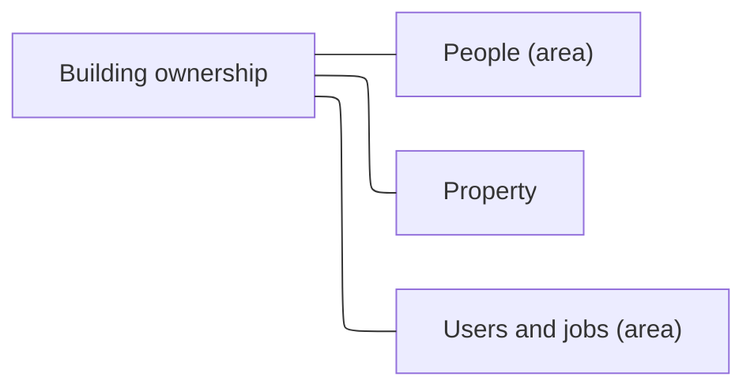
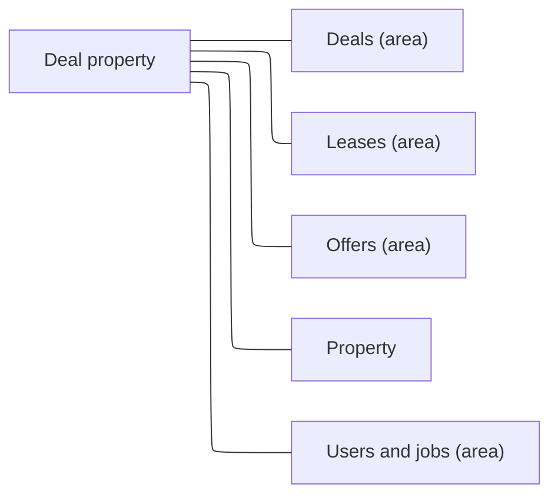
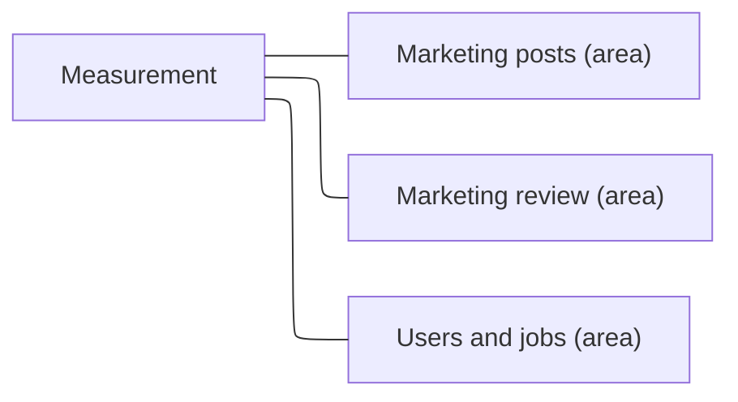
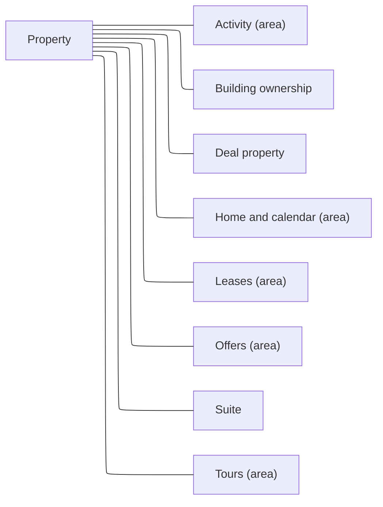
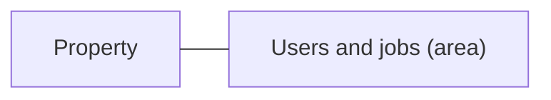
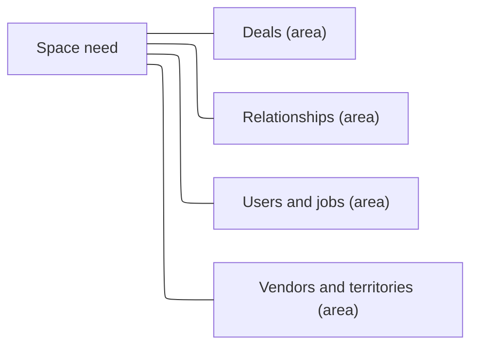
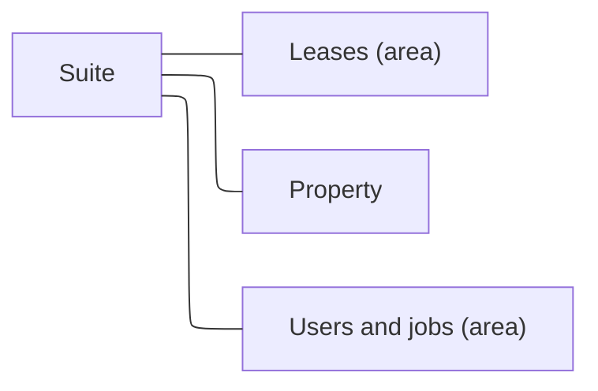

# Property

Each line shows a connection. The foreign keys below name the exact columns.

### Building ownership

### Deal property

### Measurement

### Property

### Space need

### Suite

## Foreign keys

| From table and columns                                                   | To table and columns                                              |
| ------------------------------------------------------------------------ | ----------------------------------------------------------------- |
| [activity_about](next.activity_about.md) (`property_id`)                 | [property](next.property.md) (`id`)                               |
| [building_ownership](next.building_ownership.md) (`changed_by_user_id`)  | [app_user](next.app_user.md) (`id`)                               |
| [building_ownership](next.building_ownership.md) (`changed_for_user_id`) | [app_user](next.app_user.md) (`id`)                               |
| [building_ownership](next.building_ownership.md) (`changed_by_job`)      | [job](next.job.md) (`slug`)                                       |
| [building_ownership](next.building_ownership.md) (`party_id`)            | [party](next.party.md) (`id`)                                     |
| [building_ownership](next.building_ownership.md) (`property_id`)         | [property](next.property.md) (`id`)                               |
| [deal_property](next.deal_property.md) (`changed_by_user_id`)            | [app_user](next.app_user.md) (`id`)                               |
| [deal_property](next.deal_property.md) (`changed_for_user_id`)           | [app_user](next.app_user.md) (`id`)                               |
| [deal_property](next.deal_property.md) (`deal_id`)                       | [deal](next.deal.md) (`id`)                                       |
| [deal_property](next.deal_property.md) (`changed_by_job`)                | [job](next.job.md) (`slug`)                                       |
| [deal_property](next.deal_property.md) (`property_id`)                   | [property](next.property.md) (`id`)                               |
| [home_update](next.home_update.md) (`property_id`)                       | [property](next.property.md) (`id`)                               |
| [lease](next.lease.md) (`deal_id`, `property_id`)                        | [deal_property](next.deal_property.md) (`deal_id`, `property_id`) |
| [lease](next.lease.md) (`property_id`)                                   | [property](next.property.md) (`id`)                               |
| [lease_suite](next.lease_suite.md) (`suite_id`, `property_id`)           | [suite](next.suite.md) (`id`, `property_id`)                      |
| [measurement](next.measurement.md) (`changed_by_user_id`)                | [app_user](next.app_user.md) (`id`)                               |
| [measurement](next.measurement.md) (`changed_for_user_id`)               | [app_user](next.app_user.md) (`id`)                               |
| [measurement](next.measurement.md) (`changed_by_job`)                    | [job](next.job.md) (`slug`)                                       |
| [measurement](next.measurement.md) (`platform`, `metric`)                | [platform_metric](next.platform_metric.md) (`platform`, `metric`) |
| [measurement](next.measurement.md) (`post_id`, `platform`)               | [post](next.post.md) (`id`, `platform`)                           |
| [next_step](next.next_step.md) (`property_id`)                           | [property](next.property.md) (`id`)                               |
| [offer](next.offer.md) (`deal_id`, `property_id`)                        | [deal_property](next.deal_property.md) (`deal_id`, `property_id`) |
| [property](next.property.md) (`changed_by_user_id`)                      | [app_user](next.app_user.md) (`id`)                               |
| [property](next.property.md) (`changed_for_user_id`)                     | [app_user](next.app_user.md) (`id`)                               |
| [property](next.property.md) (`changed_by_job`)                          | [job](next.job.md) (`slug`)                                       |
| [proposal](next.proposal.md) (`property_id`)                             | [property](next.property.md) (`id`)                               |
| [space_need](next.space_need.md) (`changed_by_user_id`)                  | [app_user](next.app_user.md) (`id`)                               |
| [space_need](next.space_need.md) (`changed_for_user_id`)                 | [app_user](next.app_user.md) (`id`)                               |
| [space_need](next.space_need.md) (`deal_id`)                             | [deal](next.deal.md) (`id`)                                       |
| [space_need](next.space_need.md) (`changed_by_job`)                      | [job](next.job.md) (`slug`)                                       |
| [space_need](next.space_need.md) (`market_id`)                           | [market](next.market.md) (`id`)                                   |
| [space_need](next.space_need.md) (`vendor_id`, `vendor_role`)            | [party_role](next.party_role.md) (`party_id`, `role`)             |
| [suite](next.suite.md) (`changed_by_user_id`)                            | [app_user](next.app_user.md) (`id`)                               |
| [suite](next.suite.md) (`changed_for_user_id`)                           | [app_user](next.app_user.md) (`id`)                               |
| [suite](next.suite.md) (`changed_by_job`)                                | [job](next.job.md) (`slug`)                                       |
| [suite](next.suite.md) (`property_id`)                                   | [property](next.property.md) (`id`)                               |
| [tour_stop](next.tour_stop.md) (`property_id`)                           | [property](next.property.md) (`id`)                               |

## Connects to

Numbers count foreign keys between the two areas.

[Activity](viewpoint-activity.md) (2) · [Deals](viewpoint-deals.md) (2) · [Home and calendar](viewpoint-home-calendar.md) (1) · [Leases](viewpoint-leases.md) (3) · [Marketing posts](viewpoint-marketing-posts.md) (1) · [Marketing review](viewpoint-marketing-review.md) (1) · [Offers](viewpoint-offers.md) (2) · [People](viewpoint-people.md) (1) · [Relationships](viewpoint-relationships.md) (1) · [Tours](viewpoint-tours.md) (1) · [Users and jobs](viewpoint-users-jobs.md) (18) · [Vendors and territories](viewpoint-vendors-territories.md) (1)

## Tables

- [Building ownership](next.building_ownership.md)
- [Deal property](next.deal_property.md)
- [Measurement](next.measurement.md)
- [Property](next.property.md)
- [Space need](next.space_need.md)
- [Suite](next.suite.md)
