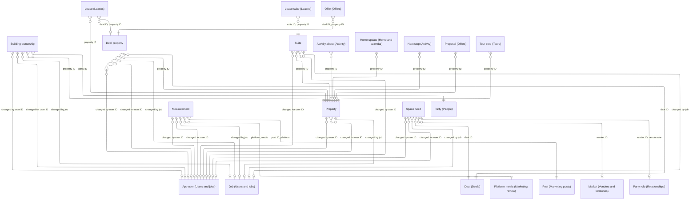

# Property

## Connects to

Numbers count foreign keys between the two areas.

[Activity](viewpoint-activity.md) (2) · [Deals](viewpoint-deals.md) (2) · [Home and calendar](viewpoint-home-calendar.md) (1) · [Leases](viewpoint-leases.md) (3) · [Marketing posts](viewpoint-marketing-posts.md) (1) · [Marketing review](viewpoint-marketing-review.md) (1) · [Offers](viewpoint-offers.md) (2) · [People](viewpoint-people.md) (1) · [Relationships](viewpoint-relationships.md) (1) · [Tours](viewpoint-tours.md) (1) · [Users and jobs](viewpoint-users-jobs.md) (18) · [Vendors and territories](viewpoint-vendors-territories.md) (1)

## Tables

- [Building ownership](next.building_ownership.md)
- [Deal property](next.deal_property.md)
- [Measurement](next.measurement.md)
- [Property](next.property.md)
- [Space need](next.space_need.md)
- [Suite](next.suite.md)

See each table for its columns and links to other areas.
