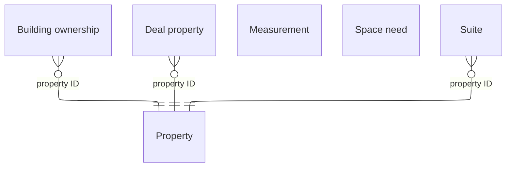

# Property

## Tables

- [Building ownership](next.building_ownership.md)
- [Deal property](next.deal_property.md)
- [Measurement](next.measurement.md)
- [Property](next.property.md)
- [Space need](next.space_need.md)
- [Suite](next.suite.md)

See each table for its columns and links to other areas.
