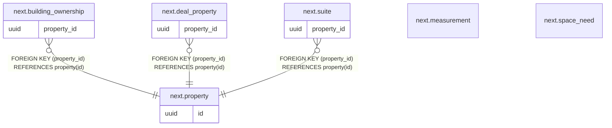

# Property

## Description

Tables in this area and the foreign keys between them.

## Tables

| Name                                                  | Columns | Comment | Type       |
| ----------------------------------------------------- | ------- | ------- | ---------- |
| [next.building_ownership](next.building_ownership.md) | 12      |         | BASE TABLE |
| [next.deal_property](next.deal_property.md)           | 7       |         | BASE TABLE |
| [next.measurement](next.measurement.md)               | 11      |         | BASE TABLE |
| [next.property](next.property.md)                     | 15      |         | BASE TABLE |
| [next.space_need](next.space_need.md)                 | 19      |         | BASE TABLE |
| [next.suite](next.suite.md)                           | 12      |         | BASE TABLE |

## Relations

---

> Generated by [tbls](https://github.com/k1LoW/tbls)
