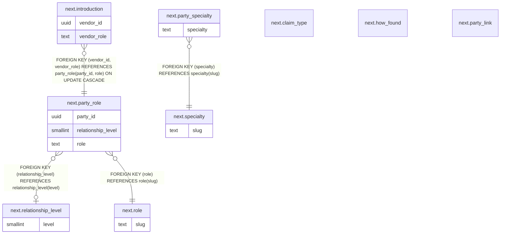

# Relationships

## Description

Tables in this area and the foreign keys between them.

## Tables

| Name                                                  | Columns | Comment | Type       |
| ----------------------------------------------------- | ------- | ------- | ---------- |
| [next.claim_type](next.claim_type.md)                 | 6       |         | BASE TABLE |
| [next.how_found](next.how_found.md)                   | 6       |         | BASE TABLE |
| [next.introduction](next.introduction.md)             | 14      |         | BASE TABLE |
| [next.party_link](next.party_link.md)                 | 12      |         | BASE TABLE |
| [next.party_role](next.party_role.md)                 | 25      |         | BASE TABLE |
| [next.party_specialty](next.party_specialty.md)       | 8       |         | BASE TABLE |
| [next.relationship_level](next.relationship_level.md) | 3       |         | BASE TABLE |
| [next.role](next.role.md)                             | 7       |         | BASE TABLE |
| [next.specialty](next.specialty.md)                   | 6       |         | BASE TABLE |

## Relations

---

> Generated by [tbls](https://github.com/k1LoW/tbls)
