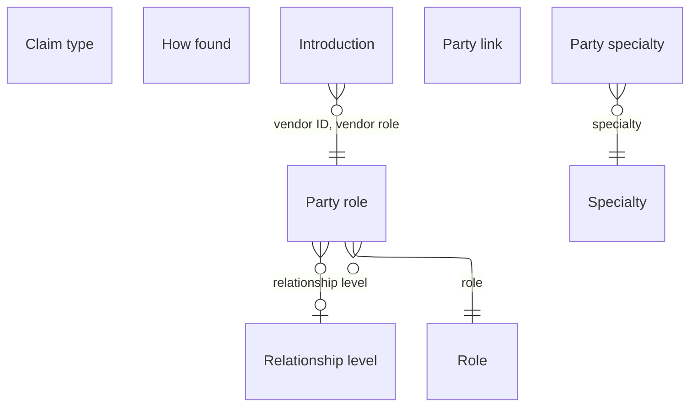

# Relationships

## Tables

- [Claim type](next.claim_type.md)
- [How found](next.how_found.md)
- [Introduction](next.introduction.md)
- [Party link](next.party_link.md)
- [Party role](next.party_role.md)
- [Party specialty](next.party_specialty.md)
- [Relationship level](next.relationship_level.md)
- [Role](next.role.md)
- [Specialty](next.specialty.md)

See each table for its columns and links to other areas.
