# Relationships

```mermaid
---
config:
  layout: elk
  er:
    nodeSpacing: 22
    rankSpacing: 44
---
erDiagram
  "Claim type"
  "How found"
  "Introduction"
  "Party link"
  "Party role"
  "Party specialty"
  "Relationship level"
  "Role"
  "Specialty"
  "Clients (area)" {
    string client
    string client_research
    string client_vertical
    string national_account
  }
  "Deals (area)" {
    string deal
    string deal_party
    string stage
  }
  "Doc (area)" {
    string doc_judgment_destination
    string doc_judgment_job
  }
  "Home and calendar (area)" {
    string weekly_review
  }
  "Imported deals (area)" {
    string imported_deal_party
  }
  "Leads (area)" {
    string candidate
    string lead_contact_draft
    string lead_email_source
    string lead_lane
    string lead_stage_move
  }
  "Offers (area)" {
    string offer_claim
    string proposal
  }
  "People (area)" {
    string party
  }
  "Property (area)" {
    string space_need
  }
  "Users and jobs (area)" {
    string app_user
    string job
  }
  "Vendors and territories (area)" {
    string vendor_loan_program
    string vendor_vertical
  }
  "Leads (area)" }o--o| "Party role" : "Candidate: promoted party ID, lead role"
  "Claim type" }o--o| "Users and jobs (area)" : "changed by user ID to App user"
  "Claim type" }o--o| "Users and jobs (area)" : "changed for user ID to App user"
  "Claim type" }o--o| "Users and jobs (area)" : "changed by job to Job"
  "Clients (area)" }o--|| "Party role" : "Client: party ID, role"
  "Clients (area)" }o--|| "Party role" : "Client research: party ID, role"
  "Clients (area)" }o--|| "Party role" : "Client vertical: party ID, role"
  "Deals (area)" }o--o| "Party role" : "Deal party: party ID, client role"
  "Deals (area)" }o--|| "Role" : "Deal party: role"
  "Doc (area)" }o--o| "Party role" : "Doc judgment destination: vendor ID, vendor role"
  "How found" }o--o| "Users and jobs (area)" : "changed by user ID to App user"
  "How found" }o--o| "Users and jobs (area)" : "changed for user ID to App user"
  "How found" }o--o| "Users and jobs (area)" : "changed by job to Job"
  "Imported deals (area)" }o--|| "Role" : "Imported deal party: role"
  "Introduction" }o--o| "Users and jobs (area)" : "changed by user ID to App user"
  "Introduction" }o--o| "Users and jobs (area)" : "changed for user ID to App user"
  "Introduction" }o--o| "Users and jobs (area)" : "introduced by user ID to App user"
  "Introduction" }o--o| "Deals (area)" : "deal ID to Deal"
  "Introduction" }o--o| "Deals (area)" : "deal ID, introduced party ID, maker client role to Deal party"
  "Introduction" }o--o| "Doc (area)" : "source job ID to Doc judgment job"
  "Introduction" }o--o| "Users and jobs (area)" : "changed by job to Job"
  "Introduction" }o--|| "People (area)" : "introduced party ID to Party"
  "Introduction" }o--|| "Party role" : "vendor ID, vendor role"
  "Leads (area)" }o--|| "Party role" : "Lead contact draft: party ID, role"
  "Leads (area)" }o--o| "Party role" : "Lead email source: party ID, lead role"
  "Leads (area)" }o--|| "Party role" : "Lead stage move: party ID, role"
  "Clients (area)" }o--|| "Party role" : "National account: party ID, role"
  "Offers (area)" }o--|| "Claim type" : "Offer claim: claim type"
  "People (area)" }o--o| "How found" : "Party: how found"
  "Party link" }o--o| "Users and jobs (area)" : "changed by user ID to App user"
  "Party link" }o--o| "Users and jobs (area)" : "changed for user ID to App user"
  "Party link" }o--o| "Users and jobs (area)" : "changed by job to Job"
  "Party link" }o--|| "People (area)" : "other party ID to Party"
  "Party link" }o--|| "People (area)" : "party ID to Party"
  "Party role" }o--o| "Users and jobs (area)" : "changed by user ID to App user"
  "Party role" }o--o| "Users and jobs (area)" : "changed for user ID to App user"
  "Party role" }o--o| "Users and jobs (area)" : "owner user ID to App user"
  "Party role" }o--o| "Clients (area)" : "lead client ID to Client"
  "Party role" }o--o| "Users and jobs (area)" : "changed by job to Job"
  "Party role" }o--o| "Leads (area)" : "lane to Lead lane"
  "Party role" }o--|| "People (area)" : "party ID to Party"
  "Party role" }o--o| "Relationship level" : "relationship level"
  "Party role" }o--|| "Role" : "role"
  "Party role" }o--o| "Deals (area)" : "role, stage to Stage"
  "Party specialty" }o--o| "Users and jobs (area)" : "changed by user ID to App user"
  "Party specialty" }o--o| "Users and jobs (area)" : "changed for user ID to App user"
  "Party specialty" }o--o| "Users and jobs (area)" : "changed by job to Job"
  "Party specialty" }o--|| "People (area)" : "person ID, person kind to Party"
  "Party specialty" }o--|| "Specialty" : "specialty"
  "Offers (area)" }o--o| "How found" : "Proposal: how found"
  "Role" }o--o| "Users and jobs (area)" : "changed by user ID to App user"
  "Role" }o--o| "Users and jobs (area)" : "changed for user ID to App user"
  "Role" }o--o| "Users and jobs (area)" : "changed by job to Job"
  "Property (area)" }o--o| "Party role" : "Space need: vendor ID, vendor role"
  "Specialty" }o--o| "Users and jobs (area)" : "changed by user ID to App user"
  "Specialty" }o--o| "Users and jobs (area)" : "changed for user ID to App user"
  "Specialty" }o--o| "Users and jobs (area)" : "changed by job to Job"
  "Deals (area)" }o--|| "Role" : "Stage: role"
  "Vendors and territories (area)" }o--|| "Party role" : "Vendor loan program: party ID, role"
  "Vendors and territories (area)" }o--|| "Party role" : "Vendor vertical: party ID, role"
  "Home and calendar (area)" }o--o| "Party role" : "Weekly review: party ID, lead role"
```

## Connects to

Numbers count foreign keys between the two areas.

[Clients](viewpoint-clients.md) (5) · [Deals](viewpoint-deals.md) (6) · [Doc](viewpoint-doc.md) (2) · [Home and calendar](viewpoint-home-calendar.md) (1) · [Imported deals](viewpoint-imported-deals.md) (1) · [Leads](viewpoint-leads.md) (5) · [Offers](viewpoint-offers.md) (2) · [People](viewpoint-people.md) (6) · [Property](viewpoint-property.md) (1) · [Users and jobs](viewpoint-users-jobs.md) (26) · [Vendors and territories](viewpoint-vendors-territories.md) (2)

## Tables

- [Claim type](next.claim_type.md)
- [How found](next.how_found.md)
- [Introduction](next.introduction.md)
- [Party link](next.party_link.md)
- [Party role](next.party_role.md)
- [Party specialty](next.party_specialty.md)
- [Relationship level](next.relationship_level.md)
- [Role](next.role.md)
- [Specialty](next.specialty.md)

See each table for its columns and links to other areas.
