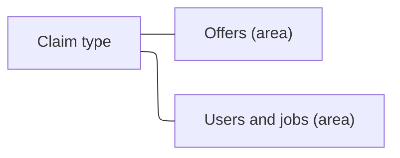
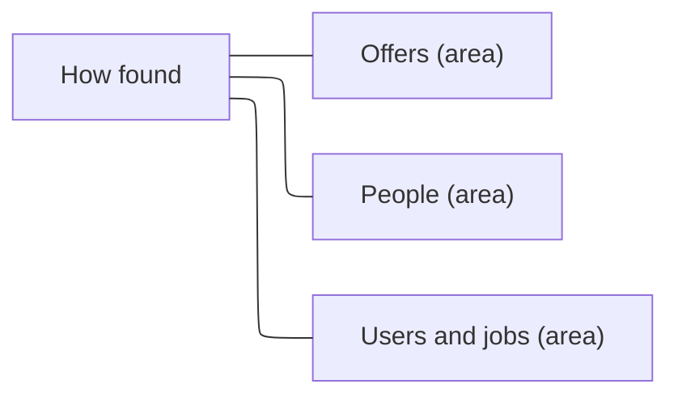
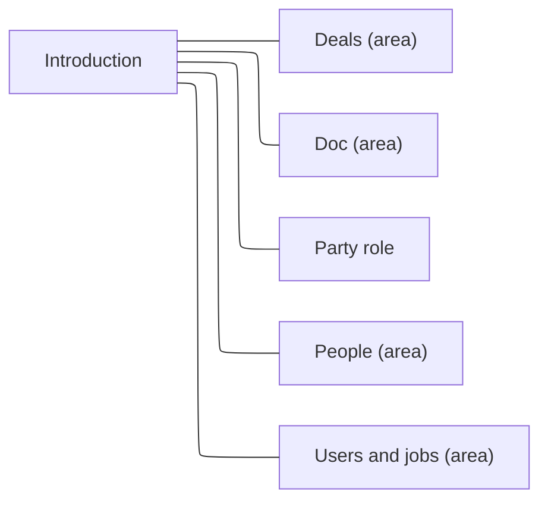
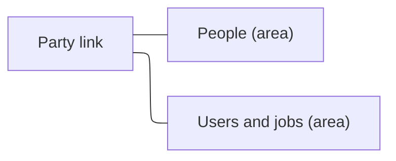
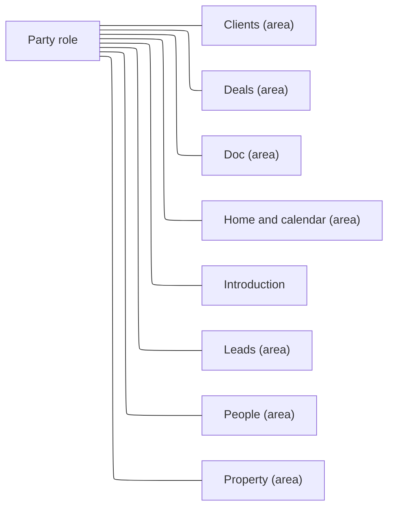
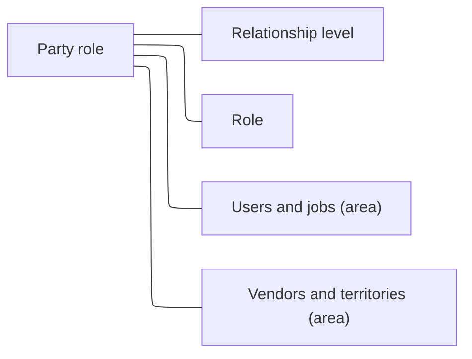
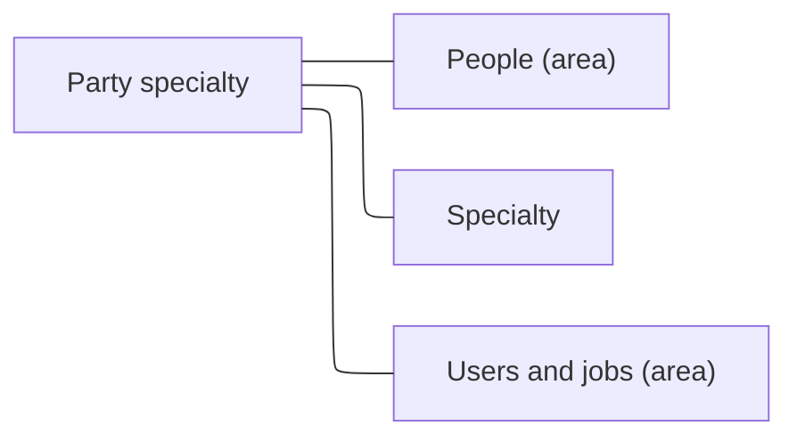
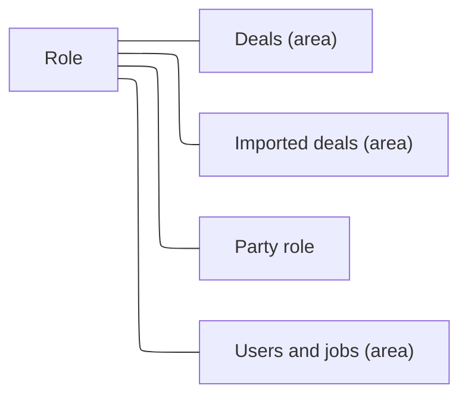
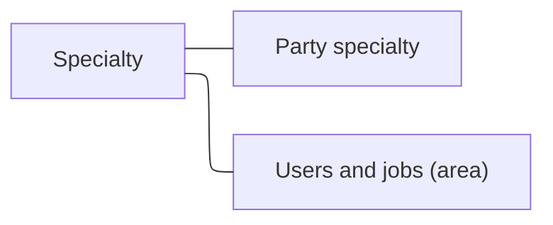

# Relationships

Each line shows a connection. The foreign keys below name the exact columns.

### Claim type

### How found

### Introduction

### Party link

### Party role

### Party specialty

### Relationship level

### Role

### Specialty

## Foreign keys

| From table and columns                                                                       | To table and columns                                             |
| -------------------------------------------------------------------------------------------- | ---------------------------------------------------------------- |
| [candidate](next.candidate.md) (`promoted_party_id`, `lead_role`)                            | [party_role](next.party_role.md) (`party_id`, `role`)            |
| [claim_type](next.claim_type.md) (`changed_by_user_id`)                                      | [app_user](next.app_user.md) (`id`)                              |
| [claim_type](next.claim_type.md) (`changed_for_user_id`)                                     | [app_user](next.app_user.md) (`id`)                              |
| [claim_type](next.claim_type.md) (`changed_by_job`)                                          | [job](next.job.md) (`slug`)                                      |
| [client](next.client.md) (`party_id`, `role`)                                                | [party_role](next.party_role.md) (`party_id`, `role`)            |
| [client_research](next.client_research.md) (`party_id`, `role`)                              | [party_role](next.party_role.md) (`party_id`, `role`)            |
| [client_vertical](next.client_vertical.md) (`party_id`, `role`)                              | [party_role](next.party_role.md) (`party_id`, `role`)            |
| [deal_party](next.deal_party.md) (`party_id`, `client_role`)                                 | [party_role](next.party_role.md) (`party_id`, `role`)            |
| [deal_party](next.deal_party.md) (`role`)                                                    | [role](next.role.md) (`slug`)                                    |
| [doc_judgment_destination](next.doc_judgment_destination.md) (`vendor_id`, `vendor_role`)    | [party_role](next.party_role.md) (`party_id`, `role`)            |
| [how_found](next.how_found.md) (`changed_by_user_id`)                                        | [app_user](next.app_user.md) (`id`)                              |
| [how_found](next.how_found.md) (`changed_for_user_id`)                                       | [app_user](next.app_user.md) (`id`)                              |
| [how_found](next.how_found.md) (`changed_by_job`)                                            | [job](next.job.md) (`slug`)                                      |
| [imported_deal_party](next.imported_deal_party.md) (`role`)                                  | [role](next.role.md) (`slug`)                                    |
| [introduction](next.introduction.md) (`changed_by_user_id`)                                  | [app_user](next.app_user.md) (`id`)                              |
| [introduction](next.introduction.md) (`changed_for_user_id`)                                 | [app_user](next.app_user.md) (`id`)                              |
| [introduction](next.introduction.md) (`introduced_by_user_id`)                               | [app_user](next.app_user.md) (`id`)                              |
| [introduction](next.introduction.md) (`deal_id`)                                             | [deal](next.deal.md) (`id`)                                      |
| [introduction](next.introduction.md) (`deal_id`, `introduced_party_id`, `maker_client_role`) | [deal_party](next.deal_party.md) (`deal_id`, `party_id`, `role`) |
| [introduction](next.introduction.md) (`source_job_id`)                                       | [doc_judgment_job](next.doc_judgment_job.md) (`id`)              |
| [introduction](next.introduction.md) (`changed_by_job`)                                      | [job](next.job.md) (`slug`)                                      |
| [introduction](next.introduction.md) (`introduced_party_id`)                                 | [party](next.party.md) (`id`)                                    |
| [introduction](next.introduction.md) (`vendor_id`, `vendor_role`)                            | [party_role](next.party_role.md) (`party_id`, `role`)            |
| [lead_contact_draft](next.lead_contact_draft.md) (`party_id`, `role`)                        | [party_role](next.party_role.md) (`party_id`, `role`)            |
| [lead_email_source](next.lead_email_source.md) (`party_id`, `lead_role`)                     | [party_role](next.party_role.md) (`party_id`, `role`)            |
| [lead_stage_move](next.lead_stage_move.md) (`party_id`, `role`)                              | [party_role](next.party_role.md) (`party_id`, `role`)            |
| [national_account](next.national_account.md) (`party_id`, `role`)                            | [party_role](next.party_role.md) (`party_id`, `role`)            |
| [offer_claim](next.offer_claim.md) (`claim_type`)                                            | [claim_type](next.claim_type.md) (`slug`)                        |
| [party](next.party.md) (`how_found`)                                                         | [how_found](next.how_found.md) (`slug`)                          |
| [party_link](next.party_link.md) (`changed_by_user_id`)                                      | [app_user](next.app_user.md) (`id`)                              |
| [party_link](next.party_link.md) (`changed_for_user_id`)                                     | [app_user](next.app_user.md) (`id`)                              |
| [party_link](next.party_link.md) (`changed_by_job`)                                          | [job](next.job.md) (`slug`)                                      |
| [party_link](next.party_link.md) (`other_party_id`)                                          | [party](next.party.md) (`id`)                                    |
| [party_link](next.party_link.md) (`party_id`)                                                | [party](next.party.md) (`id`)                                    |
| [party_role](next.party_role.md) (`changed_by_user_id`)                                      | [app_user](next.app_user.md) (`id`)                              |
| [party_role](next.party_role.md) (`changed_for_user_id`)                                     | [app_user](next.app_user.md) (`id`)                              |
| [party_role](next.party_role.md) (`owner_user_id`)                                           | [app_user](next.app_user.md) (`id`)                              |
| [party_role](next.party_role.md) (`lead_client_id`)                                          | [client](next.client.md) (`party_id`)                            |
| [party_role](next.party_role.md) (`changed_by_job`)                                          | [job](next.job.md) (`slug`)                                      |
| [party_role](next.party_role.md) (`lane`)                                                    | [lead_lane](next.lead_lane.md) (`slug`)                          |
| [party_role](next.party_role.md) (`party_id`)                                                | [party](next.party.md) (`id`)                                    |
| [party_role](next.party_role.md) (`relationship_level`)                                      | [relationship_level](next.relationship_level.md) (`level`)       |
| [party_role](next.party_role.md) (`role`)                                                    | [role](next.role.md) (`slug`)                                    |
| [party_role](next.party_role.md) (`role`, `stage`)                                           | [stage](next.stage.md) (`role`, `slug`)                          |
| [party_specialty](next.party_specialty.md) (`changed_by_user_id`)                            | [app_user](next.app_user.md) (`id`)                              |
| [party_specialty](next.party_specialty.md) (`changed_for_user_id`)                           | [app_user](next.app_user.md) (`id`)                              |
| [party_specialty](next.party_specialty.md) (`changed_by_job`)                                | [job](next.job.md) (`slug`)                                      |
| [party_specialty](next.party_specialty.md) (`person_id`, `person_kind`)                      | [party](next.party.md) (`id`, `kind`)                            |
| [party_specialty](next.party_specialty.md) (`specialty`)                                     | [specialty](next.specialty.md) (`slug`)                          |
| [proposal](next.proposal.md) (`how_found`)                                                   | [how_found](next.how_found.md) (`slug`)                          |
| [role](next.role.md) (`changed_by_user_id`)                                                  | [app_user](next.app_user.md) (`id`)                              |
| [role](next.role.md) (`changed_for_user_id`)                                                 | [app_user](next.app_user.md) (`id`)                              |
| [role](next.role.md) (`changed_by_job`)                                                      | [job](next.job.md) (`slug`)                                      |
| [space_need](next.space_need.md) (`vendor_id`, `vendor_role`)                                | [party_role](next.party_role.md) (`party_id`, `role`)            |
| [specialty](next.specialty.md) (`changed_by_user_id`)                                        | [app_user](next.app_user.md) (`id`)                              |
| [specialty](next.specialty.md) (`changed_for_user_id`)                                       | [app_user](next.app_user.md) (`id`)                              |
| [specialty](next.specialty.md) (`changed_by_job`)                                            | [job](next.job.md) (`slug`)                                      |
| [stage](next.stage.md) (`role`)                                                              | [role](next.role.md) (`slug`)                                    |
| [vendor_loan_program](next.vendor_loan_program.md) (`party_id`, `role`)                      | [party_role](next.party_role.md) (`party_id`, `role`)            |
| [vendor_vertical](next.vendor_vertical.md) (`party_id`, `role`)                              | [party_role](next.party_role.md) (`party_id`, `role`)            |
| [weekly_review](next.weekly_review.md) (`party_id`, `lead_role`)                             | [party_role](next.party_role.md) (`party_id`, `role`)            |

## Connects to

Numbers count foreign keys between the two areas.

[Clients](viewpoint-clients.md) (5) · [Deals](viewpoint-deals.md) (6) · [Doc](viewpoint-doc.md) (2) · [Home and calendar](viewpoint-home-calendar.md) (1) · [Imported deals](viewpoint-imported-deals.md) (1) · [Leads](viewpoint-leads.md) (5) · [Offers](viewpoint-offers.md) (2) · [People](viewpoint-people.md) (6) · [Property](viewpoint-property.md) (1) · [Users and jobs](viewpoint-users-jobs.md) (26) · [Vendors and territories](viewpoint-vendors-territories.md) (2)

## Tables

- [Claim type](next.claim_type.md)
- [How found](next.how_found.md)
- [Introduction](next.introduction.md)
- [Party link](next.party_link.md)
- [Party role](next.party_role.md)
- [Party specialty](next.party_specialty.md)
- [Relationship level](next.relationship_level.md)
- [Role](next.role.md)
- [Specialty](next.specialty.md)
