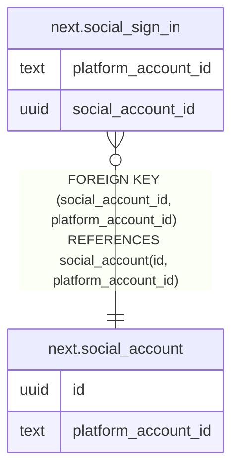

# Social accounts

## Description

Tables in this area and the foreign keys between them.

## Tables

| Name                                          | Columns | Comment | Type       |
| --------------------------------------------- | ------- | ------- | ---------- |
| [next.social_account](next.social_account.md) | 11      |         | BASE TABLE |
| [next.social_sign_in](next.social_sign_in.md) | 6       |         | BASE TABLE |

## Relations

---

> Generated by [tbls](https://github.com/k1LoW/tbls)
