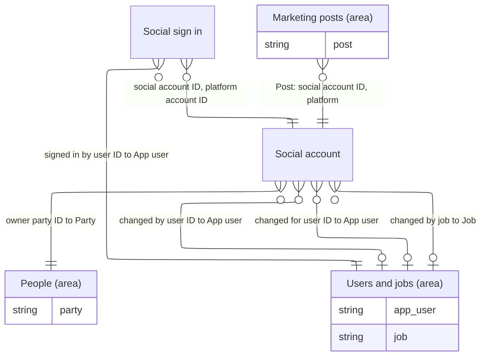

# Social accounts

## Connects to

Numbers count foreign keys between the two areas.

[Marketing posts](viewpoint-marketing-posts.md) (1) · [People](viewpoint-people.md) (1) · [Users and jobs](viewpoint-users-jobs.md) (4)

## Tables

- [Social account](next.social_account.md)
- [Social sign in](next.social_sign_in.md)

See each table for its columns and links to other areas.
