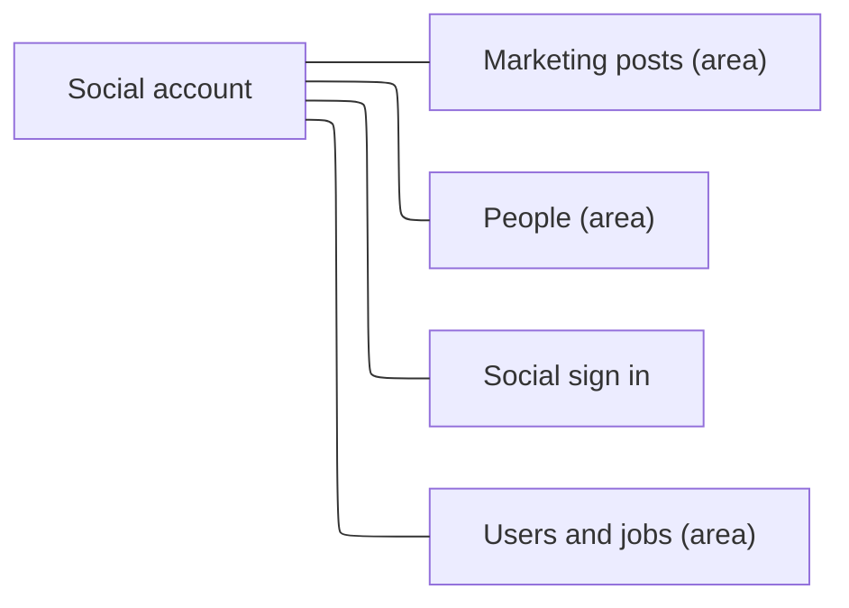
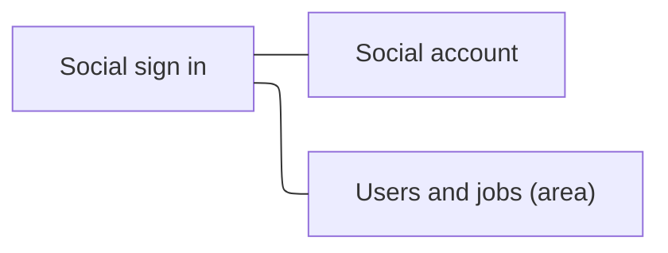

# Social accounts

Each line shows a connection. The foreign keys below name the exact columns.

### Social account

### Social sign in

## Foreign keys

| From table and columns                                                                | To table and columns                                                   |
| ------------------------------------------------------------------------------------- | ---------------------------------------------------------------------- |
| [post](next.post.md) (`social_account_id`, `platform`)                                | [social_account](next.social_account.md) (`id`, `platform`)            |
| [social_account](next.social_account.md) (`changed_by_user_id`)                       | [app_user](next.app_user.md) (`id`)                                    |
| [social_account](next.social_account.md) (`changed_for_user_id`)                      | [app_user](next.app_user.md) (`id`)                                    |
| [social_account](next.social_account.md) (`changed_by_job`)                           | [job](next.job.md) (`slug`)                                            |
| [social_account](next.social_account.md) (`owner_party_id`)                           | [party](next.party.md) (`id`)                                          |
| [social_sign_in](next.social_sign_in.md) (`signed_in_by_user_id`)                     | [app_user](next.app_user.md) (`id`)                                    |
| [social_sign_in](next.social_sign_in.md) (`social_account_id`, `platform_account_id`) | [social_account](next.social_account.md) (`id`, `platform_account_id`) |

## Connects to

Numbers count foreign keys between the two areas.

[Marketing posts](viewpoint-marketing-posts.md) (1) · [People](viewpoint-people.md) (1) · [Users and jobs](viewpoint-users-jobs.md) (4)

## Tables

- [Social account](next.social_account.md)
- [Social sign in](next.social_sign_in.md)
