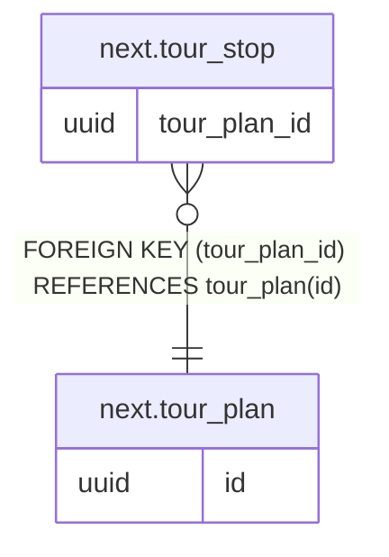

# Tours

## Description

Tables in this area and the foreign keys between them.

## Tables

| Name                                | Columns | Comment | Type       |
| ----------------------------------- | ------- | ------- | ---------- |
| [next.tour_plan](next.tour_plan.md) | 13      |         | BASE TABLE |
| [next.tour_stop](next.tour_stop.md) | 8       |         | BASE TABLE |

## Relations

---

> Generated by [tbls](https://github.com/k1LoW/tbls)
