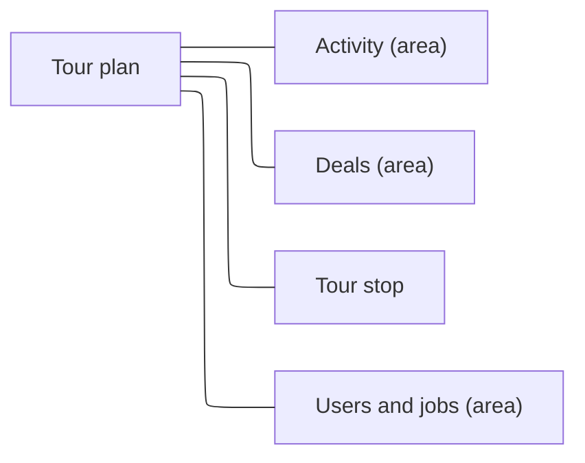
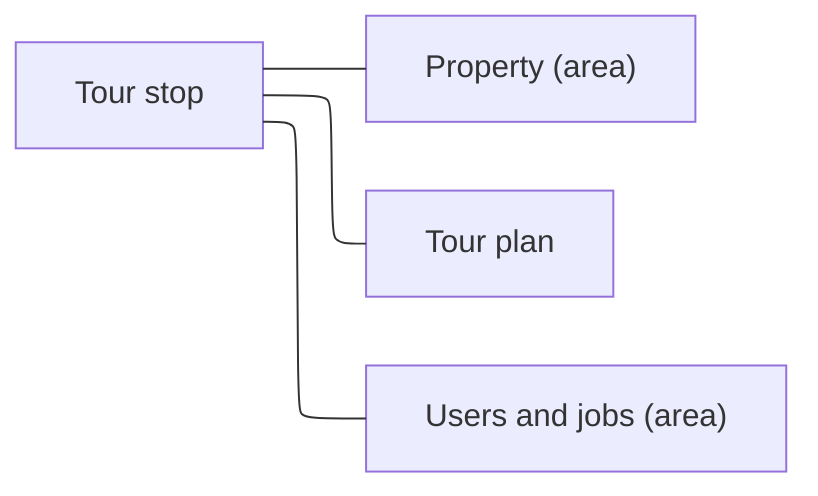

# Tours

Each line shows a connection. The foreign keys below name the exact columns.

### Tour plan

### Tour stop

## Foreign keys

| From table and columns                                                              | To table and columns                                                |
| ----------------------------------------------------------------------------------- | ------------------------------------------------------------------- |
| [tour_plan](next.tour_plan.md) (`completed_activity_id`, `completed_activity_kind`) | [activity](next.activity.md) (`id`, `kind`)                         |
| [tour_plan](next.tour_plan.md) (`completed_activity_id`, `deal_id`)                 | [activity_about](next.activity_about.md) (`activity_id`, `deal_id`) |
| [tour_plan](next.tour_plan.md) (`changed_by_user_id`)                               | [app_user](next.app_user.md) (`id`)                                 |
| [tour_plan](next.tour_plan.md) (`changed_for_user_id`)                              | [app_user](next.app_user.md) (`id`)                                 |
| [tour_plan](next.tour_plan.md) (`deal_id`)                                          | [deal](next.deal.md) (`id`)                                         |
| [tour_plan](next.tour_plan.md) (`changed_by_job`)                                   | [job](next.job.md) (`slug`)                                         |
| [tour_stop](next.tour_stop.md) (`changed_by_user_id`)                               | [app_user](next.app_user.md) (`id`)                                 |
| [tour_stop](next.tour_stop.md) (`changed_for_user_id`)                              | [app_user](next.app_user.md) (`id`)                                 |
| [tour_stop](next.tour_stop.md) (`changed_by_job`)                                   | [job](next.job.md) (`slug`)                                         |
| [tour_stop](next.tour_stop.md) (`property_id`)                                      | [property](next.property.md) (`id`)                                 |
| [tour_stop](next.tour_stop.md) (`tour_plan_id`)                                     | [tour_plan](next.tour_plan.md) (`id`)                               |

## Connects to

Numbers count foreign keys between the two areas.

[Activity](viewpoint-activity.md) (2) · [Deals](viewpoint-deals.md) (1) · [Property](viewpoint-property.md) (1) · [Users and jobs](viewpoint-users-jobs.md) (6)

## Tables

- [Tour plan](next.tour_plan.md)
- [Tour stop](next.tour_stop.md)
