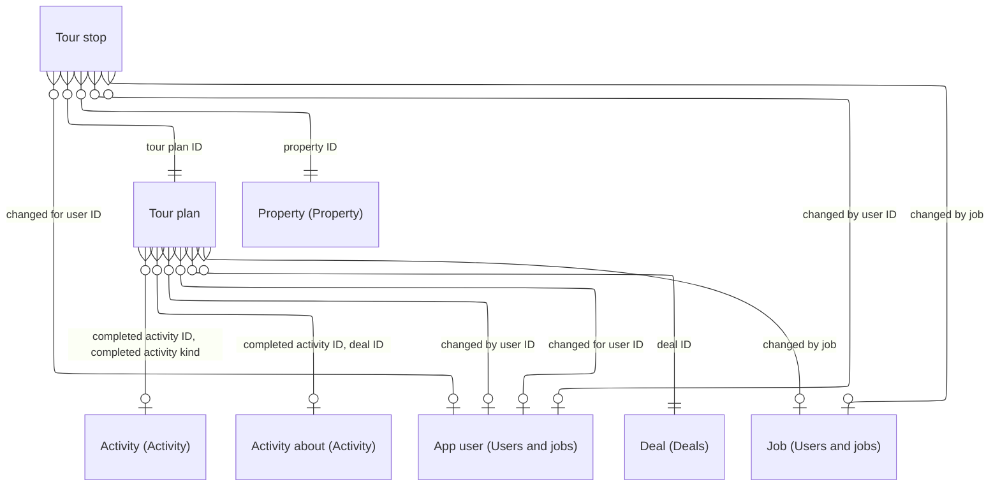

# Tours

## Connects to

Numbers count foreign keys between the two areas.

[Activity](viewpoint-activity.md) (2) · [Deals](viewpoint-deals.md) (1) · [Property](viewpoint-property.md) (1) · [Users and jobs](viewpoint-users-jobs.md) (6)

## Tables

- [Tour plan](next.tour_plan.md)
- [Tour stop](next.tour_stop.md)

See each table for its columns and links to other areas.
