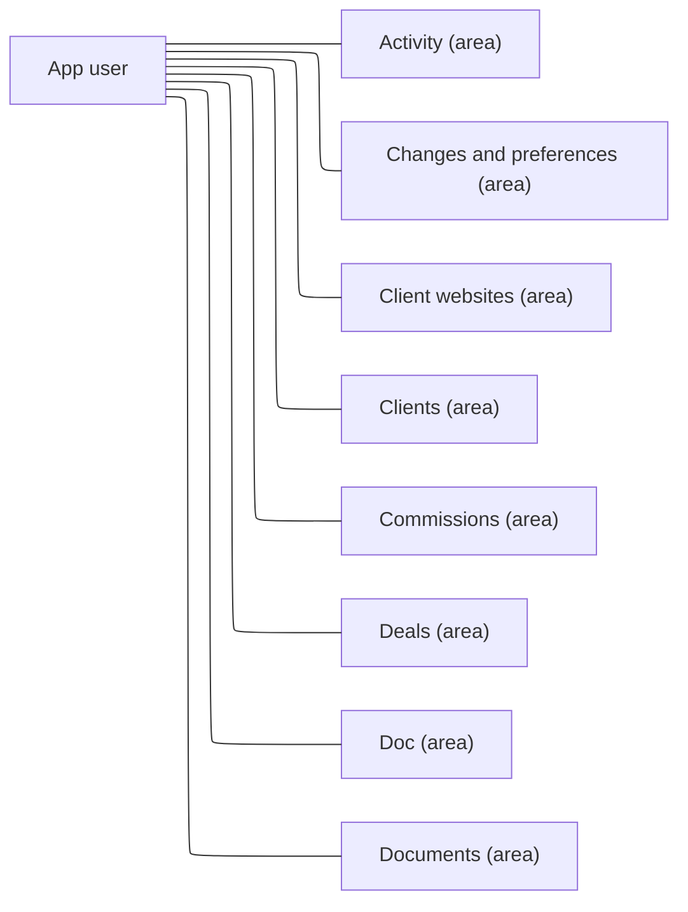
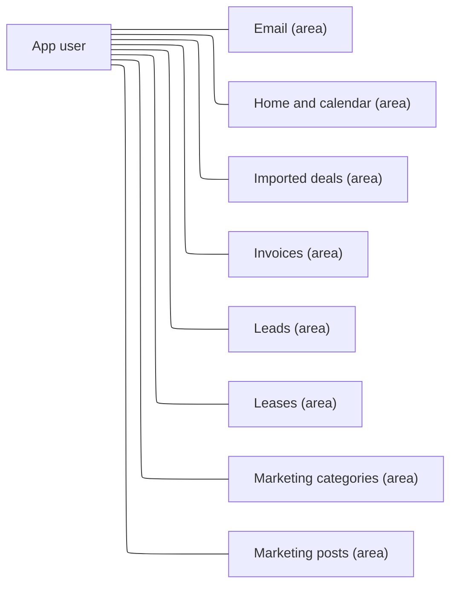
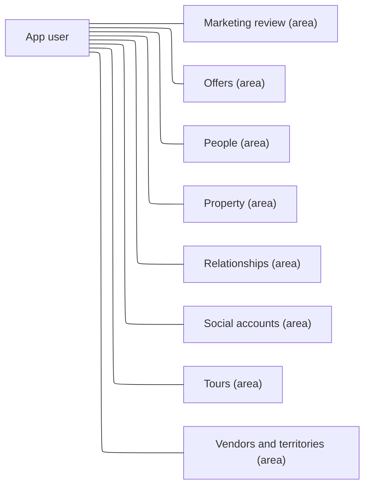
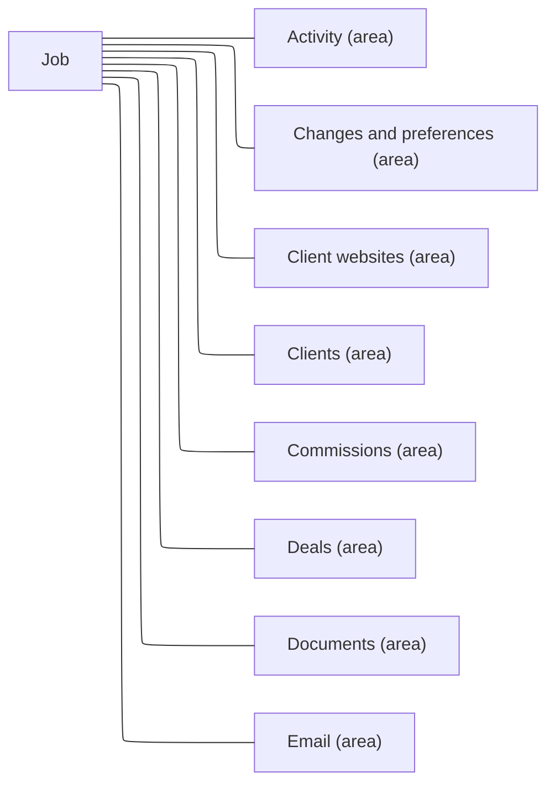
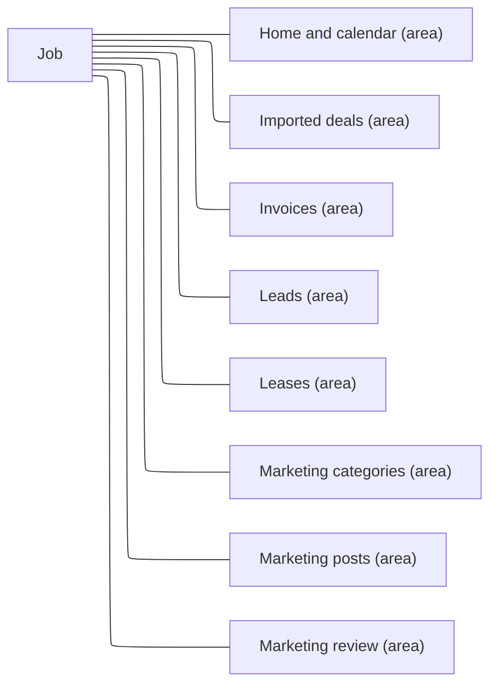
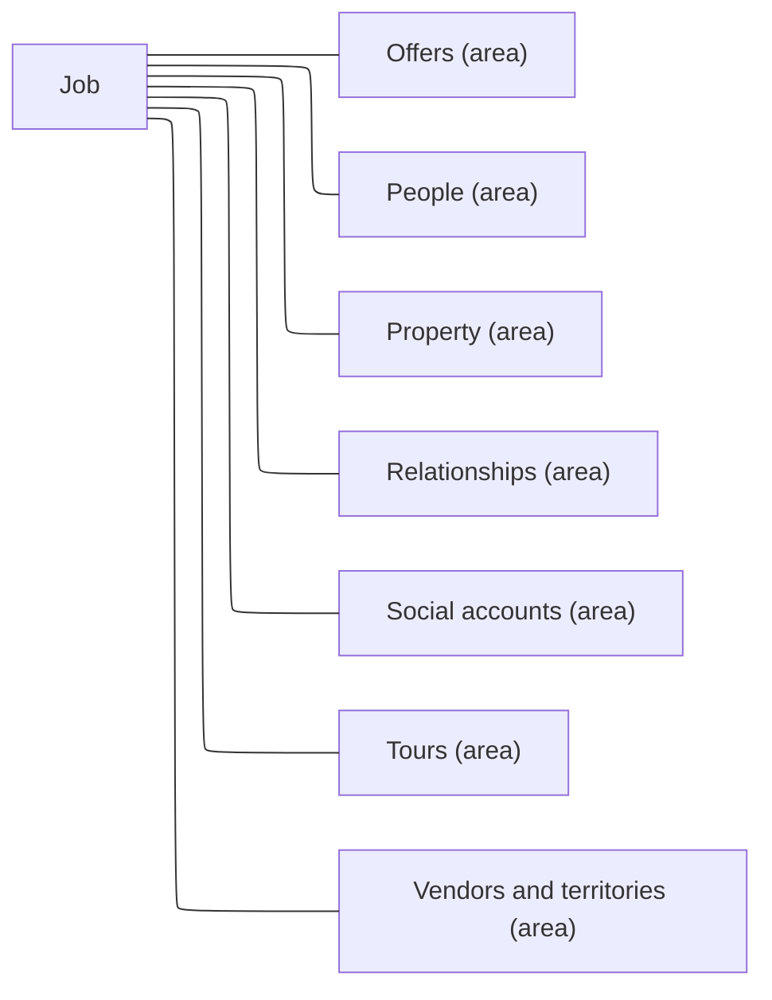

# Users and jobs

Each line shows a connection. The foreign keys below name the exact columns.

### App user

### Job

## Foreign keys

| From table and columns                                                                                      | To table and columns                                      |
| ----------------------------------------------------------------------------------------------------------- | --------------------------------------------------------- |
| [activity](next.activity.md) (`calendar_review_user_id`)                                                    | [app_user](next.app_user.md) (`id`)                       |
| [activity](next.activity.md) (`call_owner_user_id`)                                                         | [app_user](next.app_user.md) (`id`)                       |
| [activity](next.activity.md) (`changed_by_user_id`)                                                         | [app_user](next.app_user.md) (`id`)                       |
| [activity](next.activity.md) (`changed_for_user_id`)                                                        | [app_user](next.app_user.md) (`id`)                       |
| [activity](next.activity.md) (`changed_by_job`)                                                             | [job](next.job.md) (`slug`)                               |
| [activity_about](next.activity_about.md) (`changed_by_user_id`)                                             | [app_user](next.app_user.md) (`id`)                       |
| [activity_about](next.activity_about.md) (`changed_for_user_id`)                                            | [app_user](next.app_user.md) (`id`)                       |
| [activity_about](next.activity_about.md) (`changed_by_job`)                                                 | [job](next.job.md) (`slug`)                               |
| [app_user](next.app_user.md) (`id`, `kind`)                                                                 | [party](next.party.md) (`id`, `kind`)                     |
| [building_ownership](next.building_ownership.md) (`changed_by_user_id`)                                     | [app_user](next.app_user.md) (`id`)                       |
| [building_ownership](next.building_ownership.md) (`changed_for_user_id`)                                    | [app_user](next.app_user.md) (`id`)                       |
| [building_ownership](next.building_ownership.md) (`changed_by_job`)                                         | [job](next.job.md) (`slug`)                               |
| [calendar_agenda](next.calendar_agenda.md) (`changed_by_user_id`)                                           | [app_user](next.app_user.md) (`id`)                       |
| [calendar_agenda](next.calendar_agenda.md) (`changed_for_user_id`)                                          | [app_user](next.app_user.md) (`id`)                       |
| [calendar_agenda](next.calendar_agenda.md) (`user_id`)                                                      | [app_user](next.app_user.md) (`id`)                       |
| [calendar_agenda](next.calendar_agenda.md) (`changed_by_job`)                                               | [job](next.job.md) (`slug`)                               |
| [calendar_review_dismissal](next.calendar_review_dismissal.md) (`changed_by_user_id`)                       | [app_user](next.app_user.md) (`id`)                       |
| [calendar_review_dismissal](next.calendar_review_dismissal.md) (`changed_for_user_id`)                      | [app_user](next.app_user.md) (`id`)                       |
| [calendar_review_dismissal](next.calendar_review_dismissal.md) (`user_id`)                                  | [app_user](next.app_user.md) (`id`)                       |
| [calendar_review_dismissal](next.calendar_review_dismissal.md) (`changed_by_job`)                           | [job](next.job.md) (`slug`)                               |
| [candidate](next.candidate.md) (`changed_by_user_id`)                                                       | [app_user](next.app_user.md) (`id`)                       |
| [candidate](next.candidate.md) (`changed_for_user_id`)                                                      | [app_user](next.app_user.md) (`id`)                       |
| [candidate](next.candidate.md) (`changed_by_job`)                                                           | [job](next.job.md) (`slug`)                               |
| [change](next.change.md) (`changed_by_user_id`)                                                             | [app_user](next.app_user.md) (`id`)                       |
| [change](next.change.md) (`changed_for_user_id`)                                                            | [app_user](next.app_user.md) (`id`)                       |
| [change](next.change.md) (`changed_by_job`)                                                                 | [job](next.job.md) (`slug`)                               |
| [claim_type](next.claim_type.md) (`changed_by_user_id`)                                                     | [app_user](next.app_user.md) (`id`)                       |
| [claim_type](next.claim_type.md) (`changed_for_user_id`)                                                    | [app_user](next.app_user.md) (`id`)                       |
| [claim_type](next.claim_type.md) (`changed_by_job`)                                                         | [job](next.job.md) (`slug`)                               |
| [client](next.client.md) (`changed_by_user_id`)                                                             | [app_user](next.app_user.md) (`id`)                       |
| [client](next.client.md) (`changed_for_user_id`)                                                            | [app_user](next.app_user.md) (`id`)                       |
| [client](next.client.md) (`owner_user_id`)                                                                  | [app_user](next.app_user.md) (`id`)                       |
| [client](next.client.md) (`changed_by_job`)                                                                 | [job](next.job.md) (`slug`)                               |
| [client_brand](next.client_brand.md) (`changed_by_user_id`)                                                 | [app_user](next.app_user.md) (`id`)                       |
| [client_brand](next.client_brand.md) (`changed_for_user_id`)                                                | [app_user](next.app_user.md) (`id`)                       |
| [client_brand](next.client_brand.md) (`changed_by_job`)                                                     | [job](next.job.md) (`slug`)                               |
| [client_research](next.client_research.md) (`changed_by_user_id`)                                           | [app_user](next.app_user.md) (`id`)                       |
| [client_research](next.client_research.md) (`changed_for_user_id`)                                          | [app_user](next.app_user.md) (`id`)                       |
| [client_research](next.client_research.md) (`changed_by_job`)                                               | [job](next.job.md) (`slug`)                               |
| [client_research_fact](next.client_research_fact.md) (`changed_by_user_id`)                                 | [app_user](next.app_user.md) (`id`)                       |
| [client_research_fact](next.client_research_fact.md) (`changed_for_user_id`)                                | [app_user](next.app_user.md) (`id`)                       |
| [client_research_fact](next.client_research_fact.md) (`changed_by_job`)                                     | [job](next.job.md) (`slug`)                               |
| [client_type](next.client_type.md) (`changed_by_user_id`)                                                   | [app_user](next.app_user.md) (`id`)                       |
| [client_type](next.client_type.md) (`changed_for_user_id`)                                                  | [app_user](next.app_user.md) (`id`)                       |
| [client_type](next.client_type.md) (`changed_by_job`)                                                       | [job](next.job.md) (`slug`)                               |
| [client_vertical](next.client_vertical.md) (`changed_by_user_id`)                                           | [app_user](next.app_user.md) (`id`)                       |
| [client_vertical](next.client_vertical.md) (`changed_for_user_id`)                                          | [app_user](next.app_user.md) (`id`)                       |
| [client_vertical](next.client_vertical.md) (`changed_by_job`)                                               | [job](next.job.md) (`slug`)                               |
| [commission](next.commission.md) (`changed_by_user_id`)                                                     | [app_user](next.app_user.md) (`id`)                       |
| [commission](next.commission.md) (`changed_for_user_id`)                                                    | [app_user](next.app_user.md) (`id`)                       |
| [commission](next.commission.md) (`changed_by_job`)                                                         | [job](next.job.md) (`slug`)                               |
| [commission_payment](next.commission_payment.md) (`changed_by_user_id`)                                     | [app_user](next.app_user.md) (`id`)                       |
| [commission_payment](next.commission_payment.md) (`changed_for_user_id`)                                    | [app_user](next.app_user.md) (`id`)                       |
| [commission_payment](next.commission_payment.md) (`changed_by_job`)                                         | [job](next.job.md) (`slug`)                               |
| [commission_share](next.commission_share.md) (`changed_by_user_id`)                                         | [app_user](next.app_user.md) (`id`)                       |
| [commission_share](next.commission_share.md) (`changed_for_user_id`)                                        | [app_user](next.app_user.md) (`id`)                       |
| [commission_share](next.commission_share.md) (`changed_by_job`)                                             | [job](next.job.md) (`slug`)                               |
| [commission_tier](next.commission_tier.md) (`changed_by_user_id`)                                           | [app_user](next.app_user.md) (`id`)                       |
| [commission_tier](next.commission_tier.md) (`changed_for_user_id`)                                          | [app_user](next.app_user.md) (`id`)                       |
| [commission_tier](next.commission_tier.md) (`partner_user_id`)                                              | [app_user](next.app_user.md) (`id`)                       |
| [commission_tier](next.commission_tier.md) (`user_id`)                                                      | [app_user](next.app_user.md) (`id`)                       |
| [commission_tier](next.commission_tier.md) (`changed_by_job`)                                               | [job](next.job.md) (`slug`)                               |
| [critical_date](next.critical_date.md) (`changed_by_user_id`)                                               | [app_user](next.app_user.md) (`id`)                       |
| [critical_date](next.critical_date.md) (`changed_for_user_id`)                                              | [app_user](next.app_user.md) (`id`)                       |
| [critical_date](next.critical_date.md) (`confirmed_by_user_id`)                                             | [app_user](next.app_user.md) (`id`)                       |
| [critical_date](next.critical_date.md) (`resolved_by_user_id`)                                              | [app_user](next.app_user.md) (`id`)                       |
| [critical_date](next.critical_date.md) (`changed_by_job`)                                                   | [job](next.job.md) (`slug`)                               |
| [deal](next.deal.md) (`changed_by_user_id`)                                                                 | [app_user](next.app_user.md) (`id`)                       |
| [deal](next.deal.md) (`changed_for_user_id`)                                                                | [app_user](next.app_user.md) (`id`)                       |
| [deal](next.deal.md) (`owner_user_id`)                                                                      | [app_user](next.app_user.md) (`id`)                       |
| [deal](next.deal.md) (`parked_by_user_id`)                                                                  | [app_user](next.app_user.md) (`id`)                       |
| [deal](next.deal.md) (`changed_by_job`)                                                                     | [job](next.job.md) (`slug`)                               |
| [deal_attention_alert](next.deal_attention_alert.md) (`owner_user_id`)                                      | [app_user](next.app_user.md) (`id`)                       |
| [deal_client_website](next.deal_client_website.md) (`changed_by_user_id`)                                   | [app_user](next.app_user.md) (`id`)                       |
| [deal_client_website](next.deal_client_website.md) (`changed_for_user_id`)                                  | [app_user](next.app_user.md) (`id`)                       |
| [deal_client_website](next.deal_client_website.md) (`changed_by_job`)                                       | [job](next.job.md) (`slug`)                               |
| [deal_client_website_grant](next.deal_client_website_grant.md) (`user_id`)                                  | [app_user](next.app_user.md) (`id`)                       |
| [deal_kind](next.deal_kind.md) (`changed_by_user_id`)                                                       | [app_user](next.app_user.md) (`id`)                       |
| [deal_kind](next.deal_kind.md) (`changed_for_user_id`)                                                      | [app_user](next.app_user.md) (`id`)                       |
| [deal_kind](next.deal_kind.md) (`changed_by_job`)                                                           | [job](next.job.md) (`slug`)                               |
| [deal_party](next.deal_party.md) (`changed_by_user_id`)                                                     | [app_user](next.app_user.md) (`id`)                       |
| [deal_party](next.deal_party.md) (`changed_for_user_id`)                                                    | [app_user](next.app_user.md) (`id`)                       |
| [deal_party](next.deal_party.md) (`changed_by_job`)                                                         | [job](next.job.md) (`slug`)                               |
| [deal_phase_change](next.deal_phase_change.md) (`changed_by_user_id`)                                       | [app_user](next.app_user.md) (`id`)                       |
| [deal_phase_change](next.deal_phase_change.md) (`changed_for_user_id`)                                      | [app_user](next.app_user.md) (`id`)                       |
| [deal_phase_change](next.deal_phase_change.md) (`changed_by_job`)                                           | [job](next.job.md) (`slug`)                               |
| [deal_plan_date](next.deal_plan_date.md) (`changed_by_user_id`)                                             | [app_user](next.app_user.md) (`id`)                       |
| [deal_plan_date](next.deal_plan_date.md) (`changed_for_user_id`)                                            | [app_user](next.app_user.md) (`id`)                       |
| [deal_plan_date](next.deal_plan_date.md) (`changed_by_job`)                                                 | [job](next.job.md) (`slug`)                               |
| [deal_property](next.deal_property.md) (`changed_by_user_id`)                                               | [app_user](next.app_user.md) (`id`)                       |
| [deal_property](next.deal_property.md) (`changed_for_user_id`)                                              | [app_user](next.app_user.md) (`id`)                       |
| [deal_property](next.deal_property.md) (`changed_by_job`)                                                   | [job](next.job.md) (`slug`)                               |
| [deal_reason](next.deal_reason.md) (`changed_by_user_id`)                                                   | [app_user](next.app_user.md) (`id`)                       |
| [deal_reason](next.deal_reason.md) (`changed_for_user_id`)                                                  | [app_user](next.app_user.md) (`id`)                       |
| [deal_reason](next.deal_reason.md) (`changed_by_job`)                                                       | [job](next.job.md) (`slug`)                               |
| [design_template](next.design_template.md) (`changed_by_user_id`)                                           | [app_user](next.app_user.md) (`id`)                       |
| [design_template](next.design_template.md) (`changed_for_user_id`)                                          | [app_user](next.app_user.md) (`id`)                       |
| [design_template](next.design_template.md) (`changed_by_job`)                                               | [job](next.job.md) (`slug`)                               |
| [do_not_contact](next.do_not_contact.md) (`changed_by_user_id`)                                             | [app_user](next.app_user.md) (`id`)                       |
| [do_not_contact](next.do_not_contact.md) (`changed_for_user_id`)                                            | [app_user](next.app_user.md) (`id`)                       |
| [do_not_contact](next.do_not_contact.md) (`changed_by_job`)                                                 | [job](next.job.md) (`slug`)                               |
| [doc_conversation](next.doc_conversation.md) (`owner_user_id`, `is_account_partner`)                        | [app_user](next.app_user.md) (`id`, `is_account_partner`) |
| [doc_judgment_job](next.doc_judgment_job.md) (`owner_user_id`, `is_account_partner`)                        | [app_user](next.app_user.md) (`id`, `is_account_partner`) |
| [doc_link](next.doc_link.md) (`owner_user_id`, `is_account_partner`)                                        | [app_user](next.app_user.md) (`id`, `is_account_partner`) |
| [document](next.document.md) (`changed_by_user_id`)                                                         | [app_user](next.app_user.md) (`id`)                       |
| [document](next.document.md) (`changed_for_user_id`)                                                        | [app_user](next.app_user.md) (`id`)                       |
| [document](next.document.md) (`changed_by_job`)                                                             | [job](next.job.md) (`slug`)                               |
| [document_extraction](next.document_extraction.md) (`changed_by_user_id`)                                   | [app_user](next.app_user.md) (`id`)                       |
| [document_extraction](next.document_extraction.md) (`changed_for_user_id`)                                  | [app_user](next.app_user.md) (`id`)                       |
| [document_extraction](next.document_extraction.md) (`changed_by_job`)                                       | [job](next.job.md) (`slug`)                               |
| [document_kind](next.document_kind.md) (`changed_by_user_id`)                                               | [app_user](next.app_user.md) (`id`)                       |
| [document_kind](next.document_kind.md) (`changed_for_user_id`)                                              | [app_user](next.app_user.md) (`id`)                       |
| [document_kind](next.document_kind.md) (`changed_by_job`)                                                   | [job](next.job.md) (`slug`)                               |
| [email](next.email.md) (`changed_by_user_id`)                                                               | [app_user](next.app_user.md) (`id`)                       |
| [email](next.email.md) (`changed_for_user_id`)                                                              | [app_user](next.app_user.md) (`id`)                       |
| [email](next.email.md) (`changed_by_job`)                                                                   | [job](next.job.md) (`slug`)                               |
| [email_document](next.email_document.md) (`changed_by_user_id`)                                             | [app_user](next.app_user.md) (`id`)                       |
| [email_document](next.email_document.md) (`changed_for_user_id`)                                            | [app_user](next.app_user.md) (`id`)                       |
| [email_document](next.email_document.md) (`changed_by_job`)                                                 | [job](next.job.md) (`slug`)                               |
| [email_mailbox](next.email_mailbox.md) (`changed_by_user_id`)                                               | [app_user](next.app_user.md) (`id`)                       |
| [email_mailbox](next.email_mailbox.md) (`changed_for_user_id`)                                              | [app_user](next.app_user.md) (`id`)                       |
| [email_mailbox](next.email_mailbox.md) (`user_id`)                                                          | [app_user](next.app_user.md) (`id`)                       |
| [email_mailbox](next.email_mailbox.md) (`changed_by_job`)                                                   | [job](next.job.md) (`slug`)                               |
| [email_recipient](next.email_recipient.md) (`changed_by_user_id`)                                           | [app_user](next.app_user.md) (`id`)                       |
| [email_recipient](next.email_recipient.md) (`changed_for_user_id`)                                          | [app_user](next.app_user.md) (`id`)                       |
| [email_recipient](next.email_recipient.md) (`changed_by_job`)                                               | [job](next.job.md) (`slug`)                               |
| [home_mark](next.home_mark.md) (`changed_by_user_id`)                                                       | [app_user](next.app_user.md) (`id`)                       |
| [home_mark](next.home_mark.md) (`changed_for_user_id`)                                                      | [app_user](next.app_user.md) (`id`)                       |
| [home_mark](next.home_mark.md) (`user_id`)                                                                  | [app_user](next.app_user.md) (`id`)                       |
| [home_mark](next.home_mark.md) (`changed_by_job`)                                                           | [job](next.job.md) (`slug`)                               |
| [home_update](next.home_update.md) (`changed_by_user_id`)                                                   | [app_user](next.app_user.md) (`id`)                       |
| [home_update](next.home_update.md) (`changed_for_user_id`)                                                  | [app_user](next.app_user.md) (`id`)                       |
| [home_update](next.home_update.md) (`user_id`)                                                              | [app_user](next.app_user.md) (`id`)                       |
| [home_update](next.home_update.md) (`changed_by_job`)                                                       | [job](next.job.md) (`slug`)                               |
| [how_found](next.how_found.md) (`changed_by_user_id`)                                                       | [app_user](next.app_user.md) (`id`)                       |
| [how_found](next.how_found.md) (`changed_for_user_id`)                                                      | [app_user](next.app_user.md) (`id`)                       |
| [how_found](next.how_found.md) (`changed_by_job`)                                                           | [job](next.job.md) (`slug`)                               |
| [idea](next.idea.md) (`changed_by_user_id`)                                                                 | [app_user](next.app_user.md) (`id`)                       |
| [idea](next.idea.md) (`changed_for_user_id`)                                                                | [app_user](next.app_user.md) (`id`)                       |
| [idea](next.idea.md) (`changed_by_job`)                                                                     | [job](next.job.md) (`slug`)                               |
| [imported_change](next.imported_change.md) (`changed_by_user_id`)                                           | [app_user](next.app_user.md) (`id`)                       |
| [imported_change](next.imported_change.md) (`changed_for_user_id`)                                          | [app_user](next.app_user.md) (`id`)                       |
| [imported_change](next.imported_change.md) (`changed_by_job`)                                               | [job](next.job.md) (`slug`)                               |
| [imported_deal_board](next.imported_deal_board.md) (`changed_by_user_id`)                                   | [app_user](next.app_user.md) (`id`)                       |
| [imported_deal_board](next.imported_deal_board.md) (`changed_for_user_id`)                                  | [app_user](next.app_user.md) (`id`)                       |
| [imported_deal_board](next.imported_deal_board.md) (`changed_by_job`)                                       | [job](next.job.md) (`slug`)                               |
| [imported_deal_history](next.imported_deal_history.md) (`changed_by_user_id`)                               | [app_user](next.app_user.md) (`id`)                       |
| [imported_deal_history](next.imported_deal_history.md) (`changed_by_job`)                                   | [job](next.job.md) (`slug`)                               |
| [imported_deal_invoiced](next.imported_deal_invoiced.md) (`changed_by_user_id`)                             | [app_user](next.app_user.md) (`id`)                       |
| [imported_deal_invoiced](next.imported_deal_invoiced.md) (`changed_for_user_id`)                            | [app_user](next.app_user.md) (`id`)                       |
| [imported_deal_invoiced](next.imported_deal_invoiced.md) (`changed_by_job`)                                 | [job](next.job.md) (`slug`)                               |
| [imported_deal_owner](next.imported_deal_owner.md) (`changed_by_user_id`)                                   | [app_user](next.app_user.md) (`id`)                       |
| [imported_deal_owner](next.imported_deal_owner.md) (`changed_for_user_id`)                                  | [app_user](next.app_user.md) (`id`)                       |
| [imported_deal_owner](next.imported_deal_owner.md) (`user_id`)                                              | [app_user](next.app_user.md) (`id`)                       |
| [imported_deal_owner](next.imported_deal_owner.md) (`changed_by_job`)                                       | [job](next.job.md) (`slug`)                               |
| [imported_deal_party](next.imported_deal_party.md) (`changed_by_user_id`)                                   | [app_user](next.app_user.md) (`id`)                       |
| [imported_deal_party](next.imported_deal_party.md) (`changed_for_user_id`)                                  | [app_user](next.app_user.md) (`id`)                       |
| [imported_deal_party](next.imported_deal_party.md) (`changed_by_job`)                                       | [job](next.job.md) (`slug`)                               |
| [introduction](next.introduction.md) (`changed_by_user_id`)                                                 | [app_user](next.app_user.md) (`id`)                       |
| [introduction](next.introduction.md) (`changed_for_user_id`)                                                | [app_user](next.app_user.md) (`id`)                       |
| [introduction](next.introduction.md) (`introduced_by_user_id`)                                              | [app_user](next.app_user.md) (`id`)                       |
| [introduction](next.introduction.md) (`changed_by_job`)                                                     | [job](next.job.md) (`slug`)                               |
| [invoice_email](next.invoice_email.md) (`changed_by_user_id`)                                               | [app_user](next.app_user.md) (`id`)                       |
| [invoice_email](next.invoice_email.md) (`changed_for_user_id`)                                              | [app_user](next.app_user.md) (`id`)                       |
| [invoice_email](next.invoice_email.md) (`changed_by_job`)                                                   | [job](next.job.md) (`slug`)                               |
| [invoice_mailbox](next.invoice_mailbox.md) (`changed_by_user_id`)                                           | [app_user](next.app_user.md) (`id`)                       |
| [invoice_mailbox](next.invoice_mailbox.md) (`changed_for_user_id`)                                          | [app_user](next.app_user.md) (`id`)                       |
| [invoice_mailbox](next.invoice_mailbox.md) (`changed_by_job`)                                               | [job](next.job.md) (`slug`)                               |
| [lead_contact_draft](next.lead_contact_draft.md) (`changed_by_user_id`)                                     | [app_user](next.app_user.md) (`id`)                       |
| [lead_contact_draft](next.lead_contact_draft.md) (`changed_for_user_id`)                                    | [app_user](next.app_user.md) (`id`)                       |
| [lead_contact_draft](next.lead_contact_draft.md) (`owner_user_id`)                                          | [app_user](next.app_user.md) (`id`)                       |
| [lead_contact_draft](next.lead_contact_draft.md) (`changed_by_job`)                                         | [job](next.job.md) (`slug`)                               |
| [lead_email_attention](next.lead_email_attention.md) (`acknowledged_by_user_id`, `acknowledger_is_partner`) | [app_user](next.app_user.md) (`id`, `is_account_partner`) |
| [lead_email_evidence](next.lead_email_evidence.md) (`mailbox_user_id`)                                      | [app_user](next.app_user.md) (`id`)                       |
| [lead_lane](next.lead_lane.md) (`changed_by_user_id`)                                                       | [app_user](next.app_user.md) (`id`)                       |
| [lead_lane](next.lead_lane.md) (`changed_for_user_id`)                                                      | [app_user](next.app_user.md) (`id`)                       |
| [lead_lane](next.lead_lane.md) (`changed_by_job`)                                                           | [job](next.job.md) (`slug`)                               |
| [lead_stage_move](next.lead_stage_move.md) (`changed_by_user_id`)                                           | [app_user](next.app_user.md) (`id`)                       |
| [lead_stage_move](next.lead_stage_move.md) (`changed_for_user_id`)                                          | [app_user](next.app_user.md) (`id`)                       |
| [lead_stage_move](next.lead_stage_move.md) (`changed_by_job`)                                               | [job](next.job.md) (`slug`)                               |
| [lease](next.lease.md) (`changed_by_user_id`)                                                               | [app_user](next.app_user.md) (`id`)                       |
| [lease](next.lease.md) (`changed_for_user_id`)                                                              | [app_user](next.app_user.md) (`id`)                       |
| [lease](next.lease.md) (`changed_by_job`)                                                                   | [job](next.job.md) (`slug`)                               |
| [lease_option](next.lease_option.md) (`changed_by_user_id`)                                                 | [app_user](next.app_user.md) (`id`)                       |
| [lease_option](next.lease_option.md) (`changed_for_user_id`)                                                | [app_user](next.app_user.md) (`id`)                       |
| [lease_option](next.lease_option.md) (`changed_by_job`)                                                     | [job](next.job.md) (`slug`)                               |
| [lease_suite](next.lease_suite.md) (`changed_by_user_id`)                                                   | [app_user](next.app_user.md) (`id`)                       |
| [lease_suite](next.lease_suite.md) (`changed_for_user_id`)                                                  | [app_user](next.app_user.md) (`id`)                       |
| [lease_suite](next.lease_suite.md) (`changed_by_job`)                                                       | [job](next.job.md) (`slug`)                               |
| [lease_version](next.lease_version.md) (`changed_by_user_id`)                                               | [app_user](next.app_user.md) (`id`)                       |
| [lease_version](next.lease_version.md) (`changed_for_user_id`)                                              | [app_user](next.app_user.md) (`id`)                       |
| [lease_version](next.lease_version.md) (`changed_by_job`)                                                   | [job](next.job.md) (`slug`)                               |
| [market](next.market.md) (`changed_by_user_id`)                                                             | [app_user](next.app_user.md) (`id`)                       |
| [market](next.market.md) (`changed_for_user_id`)                                                            | [app_user](next.app_user.md) (`id`)                       |
| [market](next.market.md) (`changed_by_job`)                                                                 | [job](next.job.md) (`slug`)                               |
| [market_city](next.market_city.md) (`changed_by_user_id`)                                                   | [app_user](next.app_user.md) (`id`)                       |
| [market_city](next.market_city.md) (`changed_for_user_id`)                                                  | [app_user](next.app_user.md) (`id`)                       |
| [market_city](next.market_city.md) (`changed_by_job`)                                                       | [job](next.job.md) (`slug`)                               |
| [market_county](next.market_county.md) (`changed_by_user_id`)                                               | [app_user](next.app_user.md) (`id`)                       |
| [market_county](next.market_county.md) (`changed_for_user_id`)                                              | [app_user](next.app_user.md) (`id`)                       |
| [market_county](next.market_county.md) (`changed_by_job`)                                                   | [job](next.job.md) (`slug`)                               |
| [measurement](next.measurement.md) (`changed_by_user_id`)                                                   | [app_user](next.app_user.md) (`id`)                       |
| [measurement](next.measurement.md) (`changed_for_user_id`)                                                  | [app_user](next.app_user.md) (`id`)                       |
| [measurement](next.measurement.md) (`changed_by_job`)                                                       | [job](next.job.md) (`slug`)                               |
| [merged_party](next.merged_party.md) (`changed_by_user_id`)                                                 | [app_user](next.app_user.md) (`id`)                       |
| [merged_party](next.merged_party.md) (`changed_for_user_id`)                                                | [app_user](next.app_user.md) (`id`)                       |
| [merged_party](next.merged_party.md) (`changed_by_job`)                                                     | [job](next.job.md) (`slug`)                               |
| [national_account](next.national_account.md) (`changed_by_user_id`)                                         | [app_user](next.app_user.md) (`id`)                       |
| [national_account](next.national_account.md) (`changed_for_user_id`)                                        | [app_user](next.app_user.md) (`id`)                       |
| [national_account](next.national_account.md) (`changed_by_job`)                                             | [job](next.job.md) (`slug`)                               |
| [national_account_owner](next.national_account_owner.md) (`changed_by_user_id`)                             | [app_user](next.app_user.md) (`id`)                       |
| [national_account_owner](next.national_account_owner.md) (`changed_for_user_id`)                            | [app_user](next.app_user.md) (`id`)                       |
| [national_account_owner](next.national_account_owner.md) (`owner_id`, `owner_is_partner`)                   | [app_user](next.app_user.md) (`id`, `is_account_partner`) |
| [national_account_owner](next.national_account_owner.md) (`changed_by_job`)                                 | [job](next.job.md) (`slug`)                               |
| [next_step](next.next_step.md) (`changed_by_user_id`)                                                       | [app_user](next.app_user.md) (`id`)                       |
| [next_step](next.next_step.md) (`changed_for_user_id`)                                                      | [app_user](next.app_user.md) (`id`)                       |
| [next_step](next.next_step.md) (`changed_by_job`)                                                           | [job](next.job.md) (`slug`)                               |
| [offer](next.offer.md) (`changed_by_user_id`)                                                               | [app_user](next.app_user.md) (`id`)                       |
| [offer](next.offer.md) (`changed_for_user_id`)                                                              | [app_user](next.app_user.md) (`id`)                       |
| [offer](next.offer.md) (`changed_by_job`)                                                                   | [job](next.job.md) (`slug`)                               |
| [offer_claim](next.offer_claim.md) (`changed_by_user_id`)                                                   | [app_user](next.app_user.md) (`id`)                       |
| [offer_claim](next.offer_claim.md) (`changed_for_user_id`)                                                  | [app_user](next.app_user.md) (`id`)                       |
| [offer_claim](next.offer_claim.md) (`changed_by_job`)                                                       | [job](next.job.md) (`slug`)                               |
| [offer_document](next.offer_document.md) (`changed_by_user_id`)                                             | [app_user](next.app_user.md) (`id`)                       |
| [offer_document](next.offer_document.md) (`changed_for_user_id`)                                            | [app_user](next.app_user.md) (`id`)                       |
| [offer_document](next.offer_document.md) (`changed_by_job`)                                                 | [job](next.job.md) (`slug`)                               |
| [outside_id](next.outside_id.md) (`changed_by_user_id`)                                                     | [app_user](next.app_user.md) (`id`)                       |
| [outside_id](next.outside_id.md) (`changed_for_user_id`)                                                    | [app_user](next.app_user.md) (`id`)                       |
| [outside_id](next.outside_id.md) (`changed_by_job`)                                                         | [job](next.job.md) (`slug`)                               |
| [party](next.party.md) (`changed_by_user_id`)                                                               | [app_user](next.app_user.md) (`id`)                       |
| [party](next.party.md) (`changed_for_user_id`)                                                              | [app_user](next.app_user.md) (`id`)                       |
| [party](next.party.md) (`changed_by_job`)                                                                   | [job](next.job.md) (`slug`)                               |
| [party_company](next.party_company.md) (`changed_by_user_id`)                                               | [app_user](next.app_user.md) (`id`)                       |
| [party_company](next.party_company.md) (`changed_for_user_id`)                                              | [app_user](next.app_user.md) (`id`)                       |
| [party_company](next.party_company.md) (`changed_by_job`)                                                   | [job](next.job.md) (`slug`)                               |
| [party_document](next.party_document.md) (`changed_by_user_id`)                                             | [app_user](next.app_user.md) (`id`)                       |
| [party_document](next.party_document.md) (`changed_for_user_id`)                                            | [app_user](next.app_user.md) (`id`)                       |
| [party_document](next.party_document.md) (`changed_by_job`)                                                 | [job](next.job.md) (`slug`)                               |
| [party_email](next.party_email.md) (`changed_by_user_id`)                                                   | [app_user](next.app_user.md) (`id`)                       |
| [party_email](next.party_email.md) (`changed_for_user_id`)                                                  | [app_user](next.app_user.md) (`id`)                       |
| [party_email](next.party_email.md) (`changed_by_job`)                                                       | [job](next.job.md) (`slug`)                               |
| [party_link](next.party_link.md) (`changed_by_user_id`)                                                     | [app_user](next.app_user.md) (`id`)                       |
| [party_link](next.party_link.md) (`changed_for_user_id`)                                                    | [app_user](next.app_user.md) (`id`)                       |
| [party_link](next.party_link.md) (`changed_by_job`)                                                         | [job](next.job.md) (`slug`)                               |
| [party_phone](next.party_phone.md) (`changed_by_user_id`)                                                   | [app_user](next.app_user.md) (`id`)                       |
| [party_phone](next.party_phone.md) (`changed_for_user_id`)                                                  | [app_user](next.app_user.md) (`id`)                       |
| [party_phone](next.party_phone.md) (`changed_by_job`)                                                       | [job](next.job.md) (`slug`)                               |
| [party_role](next.party_role.md) (`changed_by_user_id`)                                                     | [app_user](next.app_user.md) (`id`)                       |
| [party_role](next.party_role.md) (`changed_for_user_id`)                                                    | [app_user](next.app_user.md) (`id`)                       |
| [party_role](next.party_role.md) (`owner_user_id`)                                                          | [app_user](next.app_user.md) (`id`)                       |
| [party_role](next.party_role.md) (`changed_by_job`)                                                         | [job](next.job.md) (`slug`)                               |
| [party_specialty](next.party_specialty.md) (`changed_by_user_id`)                                           | [app_user](next.app_user.md) (`id`)                       |
| [party_specialty](next.party_specialty.md) (`changed_for_user_id`)                                          | [app_user](next.app_user.md) (`id`)                       |
| [party_specialty](next.party_specialty.md) (`changed_by_job`)                                               | [job](next.job.md) (`slug`)                               |
| [party_territory](next.party_territory.md) (`changed_by_user_id`)                                           | [app_user](next.app_user.md) (`id`)                       |
| [party_territory](next.party_territory.md) (`changed_for_user_id`)                                          | [app_user](next.app_user.md) (`id`)                       |
| [party_territory](next.party_territory.md) (`changed_by_job`)                                               | [job](next.job.md) (`slug`)                               |
| [party_territory_review](next.party_territory_review.md) (`changed_by_user_id`)                             | [app_user](next.app_user.md) (`id`)                       |
| [party_territory_review](next.party_territory_review.md) (`changed_for_user_id`)                            | [app_user](next.app_user.md) (`id`)                       |
| [party_territory_review](next.party_territory_review.md) (`reviewed_by_user_id`)                            | [app_user](next.app_user.md) (`id`)                       |
| [party_territory_review](next.party_territory_review.md) (`reviewed_for_user_id`)                           | [app_user](next.app_user.md) (`id`)                       |
| [party_territory_review](next.party_territory_review.md) (`changed_by_job`)                                 | [job](next.job.md) (`slug`)                               |
| [party_territory_review](next.party_territory_review.md) (`reviewed_by_job`)                                | [job](next.job.md) (`slug`)                               |
| [phase](next.phase.md) (`changed_by_user_id`)                                                               | [app_user](next.app_user.md) (`id`)                       |
| [phase](next.phase.md) (`changed_for_user_id`)                                                              | [app_user](next.app_user.md) (`id`)                       |
| [phase](next.phase.md) (`changed_by_job`)                                                                   | [job](next.job.md) (`slug`)                               |
| [post](next.post.md) (`changed_by_user_id`)                                                                 | [app_user](next.app_user.md) (`id`)                       |
| [post](next.post.md) (`changed_for_user_id`)                                                                | [app_user](next.app_user.md) (`id`)                       |
| [post](next.post.md) (`changed_by_job`)                                                                     | [job](next.job.md) (`slug`)                               |
| [post_media](next.post_media.md) (`changed_by_user_id`)                                                     | [app_user](next.app_user.md) (`id`)                       |
| [post_media](next.post_media.md) (`changed_for_user_id`)                                                    | [app_user](next.app_user.md) (`id`)                       |
| [post_media](next.post_media.md) (`changed_by_job`)                                                         | [job](next.job.md) (`slug`)                               |
| [post_review](next.post_review.md) (`changed_by_user_id`)                                                   | [app_user](next.app_user.md) (`id`)                       |
| [post_review](next.post_review.md) (`changed_for_user_id`)                                                  | [app_user](next.app_user.md) (`id`)                       |
| [post_review](next.post_review.md) (`changed_by_job`)                                                       | [job](next.job.md) (`slug`)                               |
| [post_text](next.post_text.md) (`changed_by_user_id`)                                                       | [app_user](next.app_user.md) (`id`)                       |
| [post_text](next.post_text.md) (`changed_for_user_id`)                                                      | [app_user](next.app_user.md) (`id`)                       |
| [post_text](next.post_text.md) (`changed_by_job`)                                                           | [job](next.job.md) (`slug`)                               |
| [property](next.property.md) (`changed_by_user_id`)                                                         | [app_user](next.app_user.md) (`id`)                       |
| [property](next.property.md) (`changed_for_user_id`)                                                        | [app_user](next.app_user.md) (`id`)                       |
| [property](next.property.md) (`changed_by_job`)                                                             | [job](next.job.md) (`slug`)                               |
| [proposal](next.proposal.md) (`changed_by_user_id`)                                                         | [app_user](next.app_user.md) (`id`)                       |
| [proposal](next.proposal.md) (`changed_for_user_id`)                                                        | [app_user](next.app_user.md) (`id`)                       |
| [proposal](next.proposal.md) (`decided_by_user_id`)                                                         | [app_user](next.app_user.md) (`id`)                       |
| [proposal](next.proposal.md) (`changed_by_job`)                                                             | [job](next.job.md) (`slug`)                               |
| [proposal](next.proposal.md) (`proposed_by_job`)                                                            | [job](next.job.md) (`slug`)                               |
| [reply_draft](next.reply_draft.md) (`changed_by_user_id`)                                                   | [app_user](next.app_user.md) (`id`)                       |
| [reply_draft](next.reply_draft.md) (`changed_for_user_id`)                                                  | [app_user](next.app_user.md) (`id`)                       |
| [reply_draft](next.reply_draft.md) (`owner_user_id`)                                                        | [app_user](next.app_user.md) (`id`)                       |
| [reply_draft](next.reply_draft.md) (`changed_by_job`)                                                       | [job](next.job.md) (`slug`)                               |
| [reply_draft](next.reply_draft.md) (`proposed_by_job`)                                                      | [job](next.job.md) (`slug`)                               |
| [reply_draft_document](next.reply_draft_document.md) (`changed_by_user_id`)                                 | [app_user](next.app_user.md) (`id`)                       |
| [reply_draft_document](next.reply_draft_document.md) (`changed_for_user_id`)                                | [app_user](next.app_user.md) (`id`)                       |
| [reply_draft_document](next.reply_draft_document.md) (`changed_by_job`)                                     | [job](next.job.md) (`slug`)                               |
| [role](next.role.md) (`changed_by_user_id`)                                                                 | [app_user](next.app_user.md) (`id`)                       |
| [role](next.role.md) (`changed_for_user_id`)                                                                | [app_user](next.app_user.md) (`id`)                       |
| [role](next.role.md) (`changed_by_job`)                                                                     | [job](next.job.md) (`slug`)                               |
| [social_account](next.social_account.md) (`changed_by_user_id`)                                             | [app_user](next.app_user.md) (`id`)                       |
| [social_account](next.social_account.md) (`changed_for_user_id`)                                            | [app_user](next.app_user.md) (`id`)                       |
| [social_account](next.social_account.md) (`changed_by_job`)                                                 | [job](next.job.md) (`slug`)                               |
| [social_sign_in](next.social_sign_in.md) (`signed_in_by_user_id`)                                           | [app_user](next.app_user.md) (`id`)                       |
| [space_need](next.space_need.md) (`changed_by_user_id`)                                                     | [app_user](next.app_user.md) (`id`)                       |
| [space_need](next.space_need.md) (`changed_for_user_id`)                                                    | [app_user](next.app_user.md) (`id`)                       |
| [space_need](next.space_need.md) (`changed_by_job`)                                                         | [job](next.job.md) (`slug`)                               |
| [specialty](next.specialty.md) (`changed_by_user_id`)                                                       | [app_user](next.app_user.md) (`id`)                       |
| [specialty](next.specialty.md) (`changed_for_user_id`)                                                      | [app_user](next.app_user.md) (`id`)                       |
| [specialty](next.specialty.md) (`changed_by_job`)                                                           | [job](next.job.md) (`slug`)                               |
| [stage](next.stage.md) (`changed_by_user_id`)                                                               | [app_user](next.app_user.md) (`id`)                       |
| [stage](next.stage.md) (`changed_for_user_id`)                                                              | [app_user](next.app_user.md) (`id`)                       |
| [stage](next.stage.md) (`changed_by_job`)                                                                   | [job](next.job.md) (`slug`)                               |
| [suite](next.suite.md) (`changed_by_user_id`)                                                               | [app_user](next.app_user.md) (`id`)                       |
| [suite](next.suite.md) (`changed_for_user_id`)                                                              | [app_user](next.app_user.md) (`id`)                       |
| [suite](next.suite.md) (`changed_by_job`)                                                                   | [job](next.job.md) (`slug`)                               |
| [territory](next.territory.md) (`changed_by_user_id`)                                                       | [app_user](next.app_user.md) (`id`)                       |
| [territory](next.territory.md) (`changed_for_user_id`)                                                      | [app_user](next.app_user.md) (`id`)                       |
| [territory](next.territory.md) (`changed_by_job`)                                                           | [job](next.job.md) (`slug`)                               |
| [territory_piece](next.territory_piece.md) (`changed_by_user_id`)                                           | [app_user](next.app_user.md) (`id`)                       |
| [territory_piece](next.territory_piece.md) (`changed_for_user_id`)                                          | [app_user](next.app_user.md) (`id`)                       |
| [territory_piece](next.territory_piece.md) (`changed_by_job`)                                               | [job](next.job.md) (`slug`)                               |
| [tour_plan](next.tour_plan.md) (`changed_by_user_id`)                                                       | [app_user](next.app_user.md) (`id`)                       |
| [tour_plan](next.tour_plan.md) (`changed_for_user_id`)                                                      | [app_user](next.app_user.md) (`id`)                       |
| [tour_plan](next.tour_plan.md) (`changed_by_job`)                                                           | [job](next.job.md) (`slug`)                               |
| [tour_stop](next.tour_stop.md) (`changed_by_user_id`)                                                       | [app_user](next.app_user.md) (`id`)                       |
| [tour_stop](next.tour_stop.md) (`changed_for_user_id`)                                                      | [app_user](next.app_user.md) (`id`)                       |
| [tour_stop](next.tour_stop.md) (`changed_by_job`)                                                           | [job](next.job.md) (`slug`)                               |
| [typical_length](next.typical_length.md) (`changed_by_user_id`)                                             | [app_user](next.app_user.md) (`id`)                       |
| [typical_length](next.typical_length.md) (`changed_for_user_id`)                                            | [app_user](next.app_user.md) (`id`)                       |
| [typical_length](next.typical_length.md) (`changed_by_job`)                                                 | [job](next.job.md) (`slug`)                               |
| [user_preference](next.user_preference.md) (`changed_by_user_id`)                                           | [app_user](next.app_user.md) (`id`)                       |
| [user_preference](next.user_preference.md) (`changed_for_user_id`)                                          | [app_user](next.app_user.md) (`id`)                       |
| [user_preference](next.user_preference.md) (`user_id`)                                                      | [app_user](next.app_user.md) (`id`)                       |
| [user_preference](next.user_preference.md) (`changed_by_job`)                                               | [job](next.job.md) (`slug`)                               |
| [vendor_loan_program](next.vendor_loan_program.md) (`changed_by_user_id`)                                   | [app_user](next.app_user.md) (`id`)                       |
| [vendor_loan_program](next.vendor_loan_program.md) (`changed_for_user_id`)                                  | [app_user](next.app_user.md) (`id`)                       |
| [vendor_loan_program](next.vendor_loan_program.md) (`changed_by_job`)                                       | [job](next.job.md) (`slug`)                               |
| [vendor_vertical](next.vendor_vertical.md) (`changed_by_user_id`)                                           | [app_user](next.app_user.md) (`id`)                       |
| [vendor_vertical](next.vendor_vertical.md) (`changed_for_user_id`)                                          | [app_user](next.app_user.md) (`id`)                       |
| [vendor_vertical](next.vendor_vertical.md) (`changed_by_job`)                                               | [job](next.job.md) (`slug`)                               |
| [weekly_review](next.weekly_review.md) (`changed_by_user_id`)                                               | [app_user](next.app_user.md) (`id`)                       |
| [weekly_review](next.weekly_review.md) (`changed_by_user_id`, `reviewer_is_partner`)                        | [app_user](next.app_user.md) (`id`, `is_account_partner`) |
| [weekly_review](next.weekly_review.md) (`changed_for_user_id`)                                              | [app_user](next.app_user.md) (`id`)                       |
| [weekly_review](next.weekly_review.md) (`changed_by_job`)                                                   | [job](next.job.md) (`slug`)                               |

## Connects to

Numbers count foreign keys between the two areas.

[Activity](viewpoint-activity.md) (12) · [Changes and preferences](viewpoint-changes-preferences.md) (10) · [Client websites](viewpoint-website.md) (4) · [Clients](viewpoint-clients.md) (26) · [Commissions](viewpoint-commissions.md) (14) · [Deals](viewpoint-deals.md) (29) · [Doc](viewpoint-doc.md) (3) · [Documents](viewpoint-documents.md) (12) · [Email](viewpoint-email.md) (21) · [Home and calendar](viewpoint-home-calendar.md) (20) · [Imported deals](viewpoint-imported-deals.md) (15) · [Invoices](viewpoint-invoices.md) (6) · [Leads](viewpoint-leads.md) (15) · [Leases](viewpoint-leases.md) (17) · [Marketing categories](viewpoint-marketing-categories.md) (6) · [Marketing posts](viewpoint-marketing-posts.md) (6) · [Marketing review](viewpoint-marketing-review.md) (6) · [Offers](viewpoint-offers.md) (14) · [People](viewpoint-people.md) (22) · [Property](viewpoint-property.md) (18) · [Relationships](viewpoint-relationships.md) (26) · [Social accounts](viewpoint-social-accounts.md) (4) · [Tours](viewpoint-tours.md) (6) · [Vendors and territories](viewpoint-vendors-territories.md) (30)

## Tables

- [App user](next.app_user.md)
- [Job](next.job.md)
