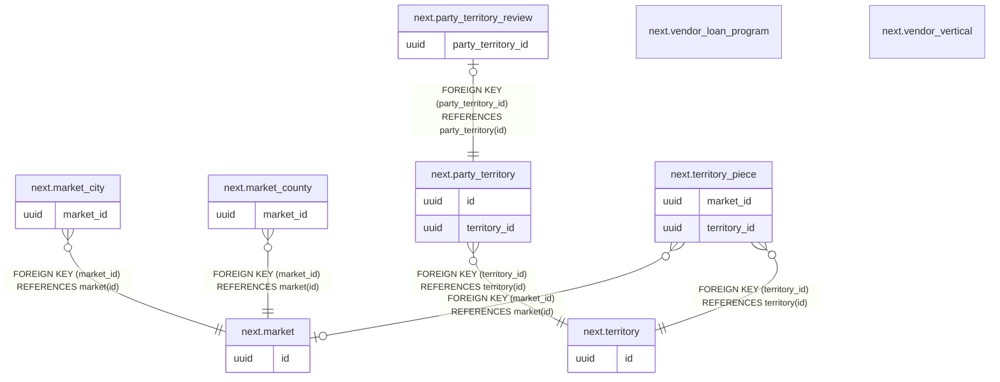

# Vendors and territories

## Description

Tables in this area and the foreign keys between them.

## Tables

| Name                                                          | Columns | Comment | Type       |
| ------------------------------------------------------------- | ------- | ------- | ---------- |
| [next.market](next.market.md)                                 | 7       |         | BASE TABLE |
| [next.market_city](next.market_city.md)                       | 7       |         | BASE TABLE |
| [next.market_county](next.market_county.md)                   | 7       |         | BASE TABLE |
| [next.party_territory](next.party_territory.md)               | 10      |         | BASE TABLE |
| [next.party_territory_review](next.party_territory_review.md) | 13      |         | BASE TABLE |
| [next.territory](next.territory.md)                           | 7       |         | BASE TABLE |
| [next.territory_piece](next.territory_piece.md)               | 12      |         | BASE TABLE |
| [next.vendor_loan_program](next.vendor_loan_program.md)       | 8       |         | BASE TABLE |
| [next.vendor_vertical](next.vendor_vertical.md)               | 8       |         | BASE TABLE |

## Relations

---

> Generated by [tbls](https://github.com/k1LoW/tbls)
