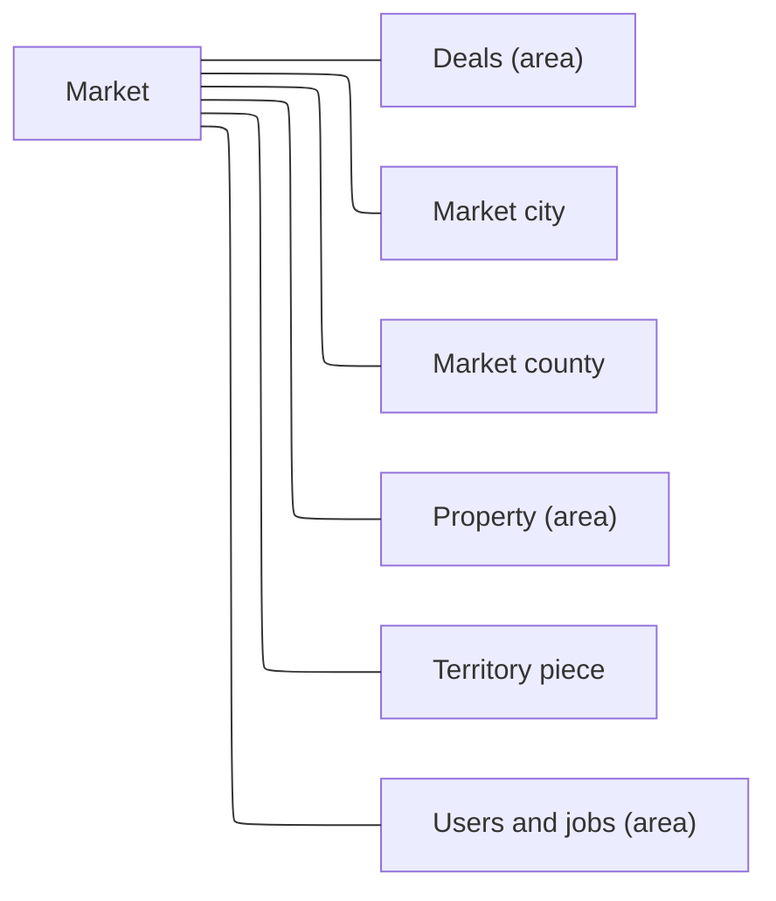
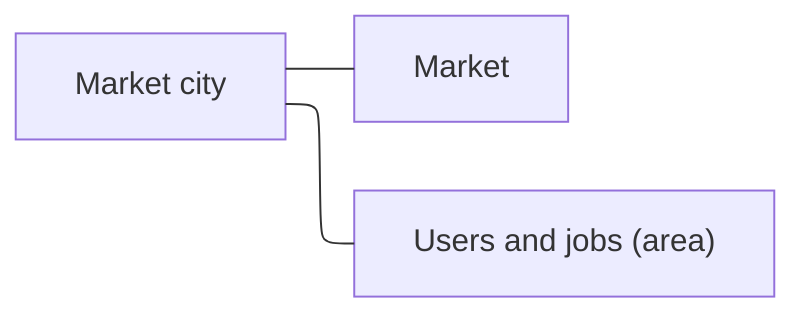
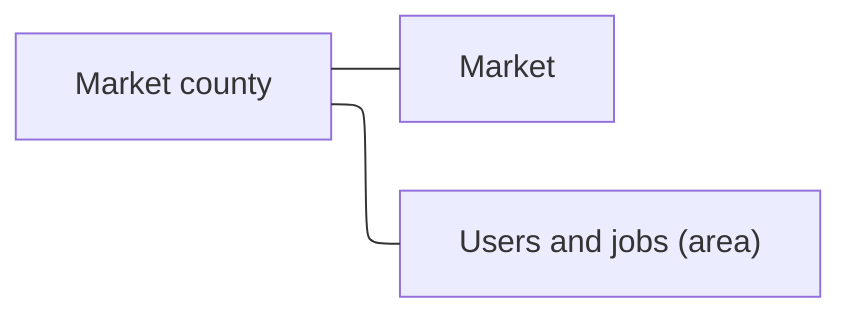
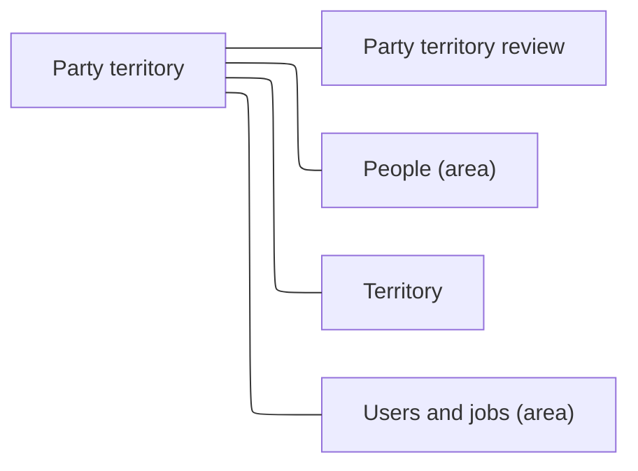
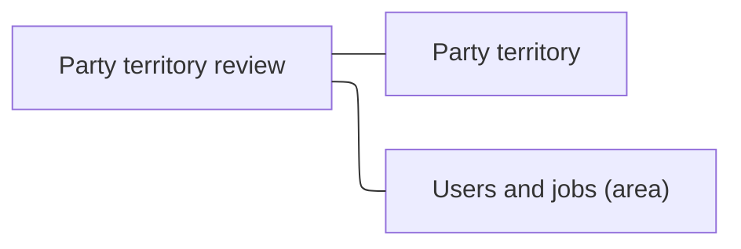
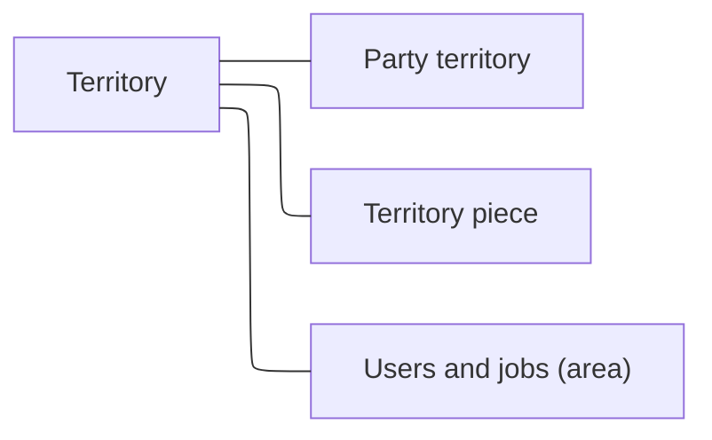
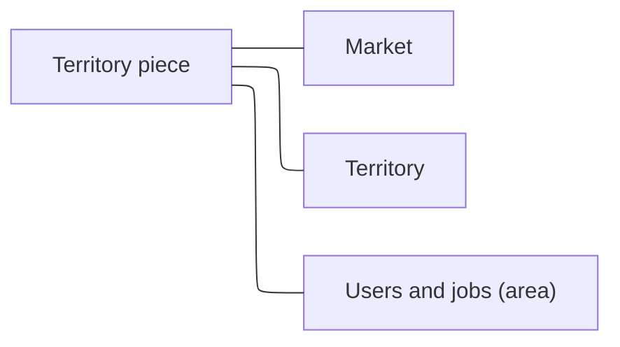
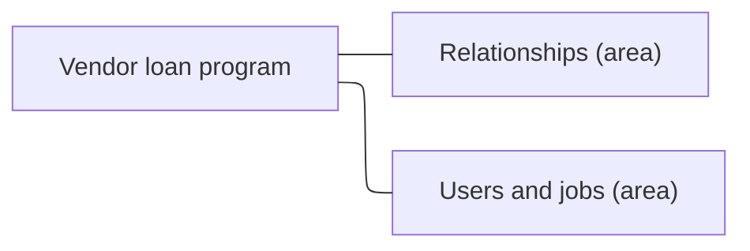
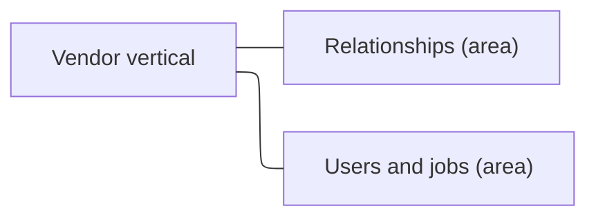

# Vendors and territories

Each line shows a connection. The foreign keys below name the exact columns.

### Market

### Market city

### Market county

### Party territory

### Party territory review

### Territory

### Territory piece

### Vendor loan program

### Vendor vertical

## Foreign keys

| From table and columns                                                            | To table and columns                                  |
| --------------------------------------------------------------------------------- | ----------------------------------------------------- |
| [deal](next.deal.md) (`market_id`)                                                | [market](next.market.md) (`id`)                       |
| [market](next.market.md) (`changed_by_user_id`)                                   | [app_user](next.app_user.md) (`id`)                   |
| [market](next.market.md) (`changed_for_user_id`)                                  | [app_user](next.app_user.md) (`id`)                   |
| [market](next.market.md) (`changed_by_job`)                                       | [job](next.job.md) (`slug`)                           |
| [market_city](next.market_city.md) (`changed_by_user_id`)                         | [app_user](next.app_user.md) (`id`)                   |
| [market_city](next.market_city.md) (`changed_for_user_id`)                        | [app_user](next.app_user.md) (`id`)                   |
| [market_city](next.market_city.md) (`changed_by_job`)                             | [job](next.job.md) (`slug`)                           |
| [market_city](next.market_city.md) (`market_id`)                                  | [market](next.market.md) (`id`)                       |
| [market_county](next.market_county.md) (`changed_by_user_id`)                     | [app_user](next.app_user.md) (`id`)                   |
| [market_county](next.market_county.md) (`changed_for_user_id`)                    | [app_user](next.app_user.md) (`id`)                   |
| [market_county](next.market_county.md) (`changed_by_job`)                         | [job](next.job.md) (`slug`)                           |
| [market_county](next.market_county.md) (`market_id`)                              | [market](next.market.md) (`id`)                       |
| [party_territory](next.party_territory.md) (`changed_by_user_id`)                 | [app_user](next.app_user.md) (`id`)                   |
| [party_territory](next.party_territory.md) (`changed_for_user_id`)                | [app_user](next.app_user.md) (`id`)                   |
| [party_territory](next.party_territory.md) (`changed_by_job`)                     | [job](next.job.md) (`slug`)                           |
| [party_territory](next.party_territory.md) (`party_id`)                           | [party](next.party.md) (`id`)                         |
| [party_territory](next.party_territory.md) (`territory_id`)                       | [territory](next.territory.md) (`id`)                 |
| [party_territory_review](next.party_territory_review.md) (`changed_by_user_id`)   | [app_user](next.app_user.md) (`id`)                   |
| [party_territory_review](next.party_territory_review.md) (`changed_for_user_id`)  | [app_user](next.app_user.md) (`id`)                   |
| [party_territory_review](next.party_territory_review.md) (`reviewed_by_user_id`)  | [app_user](next.app_user.md) (`id`)                   |
| [party_territory_review](next.party_territory_review.md) (`reviewed_for_user_id`) | [app_user](next.app_user.md) (`id`)                   |
| [party_territory_review](next.party_territory_review.md) (`changed_by_job`)       | [job](next.job.md) (`slug`)                           |
| [party_territory_review](next.party_territory_review.md) (`reviewed_by_job`)      | [job](next.job.md) (`slug`)                           |
| [party_territory_review](next.party_territory_review.md) (`party_territory_id`)   | [party_territory](next.party_territory.md) (`id`)     |
| [space_need](next.space_need.md) (`market_id`)                                    | [market](next.market.md) (`id`)                       |
| [territory](next.territory.md) (`changed_by_user_id`)                             | [app_user](next.app_user.md) (`id`)                   |
| [territory](next.territory.md) (`changed_for_user_id`)                            | [app_user](next.app_user.md) (`id`)                   |
| [territory](next.territory.md) (`changed_by_job`)                                 | [job](next.job.md) (`slug`)                           |
| [territory_piece](next.territory_piece.md) (`changed_by_user_id`)                 | [app_user](next.app_user.md) (`id`)                   |
| [territory_piece](next.territory_piece.md) (`changed_for_user_id`)                | [app_user](next.app_user.md) (`id`)                   |
| [territory_piece](next.territory_piece.md) (`changed_by_job`)                     | [job](next.job.md) (`slug`)                           |
| [territory_piece](next.territory_piece.md) (`market_id`)                          | [market](next.market.md) (`id`)                       |
| [territory_piece](next.territory_piece.md) (`territory_id`)                       | [territory](next.territory.md) (`id`)                 |
| [vendor_loan_program](next.vendor_loan_program.md) (`changed_by_user_id`)         | [app_user](next.app_user.md) (`id`)                   |
| [vendor_loan_program](next.vendor_loan_program.md) (`changed_for_user_id`)        | [app_user](next.app_user.md) (`id`)                   |
| [vendor_loan_program](next.vendor_loan_program.md) (`changed_by_job`)             | [job](next.job.md) (`slug`)                           |
| [vendor_loan_program](next.vendor_loan_program.md) (`party_id`, `role`)           | [party_role](next.party_role.md) (`party_id`, `role`) |
| [vendor_vertical](next.vendor_vertical.md) (`changed_by_user_id`)                 | [app_user](next.app_user.md) (`id`)                   |
| [vendor_vertical](next.vendor_vertical.md) (`changed_for_user_id`)                | [app_user](next.app_user.md) (`id`)                   |
| [vendor_vertical](next.vendor_vertical.md) (`changed_by_job`)                     | [job](next.job.md) (`slug`)                           |
| [vendor_vertical](next.vendor_vertical.md) (`party_id`, `role`)                   | [party_role](next.party_role.md) (`party_id`, `role`) |

## Connects to

Numbers count foreign keys between the two areas.

[Deals](viewpoint-deals.md) (1) · [People](viewpoint-people.md) (1) · [Property](viewpoint-property.md) (1) · [Relationships](viewpoint-relationships.md) (2) · [Users and jobs](viewpoint-users-jobs.md) (30)

## Tables

- [Market](next.market.md)
- [Market city](next.market_city.md)
- [Market county](next.market_county.md)
- [Party territory](next.party_territory.md)
- [Party territory review](next.party_territory_review.md)
- [Territory](next.territory.md)
- [Territory piece](next.territory_piece.md)
- [Vendor loan program](next.vendor_loan_program.md)
- [Vendor vertical](next.vendor_vertical.md)
