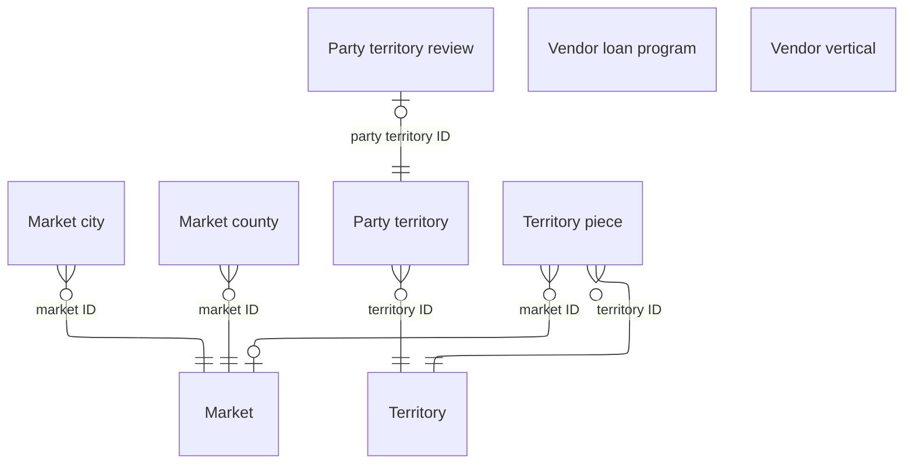

# Vendors and territories

## Tables

- [Market](next.market.md)
- [Market city](next.market_city.md)
- [Market county](next.market_county.md)
- [Party territory](next.party_territory.md)
- [Party territory review](next.party_territory_review.md)
- [Territory](next.territory.md)
- [Territory piece](next.territory_piece.md)
- [Vendor loan program](next.vendor_loan_program.md)
- [Vendor vertical](next.vendor_vertical.md)

See each table for its columns and links to other areas.
